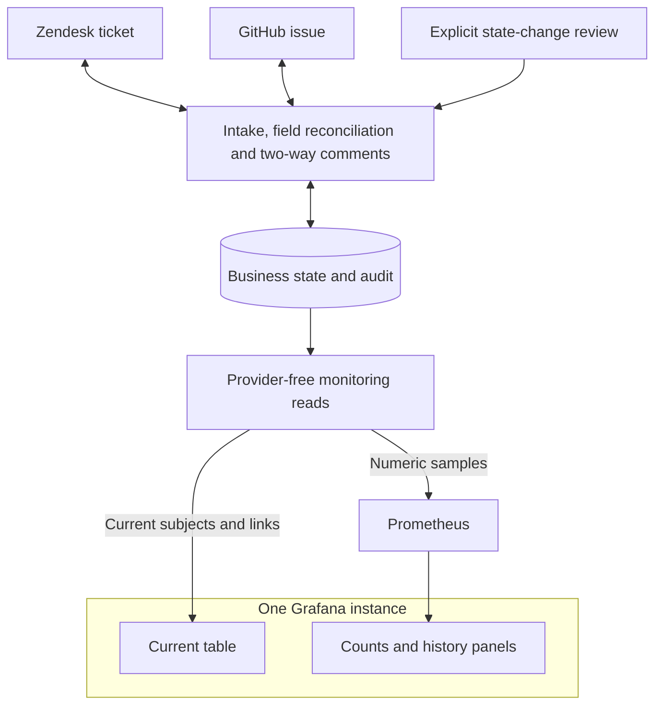

# Support Bridge

Support Bridge connects a Zendesk support escalation to its GitHub engineering issue. Support tags a ticket; the bridge creates and links an issue, reconciles their summaries and resolution state, and carries engineering questions and new internal support replies between the two systems.

It is a headless, deterministic PHP application with SQLite, a CLI and an authenticated HTTP API. There is no PHP framework, runtime LLM, queue or Composer runtime dependency.

## Customer problem and value

Our assumed customer is one B2B SaaS support team working in Zendesk with engineering in a private GitHub repository. Manual copying leaves stale summaries and hides engineering updates from support. We expect the bridge to reduce copying and follow-ups. Customer discovery, measured savings and production capacity remain unvalidated.

The [CSV-export scenario](docs/SCENARIO.md) is the primary walkthrough: intake, summary edits, internal notes, resolution review, reopening, conflicts and interrupted-write recovery. The [five-case catalogue](docs/DEMO_CASES.md) covers a verified fix, investigation, conflict, external dependency and regression. The [documentation index](docs/README.md) separates the customer flow, setup, implementation and verification guides.

## Start an escalation

1. Create an owned fictional Zendesk ticket with a subject and initial description; submit it as **Open**.
2. Add **`support_bridge_escalate`** and save. This is support's explicit engineering-escalation decision. An ordinary untagged ticket creates nothing.
3. With the configured worker enabled, wait for its next pass. It creates an open GitHub issue containing the initial description, an explicit Zendesk link and a recovery marker, then saves the one-to-one mapping. Do not create a second issue manually.
4. Find the linked issue in GitHub. One-sided subject/title edits propagate after polling. Any bridge write that changes open/closed state holds its entire field plan for exact-plan operator approval.
5. Add a GitHub issue comment. With comment delivery enabled, it becomes an **internal Zendesk note** after field reconciliation permits delivery. With reverse delivery separately enabled and its first scan initialized, add a new **internal note** in Zendesk to answer in GitHub. Public replies and historical notes stay in Zendesk; copied messages do not bounce back.
6. Open **All linked ticket and issue pairs** in [Grafana](http://127.0.0.1:1990/d/supportbridge-overview?refresh=5s). Every stored mapping appears automatically. The subject is the last verified summary; click either number to open its source in a new tab. Separate delivered/waiting counts show each direction's stored evidence.

The worker waits 60 seconds after each pass by default. Provider visibility, pagination, work duration, review and retries add delay. Monitoring refreshes separately; it does not poll vendors or authorize effects. [The full walkthrough](docs/SCENARIO.md#start-in-zendesk) explains what to inspect at each stage.

## Run with Docker

Use the existing **`support-bridge-live-demo`** project, both Compose files and its private deployment env file:

```bash
docker compose --env-file /absolute/private/live-demo.env -p support-bridge-live-demo -f compose.yaml -f compose.live-demo.yaml up --build -d --wait
docker compose --env-file /absolute/private/live-demo.env -p support-bridge-live-demo -f compose.yaml -f compose.live-demo.yaml ps
```

| Surface | Address | Access |
| --- | --- | --- |
| API reference | [127.0.0.1:1988/docs](http://127.0.0.1:1988/docs) | Swagger is public documentation; commands require the operator token |
| Prometheus | [127.0.0.1:1989](http://127.0.0.1:1989/) | No additional login on loopback |
| Grafana | [127.0.0.1:1990](http://127.0.0.1:1990/d/supportbridge-overview?refresh=5s) | The persisted Grafana account |

Normal operation has API, opt-in worker, optional managed Zendesk renewer, Prometheus and Grafana processes in separate containers. The existing deployment retains its eight volume identities. A fresh deployment leaves effectful scheduling disabled; its private configuration must explicitly enable intake, comments and the required profiles. [Docker operation](docs/DOCKER.md) is the canonical command, port, login and volume reference. [Live setup](docs/LIVE_DEMO.md) covers provider identities and credentials; [OAuth renewal](docs/OAUTH.md) covers the isolated issuer.

Keep the project name and volumes during upgrades. Grafana bootstrap files apply to a new database and may differ from a rotated account; rebuilding does not reset its login. No traffic generator or second operating demo stack is maintained.

## Run with PHP

The native local providers are isolated recovery fixtures; they do not operate the live Compose volume. Install PHP 8.2+ with PDO SQLite and cURL, then run:

```bash
php bin/demo.php
php bin/check.php
```

The demo makes no vendor requests and retains synthetic state under `var/demo-*`. Composer supplies development style tooling only:

```bash
composer install --no-interaction --no-plugins --no-scripts
composer autoload:check
composer style
composer audit --locked --no-plugins
```

Classes follow `Bridge\` → `src/` under PSR-4. The checked-in [PSR-12 ruleset](phpcs.xml.dist) defines source coverage and harness exceptions. Node 24 is used for documentation, Swagger/OpenAPI and replay checks. [Development and verification](docs/CI.md#local-reproduction-and-limits) lists the complete gates.

## Enable internal support replies

Set `BRIDGE_ZENDESK_NOTES_ENABLED=1` in the selected private deployment file only after reviewing the GitHub destination's audience. Reverse delivery defaults off and uses the existing worker; no extra service is added. The first complete scan per linked pair records existing Zendesk comment IDs without posting them. Inspect `notes` or `GET /api/note-deliveries` for a non-null `initialized_at`, then add a new internal note.

Use `BRIDGE_GITHUB_COMMENTS_ENABLED=1` for the forward direction. Copied message IDs and durable markers prevent loops, including after lost acknowledgements. New appends wait during field review; neither message text nor AI can approve a state change. [Conversation operation](docs/COMMENTS.md) explains the two flags, new-only starting point and recovery limits.

## Review a state change

Inspect the pending pair and its `governance.plan_hash`. An authorized operator reviews the exact target, both preimages/versions and policy, then explicitly approves that hash with a reason. Approval itself re-reads evidence and writes no vendor record. A later sweep checks freshness before applying effects.

Source selection and retry cannot grant approval. Conflicting same-field edits stop the whole pair until an operator selects a fresh source. See the [customer review checkpoint](docs/SCENARIO.md#4-review-the-exact-plan), [API commands](docs/API.md#deterministic-governance-and-the-operator-gate) and [governance policy](docs/GOVERNANCE.md). Local fixture commands are documented separately from effectful live commands.

## Explicit assumptions

- One repository, one Zendesk tenant, one host and one serial worker share a local SQLite business store.
- The explicit tag authorizes creating an open issue and transferring its initial description, which may have been internal. Both destinations must be approved for that data.
- Summary/state ownership is shared. Binary open/closed semantics intentionally lose richer vendor workflow distinctions.
- Forward comment enablement includes eligible existing GitHub user/bot comments. Reverse enablement records all existing Zendesk IDs at its first successful scan, then copies only new internal notes. Wait for initialized_at before adding the first reverse-demo reply. Copies retain immutable text; later editing, deletion and redaction are separate work.
- Operators share broad authority. There is no verified individual identity, independent approver role or per-pair authorization.
- Grafana viewers may read linked baseline subjects and configured source links. Prometheus retains numeric identifiers, with nine gauge series per link; access, retention and scale need review.

The [assumptions register](docs/ASSUMPTIONS.md) records each decision, consequence and validation boundary.

## Contract and scope

| Data | Behavior |
| --- | --- |
| Zendesk subject ↔ GitHub title | Three-way merge against the last verified baseline; patch only changed fields |
| Resolution state | Canonical open/closed; Zendesk writes use open/solved; every outbound transition requires exact-plan approval |
| Initial Zendesk description → issue body | Creation-only literal text, explicit source link and durable marker; 30,000 UTF-8-byte source bound |
| GitHub issue comments → Zendesk | Internal notes with immutable first-observed snapshot and source attribution |
| New internal Zendesk notes → GitHub | Separately enabled, new-only comments with source user attribution; public replies, initial report and bridge copies excluded |

Titles are nonempty and at most 500 UTF-8 bytes. Zendesk new/open/pending/hold map to open; solved/closed map to closed. An immutable closed ticket cannot be edited. Assignees, priority, attachment bytes, deletion, closure reasons and public Zendesk replies are outside the contract. [Intake](docs/INTAKE.md), [comment delivery](docs/COMMENTS.md) and [architecture](docs/ARCHITECTURE.md) define the recovery details.

## Architecture overview



CLI and HTTP dispatch shared typed commands and queries. Constructor dependencies make connection, transaction and lock ownership explicit. Policies for merge, retry and governance are pure; there is no global database Singleton. Plans persist target/preimages/versions before effects, and baselines advance only after verified agreement. A lost field-write response is recovered by reading first. Creation and comment append have stricter recovery: an attempted unknown outcome is never blindly repeated.

Grafana uses two data sources. Its current table reads protected JSON directly from the bridge; Prometheus supplies the other seven panels and sampled history. Grafana does not require Prometheus in principle; this deployment retains it for metric history and rules. Monitoring is not part of the synchronization decision. See the [implementation design](docs/ARCHITECTURE.md) and [monitoring guide](docs/OBSERVABILITY.md).

## Trade-offs

| Decision | Benefit | Cost |
| --- | --- | --- |
| Tagged intake with durable creation evidence | A support ticket starts engineering work automatically | Bounded polling and conservative uncertainty can delay creation |
| Two-way field merge | Preserves independent edits | Conflicts require review; one-way ownership would be simpler |
| Whole-plan state approval | Reviews outbound resolution/reopening effects | Holds accompanying title changes and adds review latency |
| Two attributed append channels | Keeps engineering questions and internal support replies together | Copies sensitive text; destination audience must be approved, cutover must complete, and corrections/uncertainty need investigation |
| SQLite, typed use cases and plain PHP | Explicit ownership and a small runtime | Serial single-host work, more wiring and HTTP/deployment maintenance |
| Current JSON table plus numeric Prometheus history | Useful subject/source context without titles in metric labels | Pinned Infinity plugin, monitoring-read authority and growing complete-snapshot/series costs |
| Separate credential renewer | Short-lived Zendesk access rotates without reader restarts | Issuer service/volume, network dependency and shared vendor-volume access |

## Known limitations

GitHub field updates have a read/PATCH race; no distributed exactly-once guarantee is claimed. Provider triggers, required fields, custom statuses, rate budgets and production load need broader validation. Intake/history bounds and conservative unknown outcomes can require manual investigation. Shared tokens do not enforce per-user approval, separation of duties or customer compliance. General restore/rollback, public ingress, encryption/retention policy, alert recipients and production capacity remain deployment work.

The displayed subject/resolution are last verified evidence, not continuously fresh vendor truth. The current table ignores the history time range. No verified baseline remains explicit; a delivered note count does not continuously recheck visibility. [Detailed limits](docs/ARCHITECTURE.md#known-limitations) and [executed evidence](docs/REVIEW.md) distinguish implemented controls from unvalidated claims.

## Validation

The [verification record](docs/REVIEW.md) reports current test totals and dated local/live observations. [CI policy](docs/CI.md) defines GitHub Actions and its stable **Required checks** gate. Local changes are not hosted CI evidence, and a passing workflow does not establish server-side branch protection. [Security maintenance](SECURITY.md) covers Dependabot, CVE List/NVD enrichment, image scans and bounded asset repair.

Documentation checks run offline:

```bash
node --test tools/docs/check.test.cjs
node tools/docs/check.cjs
```

They check local links, heading anchors and closed fences. External references, prose accuracy and Mermaid rendering require separate review.

## AI use

AI assisted design exploration, implementation/refactoring, failure tests, review and documentation. We check generated work against source, tests and observed local behavior and retain responsibility for the result. [Tooling evidence](docs/TOOLING-INSTALLATION.md) records optional review profiles and partial artifact inspection without treating them as independent human validation.

The service calls no LLM. We deliberately use deterministic code and explicit operator decisions for eligibility, merge/retry, conflict selection and approval. **Never rely on AI in compliance:** policy ownership, data permissions and control adequacy belong to accountable people. Generated explanations, skill instructions and dashboard state cannot authorize effects or prove compliance.
