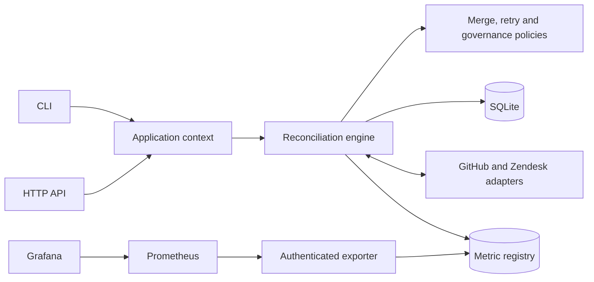

# Support Bridge

Keep the title and resolution state of linked GitHub issues and Zendesk tickets in sync. Support Bridge uses PHP 8.2+, SQLite, a CLI and an authenticated HTTP API. It has no PHP framework or Composer runtime dependencies.

## Customer problem and value

Our assumed customer is a support team that tracks tickets in Zendesk and engineering escalations in GitHub. Copying updates between them takes time and leaves stale records. Support Bridge merges independent edits, stops on conflicts and recovers interrupted writes. We expect it to reduce copying and follow-ups; we have not measured that benefit with a customer.

## Run everything with Docker

```bash
docker compose up --build -d --wait
```

This starts four services with synthetic local records:

| Service | Address or role |
| --- | --- |
| API and Swagger | [127.0.0.1:8080/docs](http://127.0.0.1:8080/docs) |
| Worker | Reconciles immediately, then once per minute |
| Prometheus | [127.0.0.1:9090](http://127.0.0.1:9090) |
| Grafana | [127.0.0.1:3000](http://127.0.0.1:3000/d/supportbridge-overview) |

The initializer creates separate credentials for the API, metrics and Grafana. Ports bind to host loopback. The default stack makes no vendor calls.

```bash
docker compose run --rm cli status
docker compose run --rm cli inspect escalation-1
docker compose --profile test run --build --rm verify
docker compose --profile test run --rm smoke
```

Named volumes retain data and credentials across restarts and ordinary `docker compose down`. See [Docker operation](docs/DOCKER.md) for credentials, alternate ports and volume handling.

### Generate synthetic traffic

```bash
docker compose -p support-bridge-traffic -f compose.yaml -f compose.traffic.yaml up --build -d --wait
```

This starts a separate stack on ports 8081, 9091 and 3001, with a traffic container that changes synthetic records every five seconds. It exercises the authenticated API, conflicts, approval waits and interrupted-write recovery. Choose one-second or random intervals and manual or scripted reviews in the [traffic guide](docs/TRAFFIC.md). Its data and credentials are separate from the default stack.

## Run with PHP

Install PHP 8.2+ with `pdo_sqlite` and `curl`. On Ubuntu/WSL:

```bash
sudo apt-get update
sudo apt-get install php-cli php-sqlite3 php-curl
php bin/demo.php
php bin/check.php
```

The demo makes no network calls and retains its state under `var/demo-*`. The test runner checks PHP syntax, merge and retry policies, reconciliation, providers, governance, metrics and the HTTP API. Server tests use loopback and synthetic records. Node 24 is needed separately for Swagger asset and OpenAPI checks.

## Review a state change

Local mode is the default. The sample links issue `101` and ticket `501`:

```bash
php bin/bridge.php init
php bin/bridge.php sync
php bin/bridge.php local-edit zendesk 501 state closed
php bin/bridge.php sync
php bin/bridge.php inspect escalation-1
php bin/bridge.php approve escalation-1 PLAN_HASH 'Reviewed the escalation and agreed this resolution'
php bin/bridge.php sync
```

The state-change sweep exits with code `2` and holds the whole plan in `awaiting_approval`. Inspect it and replace `PLAN_HASH` with `governance.plan_hash`. Approval re-reads both records and records an attestation; the next sweep checks freshness before writing. Closing and reopening use the same rule. Source selection and retry do not grant approval.

Title-only updates use the explicit link's opt-in. Conflicting edits stop the whole pair until an operator selects a source over fresh evidence. The [walkthrough](docs/WALKTHROUGH.md) covers titles, conflicts, recovery and CLI status codes.

## Explicit assumptions

The [assumptions register](docs/ASSUMPTIONS.md) lists each decision, its consequences and its validation status. The main assumptions are:

- One support/engineering team uses Zendesk and a private GitHub repository.
- An operator supplies an existing one-to-one ticket/issue mapping. The service does not infer links or create remote records.
- Either team may edit the summary and resolution state. Field ownership and data-sharing rules need agreement before live use.
- One host and one worker use local SQLite storage. Throughput and availability targets have not been established.
- Operators share a broad bearer token. It provides no individual attribution, scoped agent access or independent approval.

## Contract and scope

| Field | GitHub | Zendesk |
| --- | --- | --- |
| `title` | `title` | `subject` |
| `state=open` | `open` | `new`, `open`, `pending`, `hold` |
| `state=closed` | `closed` | `solved`, `closed` |

Only changed fields are patched. A title-only update preserves Zendesk's workflow status. A state transition writes `open` or `solved`; a terminal `closed` ticket cannot be edited. A required write to an immutable destination stops the pair as `dead`.

Titles must be nonempty and at most 500 UTF-8 bytes. Comments, descriptions, attachments, assignees, deletion, closure reasons and automatic record creation are outside the field contract.

## Architecture overview



The engine compares each field with the last common baseline. One-sided edits propagate; equal concurrent edits need no write; independent edits merge. Divergent edits and different initial records require a source choice.

Before writing, it persists the target, both preimages and both observed versions. Recovery reads the remote records first: an achieved target needs no resend, and an unfinished destination must retain its recorded version. The baseline advances only after both records match the target.

Any outbound state change holds every effect in the plan until approval. The approval hash binds the pair, target, preimages, versions and policy version (`escalation-state-v1`). An audit failure stops subsequent effects. Metrics are recorded separately and cannot decide whether a write proceeds.

### Code organization

| Responsibility | Location |
| --- | --- |
| Pure merge, retry and approval rules | `src/Domain/` |
| Read → plan → persist → write → verify | `src/Engine.php` |
| Shared CLI/API configuration and commands | `src/Application/` |
| SQLite state and canonical worker lock | `src/Store.php`, `src/Contract/PairRepository.php` |
| Vendor payloads, version checks and HTTP | `src/Provider/`, `src/HttpClient.php` |
| Request validation, authentication and responses | `src/Http/`, `public/router.php`, `bin/bridge.php` |
| Persistent aggregate metrics | `src/Observability/` |

CLI and HTTP call the same engine. Provider adapters handle vendor semantics; domain policies use plain inputs and decisions without network or storage access. The [architecture guide](docs/ARCHITECTURE.md) covers state, locking and recovery in detail.

## Trade-offs

| Choice | Benefit | Cost |
| --- | --- | --- |
| Two-way field merge | Preserves independent edits | Conflicts need an operator; one-way ownership would be simpler |
| Whole-plan state approval | Reviews closing/reopening before any related write | Holds accompanying title changes and adds review time |
| Durable intent and read-before-retry | Recovers lost responses and partial writes | Extra reads and conservative version conflicts |
| SQLite and polling | Simple single-host operation | Serial sweeps, scheduler delay and no distributed worker coordination |
| Plain PHP and shared engine | Small runtime and one set of application rules | We maintain routing, validation and composition ourselves |
| Vendored Swagger | Local API reference without a CDN | Assets must match the lockfile; Try it out is disabled |
| Separate worker and monitoring containers | Independent processes and persistent data | More images, credentials and volumes to maintain |

## Known limitations

- **Concurrent edits:** GitHub issue writes have a preflight/PATCH gap that can overwrite an intervening edit. Zendesk supports `safe_update`; timestamps still have finite precision.
- **Live compatibility:** sandbox accounts, Zendesk triggers/required fields/custom statuses and customer data-sharing rules have not been validated. Titles can contain sensitive data and are not redacted.
- **Deployment:** the PHP development server, shared operator token and local SQLite lock are for a single-host setup. Public ingress, per-user authorization, distributed workers and production capacity remain deployment work.
- **Approval and audit:** approval has no expiry or revocation. The shared token does not verify human identity or separation of duties. Audit events are mutable local records with unbounded retention.
- **Data and recovery:** SQLite stores title snapshots without application encryption. Only narrow additive migrations are implemented; general rollback and backup restoration have not been rehearsed.
- **Monitoring:** metric writes can be lost around a crash. Local scrape/dashboard tests do not verify alert delivery. Containers and digest pins do not establish complete vulnerability coverage.

See [governance](docs/GOVERNANCE.md) for policy ownership and approval limits, and [verification evidence](docs/REVIEW.md) for tested cases and outstanding checks.

## API, monitoring and dependency updates

The [OpenAPI specification](docs/api/openapi.json) documents health, linking, inspection, metrics, synchronization, source selection, approval and retry. [API setup](docs/API.md) includes authentication and curl examples.

`GET /metrics` uses a separate read-only scrape token. Prometheus collects aggregate counters, latency histograms and state gauges; Grafana provisions the dashboard. Record IDs, titles, raw errors and tokens are excluded from metric labels. See [observability](docs/OBSERVABILITY.md) and the optional [native monitoring setup](monitoring/README.md).

Dependabot exposes available update PRs. GitHub Actions also scans built images and npm dependencies, enriches detected IDs from the CVE List/NVD and updates a [vulnerability tracker](https://github.com/AlbertFlorescu/support-bridge/issues/10). [Security maintenance](SECURITY.md) explains scanner coverage, vendor fixed versions and the tested Swagger repair workflow. [CI](docs/CI.md) documents checks and branch controls.

## Live sandbox setup

Use a dedicated state directory and sandbox accounts. Restrict the GitHub token to Issues read/write in the chosen repository, and use a dedicated Zendesk agent token. Only GitHub.com and ordinary Zendesk tenant API hosts are supported.

The CLI reads environment variables; it does not load `.env` automatically. In bash/WSL:

```bash
cp .env.example .env
# Fill .env locally with sandbox credentials.
set -a
source .env
set +a
php bin/bridge.php init --mode=live --home=var/sandbox
php bin/bridge.php link escalation-1 123 456 --mode=live --home=var/sandbox
php bin/bridge.php inspect escalation-1 --mode=live --home=var/sandbox
```

`init`, `link`, `status`, `inspect` and `metrics` make no live requests. `resolve` and `approve` read both providers; `sync` can write them. Use `sync --mode=live --home=var/sandbox` only after reviewing the mapping and data permissions. Credentials travel in headers to fixed HTTPS hosts; redirects are disabled and requests time out after ten seconds.

## Validation

```bash
php bin/check.php
python3 -m unittest discover -s tools/security -p 'test_*.py' -v
cd tools/api-docs
npm ci --ignore-scripts
node check-vendor.cjs
node validate.cjs
```

The tests cover merge decisions, stale approvals, partial writes, lost responses, locks, HTTP contracts, metrics and vulnerability tooling. The [verification record](docs/REVIEW.md) contains counts and hosted results. Live vendor behavior, customer benefit and production load still need validation.

## AI use

AI assisted design exploration, code generation/refactoring, failure tests, reviews and documentation. Agency Agents profiles guided reviews; REA inspected the vendored Swagger JavaScript with partial coverage. We checked the work with the tests listed above. The [tooling record](docs/TOOLING-INSTALLATION.md) describes what ran and what it covered.

The application calls no LLM. Linking, conflict selection, merge/retry rules and approvals use PHP policies and explicit operator commands. **Never rely on AI in compliance:** policy owners must define the controls and review their adequacy; generated explanations or rationales cannot authorize writes. The shared operator token records an attestation, not verified human review.
