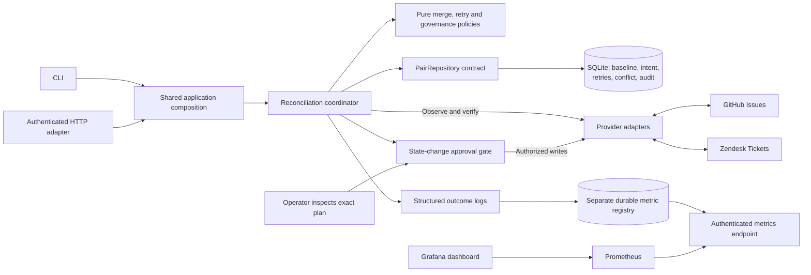

# Support Bridge

A headless, governed escalation workflow that keeps the title and resolution state of **linked GitHub issues and Zendesk tickets** aligned. We use **PHP 8.2+ without a PHP framework or Composer runtime packages** to keep the runtime small and the write path inspectable. CLI and authenticated API surfaces share one deterministic engine, with explicit state-change approvals, Swagger documentation, Prometheus metrics and Grafana.

We designed Support Bridge around explicit links, a small field contract, deterministic write controls and durable recovery. The same workflow runs behind both entry points, so transport choices cannot change merge or approval rules. [Governance and operations](docs/GOVERNANCE.md) describe our execution boundaries and rollout responsibilities.

## Customer problem and value

We target B2B SaaS teams that handle escalations in Zendesk and engineering work in GitHub. People manually copy summaries and resolution updates between tools. That creates stale escalations and repeated follow-ups.

Support Bridge gives each explicitly linked escalation a repeatable reconciliation process. Either team can edit the summary or reopen work. It merges independent changes, exposes conflicting edits for an operator decision, and recovers after partial failure. An outbound open/closed transition holds the whole plan for explicit approval; a title-only update uses the link's opt-in. The expected benefit is less duplicate work and fewer stale updates while retaining a review boundary; this is a hypothesis to measure in a pilot, not a claimed business result.

**Never rely on AI in compliance.** The application calls no LLM. AI-generated explanations, confidence scores or approval rationales cannot authorize execution or establish compliance. Fixed PHP rules enforce the supported field contract, freshness checks and state-change approval gate. Accountable customer owners must validate obligations and controls; the shared operator credential records an attestation and cannot prove human identity or separation of duties. See [the precise boundary](docs/GOVERNANCE.md#never-rely-on-ai-in-compliance).

## Explicit assumptions

We currently design for one support/engineering team, a small opt-in link set and a single-host deployment. Field ownership, data-sharing permissions, operating targets and business value need validation before a live pilot. PHP, SQLite, Prometheus/Grafana and locally served Swagger are our implementation choices.

The complete [assumptions register](docs/ASSUMPTIONS.md) states each assumption, its consequence if wrong, and how it is enforced or still needs validation. The principal assumptions are:

| Area | Assumed contract |
| --- | --- |
| Customer | One B2B SaaS team already uses Zendesk and a private GitHub escalation repository. Demand and value remain unvalidated. |
| Identity | An operator knows an existing one-to-one ticket/issue mapping. No matching or remote creation is inferred. |
| Ownership | Either side may edit the summary/resolution state. A conflicting edit requires a fresh human choice. |
| Governance | Title-only transfers use explicit linking as opt-in; any outbound open/closed transition requires approval of the whole exact plan under `escalation-state-v1`. This assumed boundary needs customer policy-owner validation. |
| Semantics | Only title/subject and a lossy open/closed state are shared; title-only writes preserve Zendesk workflow details. |
| Workload | Small opt-in link set, one host and one worker on a local SQLite database; no promised latency/throughput/SLA. |
| API | One trusted operator identity; loopback development server, shared bearer token, no multi-user roles or public ingress. |
| Observability | A local Prometheus/Grafana stack scrapes aggregate metrics using its own read-only token. No cloud account or per-record telemetry is needed. |
| Evidence | Local tests establish selected invariants; vendor accounts, customer benefit and production capacity remain unverified. |

We need to validate these defaults before a pilot, especially field ownership, sensitive titles, workflow transitions, conflict responsibility and freshness expectations.

## Run in two commands

Requirements: PHP **8.2 or later**, `pdo_sqlite` and `curl`. No Composer installation, accounts, API tokens, Docker, Node or database server are needed for the core local demonstration. Swagger's browser assets are vendored; Node is a separate development tool for refreshing/validating them. Prometheus and Grafana are separate local monitoring processes installed by the optional monitoring setup.

```bash
php bin/demo.php
php bin/check.php
```

The demo makes **no network calls**. It creates a fresh directory under `var/`, retains its state for inspection, and checks:

1. Equal linked records establish a baseline.
2. Support changes propagate to engineering.
3. Edits to different fields produce a merged plan; a state transition waits for approval before either field is written.
4. A write commits but its response is lost; a restarted worker acknowledges it without writing twice.
5. Conflicting edits stop synchronization; an explicit source choice resolves them.
6. A repeated poll performs zero writes.

`bin/check.php` lints all PHP files, runs pure policy, reconciliation, provider-contract, observability, API-integration and loopback HTTP tests, then runs the verified demo. The server tests use only local HTTP and synthetic data. No check contacts vendor accounts or a cloud telemetry service. PHP process spawning is needed for the verification runner and temporary server, not for ordinary reconciliation.

On Ubuntu/WSL, install the runtime if necessary:

```bash
sudo apt-get update
sudo apt-get install php-cli php-sqlite3 php-curl
php -v
```

Other operating systems need equivalent PHP extensions enabled. The implementation uses ordinary PHP CLI commands; we ran verification on Ubuntu/WSL with PHP 8.3.

## Explore the local service

```bash
php bin/bridge.php init
php bin/bridge.php sync
php bin/bridge.php local-edit zendesk 501 title 'Export fails above 100k rows'
php bin/bridge.php sync
php bin/bridge.php status
php bin/bridge.php inspect escalation-1
php bin/bridge.php metrics
```

The sample links GitHub issue `101` and Zendesk ticket `501`. The local adapters store their records in separate JSON files and implement version-guarded updates. They demonstrate the algorithm, not the exact vendor implementations. Local mode is the default; `--mode=live` is always explicit. `--home=/path/to/state` chooses a separate state directory. Each database is bound to its repository/account identities and refuses configuration changes that could retarget saved links.

Create and resolve a conflict:

```bash
php bin/bridge.php local-edit github 101 title 'Engineering summary'
php bin/bridge.php local-edit zendesk 501 title 'Support summary'
php bin/bridge.php sync
# Exit 2 signals that operator attention is needed.
php bin/bridge.php inspect escalation-1
php bin/bridge.php resolve escalation-1 github
php bin/bridge.php sync
```

Resolution selects one entire observed record, rather than silently choosing the newest timestamp. It checks that both records' fields and versions still match the conflict snapshot. If either changed, inspect the refreshed conflict and make the decision again. `retry PAIR` requeues transport failures after their cause is fixed; it cannot bypass conflict review.

### Review a consequential state change

```bash
php bin/bridge.php local-edit zendesk 501 state closed
php bin/bridge.php sync
# Exit 2; status awaiting_approval. No effects from this plan have been applied.
php bin/bridge.php inspect escalation-1
# Review target, before, versions and governance; copy governance.plan_hash.
php bin/bridge.php approve escalation-1 PLAN_HASH 'Reviewed the escalation and agreed this resolution'
php bin/bridge.php sync
```

Replace `PLAN_HASH` with the inspected 64-character hash. The approval command re-reads both records, records the rationale, and authorizes that plan only; it performs no remote write. The next sweep checks freshness again before execution. A stale review refreshes conflict evidence and needs a new source decision and, if state changes, a new approval. Choosing a conflict source or requesting retry never grants approval. Reopening is gated too. The demo's scripted approval uses synthetic data to demonstrate this boundary; it is not a real human review.

## Contract and scope

| Canonical field | GitHub Issues | Zendesk Tickets |
| --- | --- | --- |
| `title` | `title` | `subject` |
| `state=open` | `open` | `new`, `open`, `pending`, `hold` |
| `state=closed` | `closed` | `solved`, `closed` |

Only changed fields are patched. A title-only update preserves Zendesk's pending/hold/new distinction. An actual resolution-state transition writes Zendesk `solved` or `open`. A terminal `closed` Zendesk ticket cannot be edited; the pair becomes dead if a write to it is required. See the [Zendesk ticket reference](https://developer.zendesk.com/api-reference/ticketing/tickets/tickets/).

The slice intentionally excludes record creation, automatic matching, comments, descriptions, attachments, assignee updates, deletion, closure reasons, webhooks and a business dashboard. Swagger provides API reference pages. Explicit linking and no create operations avoid ambiguous identity matching and duplicate-creation recovery. Titles must be nonempty and at most 500 UTF-8 bytes; oversized or unsupported records stop visibly.

## Architecture overview



For each field, compare both sides with their last common baseline. A one-sided edit propagates. Equal concurrent edits converge without writes. Independent field edits merge. Divergent same-field edits quarantine the whole pair. Different initial records require a deliberate source decision.

Before any remote write, persist a plan containing the merged target, both preimages and their versions. After an interruption, read both records again. Already-achieved targets need no duplicate write. Any destination still needing a write must retain its original version; otherwise, stop for review. Verify both records before advancing the baseline. This is durable reconciliation, not an exactly-once transaction across APIs.

`GovernancePolicy` classifies the original persisted intent. Any planned outbound state transition holds every effect until the operator approves a hash covering pair identity, target, preimages, versions and policy version. An approval is separate from source selection and survives restart for the same intent; it cannot be reused for another plan or policy. Capability checks run before the first effect, and execution rechecks evidence. Already-achieved work can be acknowledged without another write. SQLite adds a nullable approval column to older databases without discarding pending plans; old state-changing intents receive the gate. General migrations/rollback remain unfinished.

Zendesk writes use its documented `safe_update` / `updated_stamp` guard. GitHub's issue update endpoint does not document an equivalent atomic precondition: a version-checked preflight read and minimal PATCH reduce the risk, but a human edit between the read and PATCH can still be overwritten. Verification cannot detect every such overwritten edit. Timestamp granularity also limits edit-and-revert detection. These are material limitations of this two-way prototype. [Zendesk safe updates](https://developer.zendesk.com/documentation/ticketing/managing-tickets/creating-and-updating-tickets/), [GitHub issue updates](https://docs.github.com/en/rest/issues/issues#update-an-issue).

The worker uses one nonblocking process lock for the canonical database path. Do not run it across multiple hosts or on networked storage. SQLite WAL with `synchronous=FULL` persists state; no database transaction is held during HTTP. A crash between either remote effect and local acknowledgement leaves the plan available for recovery.

### Clean code principles applied

| Responsibility | Code boundary | Why the boundary exists |
| --- | --- | --- |
| Merge/retry decisions | `src/Domain/MergePolicy.php`, `RetryPolicy.php` | Pure inputs/decisions make the rules independently testable, without a database, clock or network. |
| Governance decisions | `src/Domain/GovernancePolicy.php` | Pure plan validation, classification and approval binding; deterministic enforcement does not depend on model output or a skill instruction. |
| Reconciliation workflow | `src/Engine.php` | Coordinates observe → decide → durable intent → apply → verify; does not parse HTTP or implement SQL. |
| Persistence/locking | `src/Contract/PairRepository.php`, `src/Store.php` | Core depends on a narrow repository contract; SQLite and filesystem locking stay in its implementation. |
| Vendor semantics | `src/Provider/*`, `src/HttpClient.php` | Normalize a small validated model; vendor payload/auth/rate-limit details do not leak into merge decisions. |
| Composition | `src/Application/Configuration.php`, `Context.php` | CLI and HTTP share configuration, provider construction, commands and telemetry wiring. No duplicated sync algorithm. |
| Transport | `src/Http/*`, `bin/bridge.php`, `public/router.php` | Strict inputs, authentication, typed error mapping and output belong at the edges. |
| Observability | `src/Observability/Prometheus.php` | Persists aggregate counters/histograms separately; exporter failure cannot decide business success or interrupt durable work. |

Names express domain intent, provider patches contain only changed fields, and typed exceptions distinguish validation, missing resources, state conflicts and worker contention. Storage errors retain their identity. Abstractions isolate actual policies/side effects rather than wrapping every function. Persisted plan JSON stayed compatible through the refactor, so pending work is not discarded just to improve class structure.

Read [the architecture and trade-offs](docs/ARCHITECTURE.md) for the complete state model, assumptions, limits, measurement strategy and scaling path. [The walkthrough](docs/WALKTHROUGH.md) covers local operation, approval and recovery with synthetic records.

## Trade-offs

| Choice | Reason | Cost and when to reconsider |
| --- | --- | --- |
| Two-way field merge instead of a timestamp winner | Preserves independent edits and makes real disagreements visible. | More state and operator work. Use one-way ownership if the customer can nominate an authority. |
| Deterministic workflow per execution step | Merge, permission checks, approval and recovery need a reproducible path. | No adaptive runtime agent; a model would add cost/latency and new failure modes without a demonstrated need. |
| Whole-plan approval for outbound state changes | Makes consequential closing/reopening explicit before any effect in that plan. | Adds review latency and delays accompanying title edits; title-only opt-in may be too permissive for a particular customer. |
| Quarantine the whole pair | Keeps conflict evidence and source choice understandable. | Safe fields wait too. Add field-level resolution only if the workflow needs that complexity. |
| Durable intent plus read-before-retry | Handles timeout/partial-success uncertainty without blind patch replay. | Extra reads and conservative version conflicts; cannot supply a cross-vendor transaction. |
| No remote creation/automatic matching | Avoids guessing identity and duplicate-creation recovery within a small slice. | Operator setup is required; not a complete escalation lifecycle platform. |
| SQLite, one process, polling | Few moving parts and inspectable recovery, suitable for the assumed small pilot. | Serial latency, full link scans, API cost and scheduler delay; introduce webhooks/jobs/partitioning only after measuring. |
| Framework-free PHP | Keeps our runtime dependencies small and exposes clear boundaries. | Routing, input handling and composition must be maintained and tested explicitly. It does not remove HTTP/security maintenance costs. |
| Synchronous operator API | Reuses the same engine without introducing another queue. | Long sweeps can exceed client timeouts; inspect state after uncertainty. Production scale may justify async jobs. |
| Read-only vendored Swagger | Exact local reference, no CDN/validator dependency or accidental live operation from the documentation UI. | Larger repository assets and manual refresh; Try it out is unavailable. |
| Prometheus pull metrics and Grafana provisioning | Open aggregate telemetry with a reproducible local dashboard and no cloud license. | Separate services and a durable metric store; telemetry can miss an observation around a crash and is not a business audit ledger. |
| REA/Agency as scoped development aids | Real artifact analysis and specialist review prompts add evidence and challenge assumptions. | REA does not review PHP architecture, and partial artifact coverage/personas are not proof of correctness. |

We accept the maintenance cost of the operator API, vendored documentation and local monitoring because they make the service inspectable and operable. They remain separate from the reconciliation core and do not add runtime framework dependencies.

## Known limitations

- **GitHub concurrency:** its documented issue update endpoint lacks equivalent atomic CAS. A human edit in the preflight/PATCH gap can be overwritten; final reads cannot detect every lost update.
- **Finite observation:** timestamp granularity and edits reverted between polls limit what can be detected. Conservative guards can also create conflicts after unrelated edits.
- **Live compatibility:** GitHub/Zendesk sandbox permissions, required fields, triggers and custom workflows have not been exercised with credentials. Post-write transformations may quarantine a pair.
- **Scale:** one local worker, synchronous requests/sweeps, in-memory list pagination and unbounded audit history. No distributed locks, provider-wide rate budget, async queue, ingress rate limiter or production benchmark.
- **API security scope:** one shared operator token, no roles/tenant isolation. The PHP server is a loopback development server, with production TLS/ingress/secret management left to deployment.
- **Governance scope:** state-change approval is a narrow operational control, with no verified human identity, independent approver, content/DLP policy or compliance certification. An agent must not receive the broad operator token. Skill capability restrictions are instructions until a separately authorized facade enforces them.
- **Data operations:** title snapshots are not application-encrypted; retention, consistent backups and recovery rehearsals are not complete operational features. Only narrow additive approval/telemetry migrations are implemented, without a general migration/rollback system.
- **Telemetry:** metric updates are best effort and separate from business transactions. A crash/storage failure can lose an observation; deleting/resetting metric storage resets counters. Metrics are operational evidence, not an exactly-once audit. Local scrape/dashboard checks do not establish production capacity or alert notification delivery.
- **Product scope:** no creation, deletion, comments, rich workflow mapping, automatic matching or business dashboard. Customer value and SLOs remain assumptions to validate.
- **Tool coverage:** REA's semantic analysis was partial and its full vendor-bundle pass hit a heap limit; this is not a PHP or vendor security certification. Agency profiles are guidance, not independent experts or readiness scores.

These limits are intentional and visible. [The assumption register](docs/ASSUMPTIONS.md) explains the circumstances in which each choice would need to change.

## Swagger and HTTP endpoints

The [OpenAPI 3.1 specification](docs/api/openapi.json) documents health, link/list/inspection, metrics, sweeps, source resolution, exact-plan approval and retry operations. [API setup and error semantics](docs/API.md) include curl examples and the authentication/concurrency contract.

```bash
php bin/bridge.php init
export BRIDGE_API_TOKEN="$(php -r 'echo bin2hex(random_bytes(32));')"
php -S 127.0.0.1:8080 -t public public/router.php
```

Open [Swagger UI](http://127.0.0.1:8080/docs). All `/api` routes require the token; the documentation is read-only and contains no credential or account data. Local mode remains the default. No API input can select provider hosts, credentials, state paths or live mode.

## Prometheus and Grafana observability

The application exposes authenticated **Prometheus text format 0.0.4** at `GET /metrics`. Its separate `BRIDGE_METRICS_TOKEN` is read-only and cannot authorize operator commands; the operator API token cannot scrape the exporter. The tokens must be strong and different. `/api/metrics` remains an operator-only JSON inspection endpoint.

The registry persists reconciliation counters and a duration histogram in `metrics.sqlite`, separate from business state, so CLI exits and PHP request boundaries do not reset every observation. Durations use seconds; fixed outcome/status labels avoid per-record cardinality. Exported values include outcome totals, latency buckets, pair-state gauges, pending plans and last observed successful reconciliation time. No title, record ID, raw error or token is exported. A telemetry write failure cannot interrupt synchronization; an unavailable metric store causes a failed scrape instead of a misleading healthy response.

The [observability guide](docs/OBSERVABILITY.md) documents scrape authentication, PromQL, metric meaning and failure boundaries. The [monitoring stack](monitoring/README.md) provides pinned local Prometheus/Grafana setup, a provisioned data source/dashboard and example alert rules. No cloud account is required. Notification destinations and production alert thresholds still need an operator decision.

```bash
bash monitoring/install.sh
python3 monitoring/stack.py up --demo
python3 monitoring/stack.py verify
```

The monitoring demo serves Swagger on port 8080, Prometheus on 9090 and Grafana on 3000, all on loopback. It uses isolated synthetic application state, separate from the CLI's default `var/local`; the monitoring guide explains the state and credential locations. Do not start a second development server on the same port. The generated Grafana password is in a private local file, never committed.

## Live sandbox setup

The real adapters are implemented against the documented APIs, with offline contract tests. **Live accounts have not been exercised.** Before a pilot, validate Zendesk account-required fields, custom statuses, triggers and token permissions with sandbox records. Customer ticket subjects may contain sensitive information; use a private engineering repository and opt in only records appropriate for that destination.

Copy `.env.example` to `.env` and fill it locally. The CLI reads process environment variables; it does not automatically load dotenv files. In bash/WSL:

```bash
cp .env.example .env
# Edit .env locally. Never commit it.
set -a
source .env
set +a

php bin/bridge.php init --mode=live --home=var/sandbox
php bin/bridge.php link escalation-1 123 456 --mode=live --home=var/sandbox
php bin/bridge.php sync --mode=live --home=var/sandbox
php bin/bridge.php inspect escalation-1 --mode=live --home=var/sandbox
# If the initial snapshots disagree, review them before choosing a source:
php bin/bridge.php resolve escalation-1 github --mode=live --home=var/sandbox
php bin/bridge.php sync --mode=live --home=var/sandbox
```

Use a GitHub fine-grained token restricted to the selected repository with Issues read/write access, and a dedicated Zendesk sandbox agent's API token. GitHub.com and `SUBDOMAIN.zendesk.com` are supported; arbitrary API base URLs and GitHub Enterprise are outside this slice. Credentials are passed only as HTTP headers to validated HTTPS hosts. TLS verification stays enabled, redirects are disabled, requests time out after ten seconds, and responses are bounded. [GitHub issue token permissions](https://docs.github.com/en/rest/issues/issues#update-an-issue), [Zendesk API authentication](https://developer.zendesk.com/api-reference/introduction/security-and-auth/).

No live request is made by `init`, `link`, `status`, `inspect` or `metrics`. `sync` can write both systems; `resolve` reads both and persists a plan. The next `sync` evaluates the gate before any effect. `approve` reads both records and records the attestation; a later `sync` applies the approved plan if its evidence remains valid. Run commands under the same service account with a dedicated state directory.

## Operation and troubleshooting

Run one sweep per minute from cron or a service timer, under an account that already has the environment variables available:

```cron
* * * * * cd /absolute/path/to/support-bridge && /usr/bin/php bin/bridge.php sync --mode=live --home=/absolute/path/to/state >> /absolute/path/to/bridge-runs.log 2>> /absolute/path/to/bridge-events.jsonl
```

Retries use persisted exponential backoff plus jitter and honor `Retry-After` / GitHub primary reset guidance. No worker sleeps waiting for a retry; the next sweep processes due work. Timeout/408/429/5xx failures retry; native write conflicts trigger a fresh read on retry. Permanent authentication, permissions, missing records and validation errors stop automatically. Five consecutive failed attempts exhaust the retry budget. Successful convergence resets it. A slow or failed pair does not prevent the remaining pairs in the sweep from being processed.

| Status | Operator action |
| --- | --- |
| `new` | Run a sweep to establish a baseline or apply a selected resolution |
| `synced` | Last reconciliation converged; future source edits are discovered by polling |
| `retry` | Inspect the reason and `next_run`; due work retries automatically |
| `conflict` | Inspect snapshots, then `resolve PAIR github\|zendesk` |
| `dead` | Fix permissions, record/workflow issue or outage, then `retry PAIR` |
| `awaiting_approval` | Inspect the whole plan, then `approve PAIR PLAN_HASH REASON`; run a sweep afterwards |

`status`, `inspect` and `metrics` return JSON. Scheduling and last-success times are Unix seconds; `next_run=0` means no scheduled retry. Audit `created_at` values are SQLite UTC timestamp text. Logs on stderr include pair ID, outcome, attempts and per-pair reconciliation duration, never titles, authorization headers or raw vendor responses. `inspect` intentionally reveals title snapshots to the local operator. Audit records identify attempted sides and field names. Metrics expose status counts, pending plans and last success. `synced` means last observed convergence, not a guarantee that remote data has not changed since.

CLI exit codes: `0` clean/success, `1` command/configuration failure, `2` conflict, dead work or an approval wait exists, `3` retry work remains. Monitor conflict/dead counts, retry age, time since success, and reconciliation duration. Vendor error messages are deliberately summarized; inspect sandbox settings and vendor logs when investigating validation failures.

The CLI creates local state with a restrictive umask. SQLite stores titles and snapshots without encryption. Protect the state directory, use encrypted storage where appropriate, define retention and keep a consistent backup of SQLite including its WAL (or stop the worker before copying the database). Audit history is unbounded in this prototype; retention and general schema migration/rollback remain future operational work.

## Validation

The test suite covers normal convergence, per-field merge, initial mismatch, conflicting edits, stale resolution, interrupted writes, after-commit timeouts, partial success, changed destinations, edit-and-revert recovery, retry timing/exhaustion, immutable records, worker exclusion and per-pair failure isolation. HTTP provider tests cover payload mapping, safe updates, rate limits, malformed records and host restrictions. API tests check authentication before side effects, exact JSON contracts, body limits, pagination, routing/headers, private-file denial and real loopback HTTP. Observability tests verify persistent counters, cumulative histogram units/buckets, concurrent-process increments, rollback, bounded storage waits and fail-open recording versus failed scrapes.

Run `php bin/check.php` for the complete accountless gate. Run the locked OpenAPI validator separately from `tools/api-docs` with `npm ci --ignore-scripts` and `node validate.cjs`; it does not use an online validator. See [review evidence](docs/REVIEW.md) for executed counts, tooling findings and remaining live checks. CI runs the PHP gate and API validation on pushes and pull requests. [Verification evidence](docs/REVIEW.md) records test coverage and remaining validation.

## AI use

We used AI extensively while developing Support Bridge: exploring the customer hypothesis and design alternatives, generating and refactoring PHP, writing failure tests, reviewing changes, and drafting documentation. We also used selected Agency Agents review profiles and REA for supported JavaScript artifact analysis. This is assisted work, and we remain responsible for the resulting design and implementation.

We check generated changes through syntax checks, deterministic policy and recovery tests, provider contract tests, real loopback HTTP fixtures, OpenAPI validation, and local Prometheus/Grafana queries. AI-assisted reviews complement those checks; neither a reviewer persona nor a passing suite proves production readiness. [Verification evidence](docs/REVIEW.md) records the scope and remaining checks.

We deliberately keep AI out of runtime authority. It does not infer record links, choose a conflicting source, approve a state transition, determine compliance obligations, certify vendor behavior or invent business results. The application calls no LLM. Fixed policies and explicit operator actions govern writes. The shared operator credential cannot prove human review, and a generated rationale is not compliance evidence.

## Development tools and reusable workflows

REA **6.7.0** and selected Agency Agents architecture, engineering, testing and security profiles support our development workflow. Their [installation and analysis record](docs/TOOLING-INSTALLATION.md) distinguishes actual analysis from tool availability and documents partial coverage. They are optional development aids, not runtime dependencies.

The versioned [escalation-review skill](skills/support-bridge-escalation-review/SKILL.md) describes a read-only business capability. It cannot grant approval, and its Markdown allowlist does not replace enforced credentials or an authorization facade. `AGENTS.md` records our project conventions and recovery/governance invariants. Local development, API and observability skills help maintain those same boundaries across changes.

Our next validation step is live sandbox contract testing. Further changes should follow measured needs: provider-wide rate budgets, state-age metrics, audit retention and webhook wake-ups with periodic polling as repair. Parallel processing requires explicit per-pair coordination and a suitable database. We have not benchmarked production throughput or customer impact.
