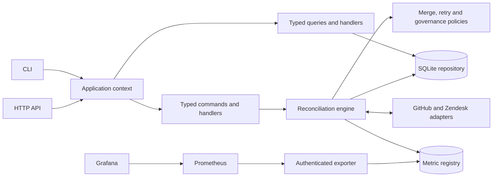

# Support Bridge

Keep the title and resolution state of linked GitHub issues and Zendesk tickets in sync. Support Bridge uses PHP 8.2+, SQLite, a CLI and an authenticated HTTP API. It has no PHP framework or Composer runtime dependencies.

## Customer problem and value

Our assumed customer is a support team that tracks tickets in Zendesk and engineering escalations in GitHub. Copying updates between them takes time and leaves stale records. Support Bridge merges independent edits, stops on conflicts and recovers interrupted writes. We expect it to reduce copying and follow-ups; we have not measured that benefit with a customer.

## Primary customer scenario

Follow the [CSV-export escalation](docs/SCENARIO.md) from the customer's first report through summary updates, whole-plan approval, resolution, reopening, lost-response recovery and conflicting edits. This is our main case for explaining the workflow, architecture, operator decisions and monitoring. The guide separates implemented behavior, existing verification evidence and the proposed guided run. The [live demonstration guide](docs/LIVE_DEMO.md) adds isolated vendor setup, manual checkpoints and a read-only replay of captured observations.

The versioned [live demo operating skill](skills/support-bridge-live-demo/SKILL.md) keeps the repeatable procedure with its source, review and evidence boundaries. It supplies guidance, not authorization for effects.

## Run with Docker

```bash
docker compose -p support-bridge-traffic -f compose.yaml -f compose.traffic.yaml up --build -d --wait
```

For continuous synthetic activity, use this traffic stack. It runs the API, worker, traffic generator, Prometheus and Grafana. The generator changes synthetic records every five seconds and exercises conflicts, approval waits and interrupted-write recovery. Compose 2.24.4 or later is required. Choose one-second or random delays and manual or scripted reviews in the [traffic guide](docs/TRAFFIC.md).

Choose links from the same column. Each project has separate records, credentials and monitoring history:

| Service | Traffic stack (`support-bridge-traffic`) | Default stack (`support-bridge`) | Explicit live demo (`support-bridge-live-demo`) |
| --- | --- | --- | --- |
| API and Swagger | [127.0.0.1:8081/docs](http://127.0.0.1:8081/docs) | [127.0.0.1:8080/docs](http://127.0.0.1:8080/docs) | [127.0.0.1:8082/docs](http://127.0.0.1:8082/docs) |
| Prometheus | [127.0.0.1:9091](http://127.0.0.1:9091/) | [127.0.0.1:9090](http://127.0.0.1:9090/) | [127.0.0.1:9092](http://127.0.0.1:9092/) |
| Grafana dashboard | [127.0.0.1:3001](http://127.0.0.1:3001/d/supportbridge-overview) | [127.0.0.1:3000](http://127.0.0.1:3000/d/supportbridge-overview) | [127.0.0.1:3002](http://127.0.0.1:3002/d/supportbridge-overview) |
| Worker | Immediate sweep, then every five seconds | Immediate sweep, then every minute | Disabled unless `live-worker` is selected |
| Traffic generator | Every five seconds by default | Absent | Absent |

These are default host ports, all bound to loopback. The initializer creates separate API, metrics and Grafana bootstrap credentials for each project. Use that project's [credential instructions](docs/DOCKER.md#credentials-and-isolation); an existing Grafana account may have been renamed or its password changed. The default and traffic stacks make no vendor calls. The live overlay requires explicit account configuration and access tokens imported into its separate vendor credential volume; follow [its setup guide](docs/LIVE_DEMO.md) before starting it.

For [Grafana sign-in](docs/DOCKER.md#sign-in-to-grafana), a new database uses `admin` and its generated password; existing databases retain their current account credentials. Compose gives each project a separate login cookie name. Use `127.0.0.1` consistently and sign in once again after recreating Grafana to apply the cookie setting; accounts and data are retained. Older shared-cookie deployments may need independent browser sessions for diagnosis. The bootstrap password file does not prove a changed account's current login.

Inspect the running traffic stack with its full command prefix:

```bash
docker compose -p support-bridge-traffic -f compose.yaml -f compose.traffic.yaml ps
docker compose -p support-bridge-traffic -f compose.yaml -f compose.traffic.yaml run --rm --no-deps cli status
docker compose -p support-bridge-traffic -f compose.yaml -f compose.traffic.yaml run --rm --no-deps cli inspect escalation-1
```

### Default stack without generated traffic

To run the API, worker and monitoring without the generator, use the default project instead:

```bash
docker compose -p support-bridge -f compose.yaml up --build -d --wait
docker compose -p support-bridge -f compose.yaml run --rm --no-deps cli status
```

Keep the project name and Compose files with every operation. Changing only a URL or host port does not select another project's data. Named volumes retain data and credentials across restarts and ordinary `down`. See [Docker operation](docs/DOCKER.md) for all port sets, overrides, credential handling and verification.

## Run with PHP

Install PHP 8.2+ with `pdo_sqlite` and `curl`. On Ubuntu/WSL:

```bash
sudo apt-get update
sudo apt-get install php-cli php-sqlite3 php-curl
php bin/demo.php
php bin/check.php
```

These native commands use filesystem state outside the Compose volumes. The demo makes no network calls and retains its state under `var/demo-*`. The test runner checks PHP syntax, merge and retry policies, reconciliation, providers, governance, metrics and the HTTP API. Server tests use loopback and synthetic records. Node 24 is needed separately for Swagger asset and OpenAPI checks.

For development, Composer installs the locked PHP_CodeSniffer tool; it adds no runtime package:

```bash
sudo apt-get install composer php-xml unzip
composer install --no-interaction --no-plugins --no-scripts
composer autoload:check
composer style
```

Classes follow the [PSR-4](https://www.php-fig.org/psr/psr-4/) `Bridge\` → `src/` mapping. [The style ruleset](phpcs.xml.dist) enforces [PSR-12](https://www.php-fig.org/psr/psr-12/) on its listed source and entrypoint paths and records harness exceptions. Use `composer style:fix` to apply automatic formatting, then rerun style and behavior checks. The runtime and core demonstration work without Composer or `vendor/`.

## Review a state change

The following native CLI example uses `var/local`, separate from both Docker projects. Use the [Docker workflow commands](docs/DOCKER.md#operate-the-workflow) to operate container state. Local mode is the default; the sample links issue `101` and ticket `501`:

```bash
export BRIDGE_MODE=local
php bin/bridge.php init
php bin/bridge.php sync
php bin/bridge.php local-edit zendesk 501 state closed
php bin/bridge.php sync
php bin/bridge.php inspect escalation-1
php bin/bridge.php approve escalation-1 PLAN_HASH 'Reviewed the escalation and agreed this resolution'
php bin/bridge.php sync
```

The state-change sweep exits with code `2` and holds the whole plan in `awaiting_approval`. Inspect it and replace `PLAN_HASH` with `governance.plan_hash`. Approval re-reads both records and records an attestation; the next sweep checks freshness before writing. Closing and reopening use the same rule. Source selection and retry do not grant approval.

Title-only updates use the explicit link's opt-in. Conflicting edits stop the whole pair until an operator selects a source over fresh evidence. The [walkthrough](docs/WALKTHROUGH.md) covers titles, conflicts, recovery and CLI status codes.

## Explicit assumptions

The [assumptions register](docs/ASSUMPTIONS.md) lists each decision, its consequences and its validation status. The main assumptions are:

- One support/engineering team uses Zendesk and a private GitHub repository.
- An operator supplies an existing one-to-one ticket/issue mapping. The service does not infer links or create remote records.
- Either team may edit the summary and resolution state. Field ownership and data-sharing rules need agreement before live use.
- One host and one worker use local SQLite storage. Throughput and availability targets have not been established.
- Operators share a broad bearer token. It provides no individual attribution, scoped agent access or independent approval.

## Contract and scope

| Field | GitHub | Zendesk |
| --- | --- | --- |
| `title` | `title` | `subject` |
| `state=open` | `open` | `new`, `open`, `pending`, `hold` |
| `state=closed` | `closed` | `solved`, `closed` |

Only changed fields are patched. A title-only update preserves Zendesk's workflow status. A state transition writes `open` or `solved`; a terminal `closed` ticket cannot be edited. A required write to an immutable destination stops the pair as `dead`.

Titles must be nonempty and at most 500 UTF-8 bytes. Comments, descriptions, attachments, assignees, deletion, closure reasons and automatic record creation are outside the field contract.

## Architecture overview



The engine compares each field with the last common baseline. One-sided edits propagate; equal concurrent edits need no write; independent edits merge. Divergent edits and different initial records require a source choice.

Before writing, it persists the target, both preimages and both observed versions. Recovery reads the remote records first: an achieved target needs no resend, and an unfinished destination must retain its recorded version. The baseline advances only after both records match the target.

Any outbound state change holds every effect in the plan until approval. The approval hash binds the pair, target, preimages, versions and policy version (`escalation-state-v1`). An audit failure stops subsequent effects. Metrics are recorded separately and cannot decide whether a write proceeds.

### Code organization

| Responsibility | Location |
| --- | --- |
| Pure merge, retry and approval rules | `src/Domain/` |
| Read → plan → persist → write → verify | `src/Engine.php` |
| Composition, typed commands/queries, handlers and factories | `src/Application/` |
| Repository contract and SQLite state operations | `src/Contract/PairRepository.php`, `src/Store.php` |
| Scoped connection, schema migration, transactions and canonical lock | `src/Infrastructure/Persistence/` |
| Vendor payloads, version checks and HTTP | `src/Provider/`, `src/HttpClient.php` |
| CLI, HTTP and container adapters | `src/Console/`, `src/Http/`, `src/Runtime/` |
| Persistent aggregate metrics | `src/Observability/` |
| Locked provider observation and private checkpoint archive | `src/Simulation/Replay/`, `bin/capture-demo.php` |
| Offline HTML replay and development-only OAuth issuance | `tools/demo-viewer/`, `tools/oauth/` |

Entry scripts delegate to adapter objects. CLI and HTTP dispatch the same typed application use cases: commands initialize/link/edit/reconcile/resolve/approve/retry; queries read status, pair details and metrics without contacting providers. Both sides share SQLite. This is synchronous CQRS without a queue, event sourcing or separate read database.

`Context` wires constructor dependencies and creates one scoped `SqliteConnection` for its repository. Reusing that connection keeps transaction ownership explicit while separate contexts can use separate databases. A process-global Singleton would hide that dependency and risk coupling local, live and test state. Provider adapters handle vendor semantics; pure domain policies use plain inputs and decisions without network or storage access. The [architecture guide](docs/ARCHITECTURE.md) covers these boundaries and recovery in detail.

The guided-demo capture operation takes the canonical lock and reads both providers sequentially without reconciling. It records bounded, allowlisted checkpoints outside source. The offline viewer's Next and Play controls only navigate those observations; they never call a write, source-selection or approval endpoint. Provider snapshots, local inspection and aggregate monitoring samples are not one atomic observation.

## Trade-offs

| Choice | Benefit | Cost |
| --- | --- | --- |
| Two-way field merge | Preserves independent edits | Conflicts need an operator; one-way ownership would be simpler |
| Whole-plan state approval | Reviews closing/reopening before any related write | Holds accompanying title changes and adds review time |
| Durable intent and read-before-retry | Recovers lost responses and partial writes | Extra reads and conservative version conflicts |
| SQLite and polling | Simple single-host operation | Serial sweeps, scheduler delay and no distributed worker coordination |
| Plain PHP and shared engine | Small runtime and one set of application rules | We maintain routing, validation and composition ourselves |
| Typed commands/queries and focused handlers | Explicit use cases shared by CLI and HTTP | More classes and wiring; the shared database and serial worker remain |
| Injected connection and repository infrastructure | Clear connection, transaction and lock ownership | Each context must be composed correctly; no global service lookup |
| Vendored Swagger | Local API reference without a CDN | Assets must match the lockfile; Try it out is disabled |
| Separate worker and monitoring containers | Independent processes and persistent data | More images, credentials and volumes to maintain |
| Isolated live project and short OAuth access tokens | Explicit account/state boundaries and limited token lifetime | Separate secret ownership, manual reissuance and container recreation |
| Recorded checkpoint replay | Explains observed workflow stages without repeating effects | Selected evidence can become stale and needs private storage |

## Known limitations

- **Concurrent edits:** GitHub issue writes have a preflight/PATCH gap that can overwrite an intervening edit. Zendesk supports `safe_update`; timestamps still have finite precision.
- **Live compatibility:** the selected fictional records verified bidirectional title transfer, an approved state update and convergence. Broader Zendesk triggers, required fields, custom statuses and customer data-sharing rules still need account-specific validation. Titles can contain sensitive data and are not redacted.
- **Deployment:** the PHP development server, shared operator token and local SQLite lock are for a single-host setup. Public ingress, per-user authorization, distributed workers and production capacity remain deployment work.
- **Approval and audit:** approval has no expiry or revocation. The shared token does not verify human identity or separation of duties. Audit events are mutable local records with unbounded retention.
- **Data and recovery:** SQLite stores title snapshots without application encryption. Only narrow additive migrations are implemented; general rollback and backup restoration have not been rehearsed.
- **Monitoring:** metric writes can be lost around a crash. Local scrape/dashboard tests do not verify alert delivery. Containers and digest pins do not establish complete vulnerability coverage.
- **Development tooling:** PSR formatting checks and locked development-package audits need Composer and XML extensions. They add maintenance work without proving domain correctness or a stronger concurrency model.
- **Live demo and replay:** vendor credential scopes are not per-pair authorization. OAuth renewal is manual. Captured JSON/HTML can retain titles and vendor links; presentation artifacts do not replace fresh approval evidence or a tamper-evident audit.

See [governance](docs/GOVERNANCE.md) for policy ownership and approval limits, and [verification evidence](docs/REVIEW.md) for tested cases and outstanding checks.

## API, monitoring and dependency updates

The [OpenAPI specification](docs/api/openapi.json) documents health, linking, inspection, metrics, synchronization, source selection, approval and retry. [API setup](docs/API.md) includes authentication and curl examples.

`GET /metrics` uses a separate read-only scrape token. Prometheus collects aggregate counters, latency histograms and state gauges; Grafana provisions the dashboard. Record IDs, titles, raw errors and tokens are excluded from metric labels. See [observability](docs/OBSERVABILITY.md) and the optional [native monitoring setup](monitoring/README.md).

Dependabot exposes available update PRs. GitHub Actions also scans built images and npm dependencies, enriches detected IDs from the CVE List/NVD and updates a [vulnerability tracker](https://github.com/AlbertFlorescu/support-bridge/issues/10). [Security maintenance](SECURITY.md) explains scanner coverage, vendor fixed versions and the tested Swagger repair workflow. [CI](docs/CI.md) documents checks and branch controls.

## Live sandbox setup

Use a dedicated state directory and sandbox accounts. Restrict the GitHub token to Issues read/write in the chosen repository. For Zendesk, select OAuth bearer authentication with ticket read/write scopes; email is unnecessary in OAuth mode. Legacy API-token mode remains supported where the account permits it and requires an agent email. Only GitHub.com and ordinary Zendesk tenant API hosts are supported.

For containers, use the explicit [live overlay and credential procedure](docs/LIVE_DEMO.md). Its initializer creates no fixtures or links, and its worker is disabled by default. The development OAuth helper requests a four-hour access token; the application does not automatically renew it. Keep the client identifier/secret on the issuance host. An explicit network-isolated importer receives only the two access tokens through JSON stdin and writes a separate `vendor-secret` volume as UID10001; API, CLI and the optional worker mount it read-only. These protected plaintext files are not an encrypted secret manager. Reimport rotated tokens and recreate their reading containers, because startup processes load credentials into their environment once.

The native CLI reads environment variables and supported `*_FILE` secret paths; it does not load `.env` automatically. Configure either a value or its file, not both. In bash/WSL:

```bash
cp .env.example .env
# Fill .env locally with sandbox credentials.
set -a
source .env
set +a
php bin/bridge.php init --mode=live --home=var/sandbox
php bin/bridge.php link escalation-1 123 456 --mode=live --home=var/sandbox
php bin/bridge.php inspect escalation-1 --mode=live --home=var/sandbox
```

`init`, `link`, `status`, `inspect` and `metrics` make no live requests. `resolve` and `approve` read both providers; `sync` can write them. Use `sync --mode=live --home=var/sandbox` only after reviewing the mapping and data permissions. Credentials travel in headers to fixed HTTPS hosts; redirects are disabled and requests time out after ten seconds.

## Validation

```bash
php bin/check.php
composer install --no-interaction --no-plugins --no-scripts
composer autoload:check
composer style
composer audit --locked --no-plugins
python3 -m unittest discover -s tools/security -p 'test_*.py' -v
cd tools/api-docs
npm ci --ignore-scripts
node check-vendor.cjs
node validate.cjs
```

The dependency-free replay checks also run with `node --test tools/demo-viewer/viewer.test.cjs` from the repository root. Rendering requires Node on the development host; the runtime image contains neither the renderer nor the OAuth issuance helper.

The tests cover merge decisions, stale approvals, partial writes, lost responses, scoped persistence, command/query behavior, locks, HTTP contracts, metrics and vulnerability tooling. Style checks enforce the configured coding standard separately. The [verification record](docs/REVIEW.md) separates executed checks from the selected live transfers and approval. Broader vendor behavior, customer benefit and production load still need validation.

## AI use

AI assisted design exploration, code generation/refactoring, failure tests, reviews and documentation, including the guided-demo presentation. Agency Agents profiles guided reviews; REA inspected the vendored Swagger JavaScript with partial coverage. We checked the work with the tests listed above. The [tooling record](docs/TOOLING-INSTALLATION.md) describes what ran and what it covered. Replay labels and generated explanations describe observations; they cannot supply missing vendor evidence.

The application calls no LLM. Linking, conflict selection, merge/retry rules and approvals use PHP policies and explicit operator commands. **Never rely on AI in compliance:** policy owners must define the controls and review their adequacy; generated explanations or rationales cannot authorize writes. The shared operator token records an attestation, not verified human review.
