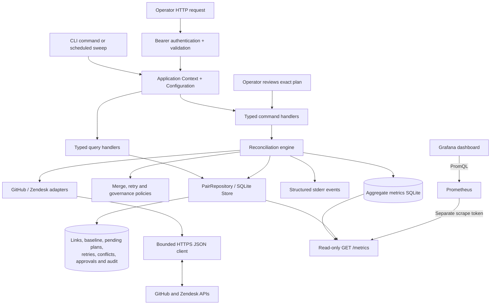

# Support Bridge: design and tradeoffs

## Customer and scope

Support Bridge keeps the summary and resolution state of linked Zendesk tickets and GitHub issues aligned. We target B2B SaaS support and engineering teams that currently copy those updates by hand. A pilot still needs to measure the benefit and validate the [customer and deployment assumptions](ASSUMPTIONS.md).

An operator links two existing records. We synchronize title/subject and a binary open/closed state; we do not infer matching records, create remote records or copy descriptions, comments, attachments or requester details. Titles can still contain confidential information and are stored locally.

The [primary CSV-export scenario](SCENARIO.md) follows these boundaries through one escalation, including exact-plan review, a lost response after commit, conflict handling and the monitoring evidence.

CLI and HTTP use the same fixed workflow. Our [governance model](GOVERNANCE.md) defines approval and operating ownership. **Never rely on AI in compliance:** policy owners must validate data transfers and controls; model output cannot authorize a write.

## Architecture overview

The application uses PHP 8.2+, PDO SQLite and cURL, without a PHP framework or Composer runtime packages. CLI and HTTP adapters share typed application commands, queries and the reconciliation `Engine`. SQLite stores reconciliation state and retry times. A process lock on the canonical database path permits one operation at a time. Each database is bound to its repository and Zendesk tenant, preventing configuration changes from retargeting saved links.

Compose runs initialization, API, a scheduled worker, Prometheus and Grafana. CLI, verification and smoke containers use the application image or its development stage. API, CLI and worker share one local `app-data` volume and lock. Business state (`local.sqlite`) and aggregate telemetry (`metrics.sqlite`) are separate SQLite databases in that shared volume. Prometheus and Grafana have their own data volumes; credentials use separate volumes. The default stack explicitly uses synthetic providers. Containers run as non-root users with read-only root filesystems and temporary writable paths. Monitoring configuration files ship in the images. Application settings, worker intervals and secret-file paths come from the Compose environment; credential values stay in their mounted files. Composer development tools and Node are added only to verification for style, dependency and API asset checks. See [Docker operation](DOCKER.md) for startup and volume details.

Provider calls run outside SQLite transactions. Local commits cannot make GitHub and Zendesk participate in one transaction.

An opt-in [traffic stack](TRAFFIC.md) adds a synthetic driver in a separate Compose project. It edits eight owned local record pairs, then exercises the ordinary HTTP API for reconciliation and scripted or manual review. Record-targeted faults exercise retries and uncertain outcomes. The driver uses the existing policies; it adds no operator endpoint or runtime model decisions.

Our one operating [demonstration deployment](LIVE_DEMO.md) uses the existing `support-bridge-live-demo` project on API 8080, Prometheus 9090 and Grafana 3000. The live overlay requires explicit repository/tenant identities and access tokens imported into a separate `vendor-secret` named volume. Its guarded `live-init` initializes schemas and bootstrap credentials without provider construction, fetching, fixtures or links. API, CLI and an optional worker share that project's business state and canonical lock, and mount vendor credentials read-only at `/run/secrets/vendor`. The worker's `live-worker` profile is disabled by default. The base/local and traffic configurations remain explicit isolated verification tools; they are not additional operating deployments. Existing test volumes stay parked, and their records are never imported into live state. Source-record creation is a separately authorized setup activity, outside the reconciliation provider interface.

| Files | Responsibility |
| --- | --- |
| `src/Domain/MergePolicy.php`, `RetryPolicy.php`, `GovernancePolicy.php` | Decide values, schedules and approval requirements without I/O. Time and jitter are inputs. |
| `src/Engine.php` | Coordinate reads, durable plans, guarded writes, verification and recovery. |
| `src/Contract/PairRepository.php`, `src/Store.php` | Define state/locking operations and implement them with SQLite. |
| `src/Infrastructure/Persistence/*` | Own the scoped PDO connection, schema upgrades, atomic repository transactions and canonical file lock. |
| `src/Provider/*` | Normalize records and patch supported fields. Local adapters and test doubles use the same engine. |
| `src/HttpClient.php`, `HttpResponse.php` | Restrict HTTPS hosts, bound transport and classify upstream failures. |
| `src/Application/Command/*`, `Query/*` | Represent each use case and dispatch it to a focused command or query handler. |
| `src/Application/Configuration.php`, `Context.php`, `ProviderFactory.php`, `EngineFactory.php` | Wire explicit dependencies and construct providers/engines for command execution. |
| `src/Console/*`, `src/Http/*`, `src/Runtime/*` | Adapt command-line arguments, HTTP requests and container processes to shared application behavior. |
| `src/Exception/*` | Identify expected application failures without message parsing. |
| `src/Observability/Prometheus.php` | Persist counters/histograms and expose aggregate metrics and state gauges. |
| `src/Simulation/Replay/*`, `bin/capture-demo.php` | Observe providers and local state under the canonical lock, sanitize and append private checkpoints without reconciliation. |
| `tools/demo-viewer/*` | Validate captured evidence and render dependency-free offline HTML; playback performs no workflow operations. |
| `tools/oauth/*`, `src/Provider/ZendeskAuthentication.php` | Issue a bounded access token manually in development tooling, and select runtime bearer or legacy API-token headers. |
| `src/Runtime/VendorCredentialImporter.php`, `docker/import-vendor-credentials.php` | Import only vendor access tokens through JSON stdin into a separate protected volume, without network, business state or operator authority. |

Validation, missing-record, state-conflict and worker-busy exceptions let the API distinguish expected outcomes without parsing error messages.

### Commands, queries and dependency ownership

Commands represent local initialization, linking, synthetic source edits, reconciliation, source selection, approval and retry. Each has an explicit handler. Queries list/inspect pairs or read status/metrics; they do not call providers or perform reconciliation. The dispatchers map known types directly to handlers, without reflection or runtime discovery. The HTTP and CLI entry scripts delegate to adapter objects rather than implementing these use cases themselves.

We use CQRS as an application-code boundary. Commands and queries remain synchronous and share the same SQLite database. There is no event-sourced aggregate, asynchronous command bus, replicated projection or separate read store. Splitting these concerns makes dependencies and side effects easier to review; it does not create additional throughput or isolation.

`Context` is the composition root. It creates one `SqliteConnection` and injects it into `Store`, then shares the repository with use-case handlers and engine factories. `SqliteConnection` owns PDO setup and canonical path resolution; `SchemaMigrator` owns table creation and the additive approval upgrade; `TransactionManager` commits or rolls back repository work such as linking with its required audit event; `DatabaseLock` coordinates operations through the canonical file path. Separate contexts can use separate database identities. A global Singleton would make that choice implicit and could couple tests or local/live deployments. Connection reuse stays within a context; the file lock supplies cross-process coordination.

### PHP coding standards

The `Bridge\` namespace maps to `src/` under PSR-4. PHP_CodeSniffer is a locked Composer development dependency; [the ruleset](../phpcs.xml.dist) defines PSR-12 coverage and standalone-harness exceptions. `composer style` checks formatting and `composer style:fix` applies supported fixes. Runtime bootstrapping needs no installed Composer package. Style checks complement behavior tests; they cannot verify approval freshness, audit ordering or recovery correctness.

### Live authentication and observation tooling

The live overlay selects Zendesk OAuth bearer mode. The provider factory retains legacy API-token mode by default for compatibility when no auth mode is configured; OAuth needs no email, while legacy mode requires one. Header validation rejects malformed credentials before transport. Runtime adapters still fetch existing records and issue minimal patches; no create or OAuth-token POST operation was added to their transport contract.

The development-only OAuth command has its own bounded HTTPS issuance transport. It reads private client files, requests exactly ticket read/write scope with a four-hour maximum lifetime, validates the response and atomically saves a private access token. It supplies no background renewal, runtime client-secret mount or file-ownership change. OAuth client inputs remain on the private issuance host.

The explicit `credentials` service runs under the `tools` profile as UID10001 with no network and a read-only root filesystem. It mounts only `vendor-secret` read/write at `/var/lib/support-bridge`, where that path refers to the credential volume rather than `app-data`. Bounded JSON stdin supplies exactly `github-token` and `zendesk-token`; the importer validates both before replacement, protects the directory as `0700` and stores token files as `0400`. Runtime API, CLI and worker mount this volume read-only. These are protected plaintext files, not encrypted Docker Secrets or a complete secret-management service. After rotation, reimport the tokens and recreate credential-reading containers because their processes load values into the environment at startup.

`CheckpointCapture` is an explicit effectful observer, keeping provider access outside query handlers. It acquires the application lock, asks the local inspection query, then reads both providers sequentially. It does not change a baseline, execute reconciliation, resolve a conflict or approve work. The local lock cannot freeze remote edits. Optional aggregate Prometheus queries follow separately and fail by omitting telemetry rather than fabricating a business result.

`EvidenceArchive` appends bounded checkpoints under a separate archive lock and uses atomic replacement. Run identity binds mode, repository and Zendesk tenant as well as the run ID. `EvidenceSanitizer` retains supported fields, fixed reason codes and bounded operational event details, excluding raw responses and free-form rationale. Capture is not a complete historical audit or business backup. The [viewer](../tools/demo-viewer/README.md) rebuilds an allowlisted presentation model and renders offline navigation with network/form submission disabled. It strips tenant metadata, but retained record links and titles can still disclose private account context. Neither capture nor playback grants workflow authority.

## Operator API and documentation

The API creates, lists and inspects links; runs sweeps; selects conflict sources; approves exact plans; retries failed work; and exposes status. `/api` requires a configured bearer token compared with `hash_equals`. `GET /metrics` requires a distinct read-only scrape token; equal operator/scrape tokens are rejected. `/health`, `/docs`, the specification and allowlisted static assets are public. JSON commands accept only documented fields, with a 16 KiB body limit. Errors carry a request ID and sanitized code. Requests cannot select provider hosts, credentials, state directories or live mode.

`public/router.php` bootstraps `Http\WebApplication`, which uses `Http\StaticAssets` for the asset allowlist and `Http\Api` for authentication/routing. Focused controllers dispatch typed application commands and queries. [OpenAPI](api/openapi.json) defines the contract. Swagger UI 5.34.0 is served locally with submission, remote validation and query-supplied configuration disabled. Clients can still call the operator API directly. Its JavaScript bundle includes React; Node/npm are needed only to refresh and validate those assets.

The shared token gives broad operator authority, without accounts, roles, token scopes or individual attribution. The documented PHP development server binds to loopback and supplies neither TLS nor rate limiting. A sweep blocks its HTTP request and uses the CLI's worker lock. List responses bound `limit`/`offset` but load all pairs before slicing them in memory.

## Mapping and merge rules

| Canonical field | GitHub | Zendesk |
| --- | --- | --- |
| `title` | `title` | `subject` |
| `state=open` | `open` | `new`, `open`, `pending`, `hold` |
| `state=closed` | `closed` | `solved`, `closed` |

A state write to Zendesk uses `open` or `solved`. A title-only patch preserves pending/hold status. The common model loses GitHub closure reasons and Zendesk workflow distinctions; custom status categories need account-specific validation. See the [Tickets API](https://developer.zendesk.com/api-reference/ticketing/tickets/tickets/) and [custom status reference](https://developer.zendesk.com/api-reference/ticketing/tickets/custom_ticket_statuses/).

A Zendesk `closed` ticket is terminal. We can read it but block a plan that would edit or reopen it, without creating a follow-up ticket. See [Zendesk's update guidance](https://developer.zendesk.com/documentation/ticketing/managing-tickets/creating-and-updating-tickets/).

For each field, compare both values with the persisted common baseline:

| Observation | Decision |
| --- | --- |
| Both values equal | Accept convergence; no write |
| Only GitHub differs from baseline | Copy the field to Zendesk |
| Only Zendesk differs from baseline | Copy the field to GitHub |
| Both changed to different values | Quarantine the whole pair |

Edits to different fields merge. For example, an engineer's title edit and a support agent's resolution can form one plan, held for state-change approval. A conflict in any field suspends every write for that pair.

On first observation, equal records establish a baseline. Disagreement requires an operator to choose one whole record as the source. Timestamps do not select a winner. Resolution checks fields and versions against the stored conflict snapshot; a changed value or version refreshes the conflict for another review. Timestamp granularity limits this check as described below.

## Durable work and uncertain outcomes

### Deterministic approval before an effect

Under `escalation-state-v1`, explicit linking authorizes title-only transfers. Any outbound open/closed transition holds the entire plan in `awaiting_approval`, including accompanying title changes. `GovernancePolicy` validates the saved fields/capabilities and original state transitions. Immutable destinations fail before approval is requested.

Inspection returns the policy version, plan hash, approval requirement and current approval match without reading providers or changing state. `approve PAIR HASH REASON` and its HTTP equivalent acquire the canonical lock, require the inspected hash and reread both records. The hash binds pair/link identities, target, both preimages, both versions and policy version. Changed evidence is rejected. The approval event is saved before authorization; an audit failure blocks later effects. Retry and source selection cannot grant approval.

Execution checks the saved approval and provider evidence again. Every destination still needing a write must retain its observed version; an unchanged original source must retain its reviewed version too. A destination already at the full target can be acknowledged without writing. Approval never carries to another plan or policy. Convergence or quarantine clears the current approval, retaining its audit history. Sweeps skip pending reviews; a stale approval request refreshes the conflict for a new source decision.

The shared credential records an operator attestation, without proving a person or independent approver. Do not give it to an agent. The [review skill](../skills/support-bridge-escalation-review/SKILL.md) is read-only guidance; an authenticated facade must enforce agent scopes before integration. Policy owners must approve data boundaries, closure prerequisites and title-only opt-in.

Existing stores receive a transactional nullable `approval` column. The saved `target` / `before` / `versions` structure stays intact, and legacy state-changing plans receive the current gate. General schema migration, rollback and restored-backup recovery remain unfinished.

### Reconciliation and recovery

Before writing, persist the merged target, both preimages and both versions. Patch only changed fields and retain the plan until all effects are acknowledged. Advance the common baseline only after both records are observed at the target.

Recovery reads both records before another write:

- A field already at its target needs no repeat write.
- A field at its recorded preimage can still be written only if the destination version is unchanged.
- A field at neither value causes a conflict.

If any destination still needs a write and its version changed, quarantine the pair even if the canonical values look unchanged. This catches observable edits that were later reverted, at the cost of stopping after unrelated edits. A complete destination already at target can be acknowledged regardless of its original version.

These checks handle a committed write whose response was lost, a crash before local acknowledgement and one-sided success. Saved patches are not replayed blindly; polling a converged pair emits no writes. This does not provide exactly-once delivery. API timestamps have finite granularity, and changes reverted between observations can remain invisible.

## Remote concurrency and retry policy

Zendesk uses `safe_update` with the latest `updated_stamp`. A collision triggers fresh observation. [Zendesk documents the mechanism here](https://developer.zendesk.com/documentation/ticketing/managing-tickets/creating-and-updating-tickets/).

The [GitHub issue update endpoint](https://docs.github.com/en/rest/issues/issues#update-an-issue) has no documented equivalent atomic version precondition. A person can edit a field between our read and PATCH, and verification cannot detect every resulting lost update. Conditional GET support does not establish conditional PATCH support.

Network/server failures and rate limiting use persisted exponential backoff with jitter and server retry guidance. Five failed attempts mark a pair dead for operator attention. Authentication and validation errors need correction; conflicts are handled separately. See [GitHub integration practices](https://docs.github.com/en/rest/using-the-rest-api/best-practices-for-using-the-rest-api) and [Zendesk rate-limit guidance](https://developer.zendesk.com/documentation/api-basics/best-practices/best-practices-for-avoiding-rate-limiting/).

## Observability boundary

`metrics.sqlite` stores outcome counters and a classic duration histogram across processes. Labels are fixed, without pair IDs, titles, credentials or raw errors. Gauges report stored pair counts, pending plans and the latest observed convergence. `/api/metrics` is operator JSON; `/metrics` is Prometheus text.

Metrics are best effort after the business result is durable. A crash can omit an observation, and metrics-store failure cannot change reconciliation. An exporter read failure returns HTTP 503, causing Prometheus's `up` signal to fail; a successful scrape includes the separate telemetry-storage availability gauge.

Compose supplies Prometheus 3.13.5 LTS and Grafana OSS 13.2.4. The optional native setup uses checksum-verified archives. Prometheus reads its scrape credential from a private file; Grafana has a provisioned datasource and eight-panel dashboard. Four local rules are loaded, with no Alertmanager or notification recipient. Listeners bind to loopback, credentials/state stay outside source, and Prometheus itself has no extra authentication, so other host processes can query it. See [monitoring setup](../monitoring/README.md) and [metric semantics](OBSERVABILITY.md).

Authenticated scrapes, queries, Grafana health/provisioning and loaded rules were verified with synthetic local data. [REVIEW.md](REVIEW.md) records that evidence and the remaining deployment checks.

## Trade-offs

- Whole-plan state approval keeps one review decision, but adds latency and holds title changes too. Some teams may require review for title-only transfers as well.
- The binary state model simplifies merging while losing richer workflow meaning. Whole-pair quarantine also delays fields that could otherwise merge safely.
- Conservative versions stop stale writes, including some unrelated edits. A one-way ownership contract would remove much of the conflict handling if both teams accept it.
- SQLite and a local lock simplify setup and recovery while limiting us to one host and serial work.
- Polling avoids webhook setup but consumes API calls without changes. The CLI and API share code, while the framework-free HTTP layer leaves authentication and deployment maintenance with us.
- Command/query objects and handlers make use cases explicit at the cost of more files and constructor wiring. We retain one database and one serial worker until measured requirements justify another execution model.
- Explicit connection ownership supports reuse and isolated tests. Each composition root must supply the correct database identity and lifetime.
- One operating live project makes the three linked cases visible in one dashboard. Preserving its identity retains state and credentials; local reliability tests still need disposable isolation. Manual OAuth issuance and short expiry require reissuance and container recreation.
- Captured replay explains observed states without repeating writes, while adding sensitive artifact storage and stale-evidence risks. It is kept outside the execution and approval path.

## Known limitations

SQLite contains unencrypted title snapshots and unbounded audit history. Restrict access, define retention and back up the database consistently with its WAL. Deployment also needs credential rotation, secret management, TLS, ingress access controls and supervision. General migration/rollback and restore rehearsals are unfinished.

The provider adapters have controlled transport tests and selected live evidence: three fictional pairs were linked, and the CSV-export case verified title transfers in both directions, an exact-plan approval hold, a state update and convergence. The webhook and SSO pairs are linked cases; their broader proposed sequences are not claimed as executed live tests. Before a pilot, validate required fields/custom statuses, triggers, rate limits, terminal tickets and broader reconciliation behavior. Vendor rules can transform or reject a write. Production throughput and customer benefit remain unmeasured. [REVIEW.md](REVIEW.md#live-demonstration-verification-2026-10-28) records the bounded execution evidence.

An unchanged eligible pair needs two provider reads; writes and recovery add more. Synchronous requests, full link scans and serial processing let slow providers or retry backlogs increase lag. There is no distributed lock, job queue, built-in request-rate limiter or provider-wide rate budget. A local filesystem lock cannot coordinate multiple hosts.

CQRS separates use-case code but does not split storage or remove the existing listing/worker bottlenecks. The development formatter, Composer lockfile and dependency audit add tooling dependencies; they are absent from the runtime image and do not validate vendor behavior.

Live credential scopes exceed the two-field/per-pair contract enforced by this application. OAuth access-token refresh is manual. Replay files remain mutable and bounded, omit arbitrary error detail and contain sequential rather than atomic provider observations. Private tenant metadata is not the only sensitive content: vendor URLs and titles still need review before sharing.

Metrics can miss a post-commit crash, and a recent global convergence timestamp can hide a stalled pair. Histogram quantiles are estimates; rate queries need samples, and missing samples are not zero latency. A blocking sweep can delay scrapes on the development server. The dashboard and example rules are not agreed SLOs or a configured incident-response service.

Development-tool coverage is recorded in [TOOLING-INSTALLATION.md](TOOLING-INSTALLATION.md): REA's JavaScript analysis was partial and its vendor-bundle pass exceeded the worker heap. Agency profiles supply review guidance. Neither replaces tests or provider validation.

## Measurement and next improvements

Measure a pilot against its pre-adoption baseline:

- Copying actions and minutes per escalation.
- Source-edit-to-convergence time, including median and tail latency.
- Stale, conflicted, dead and approval-waiting pairs, plus their ages.
- API calls per useful change, rate limiting and outage recovery success.

The exporter does not yet measure approval wait duration or every per-pair age. Agree on acceptance targets with the support team and compare similar escalation cohorts.

Start with live sandbox contracts, then fill gaps in metrics and recovery tooling. Add webhook wake-ups if polling lag warrants them, retaining polling for repair. Parallel workers need durable pair-partitioned jobs, explicit database coordination and provider-wide rate budgets. Stronger remote concurrency requires provider-supported version checks or a different ownership contract.
