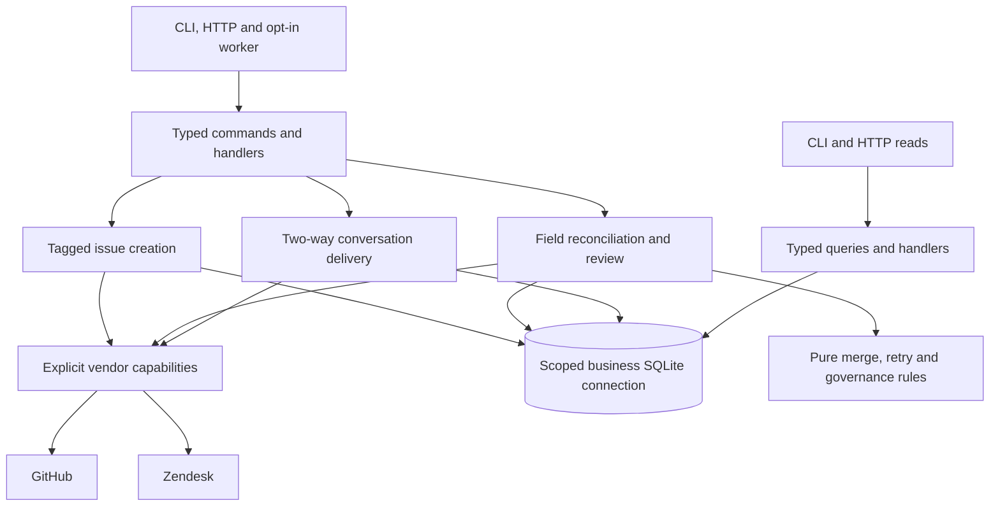
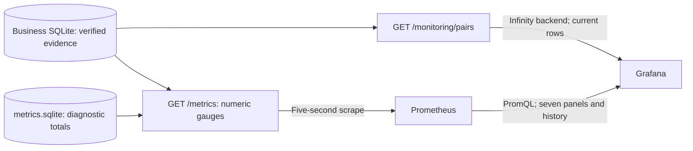

# Support Bridge architecture

## Customer and scope

Support works in Zendesk and engineering in GitHub. An explicit escalation tag creates and links an open issue; the bridge then reconciles title/subject and binary resolution state. Separately enabled GitHub comment delivery appends internal Zendesk notes. We expect less copying and fewer stale records; customer benefit and production capacity remain unmeasured.

The [scenario](SCENARIO.md) explains the business decisions. [Intake](INTAKE.md) and [comments](COMMENTS.md) own creation/append details. This guide explains code ownership, persistence, reconciliation and monitoring. It implements a focused deterministic workflow, without a general agent harness, runtime model, queue, event sourcing or distributed worker.

## Architecture overview

The operating project is `support-bridge-live-demo`, on API 1988, Prometheus 1989 and Grafana 1990. API, worker and CLI share its business state and canonical lock. Live state is `live.sqlite`; isolated local-provider checks use their own `local.sqlite`. Diagnostic observations persist separately in `metrics.sqlite`. Prometheus and Grafana have separate retained volumes. Credentials use separate volumes and restricted reader sets; see [Docker operation](DOCKER.md).

| Responsibility | Code |
| --- | --- |
| Dependency composition | `Application/Context` and focused factories |
| Shared use cases | `Application/Command` and `Application/Query` |
| Pure merge, retry and approval rules | `Domain` |
| Read, plan, persist, patch and verify | `Engine` |
| Tagged issue creation and recovery | `Intake`, `EscalationRepository` |
| Immutable comments and internal append recovery | `Comments`, `CommentRepository` |
| Durable pair/audit repository | `Store`, `Contract/PairRepository` |
| Connections, schema, transactions and canonical locks | `Infrastructure/Persistence` |
| Vendor capabilities and HTTP contracts | `Provider`, `HttpClient` |
| CLI, HTTP and process adapters | `Console`, `Http`, `Runtime` |
| Numeric metrics and current table presentation | `Observability` |
| Isolated OAuth issuer and managed credentials | `Infrastructure/OAuth`, `Runtime/ZendeskTokenRenewer` |
| Private observations and offline presentation | `Simulation/Replay`, `tools/demo-viewer` |

### Commands, queries and dependency ownership

`Context` creates one scoped `SqliteConnection` and injects it into repositories. Commands construct provider capabilities only when executing an effectful use case. Queries read local evidence without constructing providers or running workflows. `GetMonitoringSnapshot` returns one consistent numeric/business snapshot; `GetLinkedPairTable` applies the configured table projection through its handler. `MonitoringController` handles HTTP authentication and representation, rather than assembling the view itself.

`SqliteConnection` owns configuration and canonical database identity. `SchemaMigrator` owns additive schema changes. `TransactionManager` commits/rolls back repository operations or consistent read snapshots; `DatabaseLock` excludes concurrent business commands across processes on one host. A global database Singleton would hide the selected database/lifetime and couple fixtures to live state. There is no separate read database or asynchronous command bus.

### PHP coding standards

PSR-4 maps `Bridge\` to `src/`. Thin entry scripts delegate to focused objects with constructor dependencies. The locked PHP_CodeSniffer development dependency enforces the checked-in PSR-12 ruleset and its stated harness exceptions. Composer and Node tooling remain outside the PHP runtime image. Style checks do not establish recovery correctness; behavior and transport checks run separately.

### Live authentication and observation tooling

Provider identity is fixed by mode, repository and Zendesk tenant and bound to the business database. A mismatch refuses reuse rather than retargeting saved IDs. GitHub.com and ordinary Zendesk tenant hosts are supported; credentials travel in headers over fixed HTTPS destinations with redirects disabled.

The field `Provider` boundary fetches and patches existing records. Tagged intake has its own create/search capabilities, and comments have source/internal-note capabilities; their broader transports are not added implicitly to field reconciliation. Zendesk supports OAuth bearer and retained legacy API-token mode. The [isolated renewer](OAUTH.md) receives issuer credentials, publishes an atomic tenant/scope/expiry bundle and never changes business work or approvals. Managed readers reload the bundle per request; manual/GitHub startup-loaded rotation requires reader recreation.

Checkpoint capture is an explicit observer with provider access. It holds the canonical lock and reads both sources sequentially without reconciling, approving or advancing a baseline. Remote edits remain possible between reads. Private archive updates use a separate archive lock and atomic replacement. The offline viewer navigates allowlisted observations and cannot execute the story. See [live evidence](LIVE_DEMO.md#capture-and-render-actual-observations).

## Operator API and documentation

`WebApplication` serves allowlisted static assets and delegates requests to `Api`. `OperatorController` dispatches typed commands/queries; `MonitoringController` serves the read-only monitoring boundary. `/api` requires the broad operator token. `/metrics` and `/monitoring/pairs` require a distinct monitoring token; equal credentials fail closed. Health, Swagger and the static specification contain no record data and need no token.

The monitoring credential can read every linked verified subject and source URL through the current-context endpoint, but cannot call operator commands. Grafana holds it server-side in secure provisioning, with an API-only allowed host. No individual identity or per-pair authorization is enforced. The operator token is also a shared principal, with no separation of duties or scoped agent identity.

The [OpenAPI contract](api/openapi.json) and [API guide](API.md) define exact inputs/errors. Deployment mode, hosts, credentials and paths are process configuration, never request data. POST objects are bounded to 16 KiB; list limit/offset are bounded, although pair listing enumerates the store before slicing. A synchronous sweep can return conflict/retry/dead outcomes under HTTP 200; a client timeout does not prove no effect. Swagger is vendored, read-only documentation with no CDN/remote validator or credential persistence.

## Mapping and merge rules

| Canonical field | GitHub | Zendesk |
| --- | --- | --- |
| `title` | `title` | `subject` |
| `state=open` | `open` | `new`, `open`, `pending`, `hold` |
| `state=closed` | `closed` | `solved`, `closed` |

Title-only patches preserve Zendesk workflow status. State writes use `open` or `solved`; immutable `closed` tickets cannot be edited. Custom statuses, triggers and richer distinctions need account-specific validation. The binary model intentionally loses workflow detail.

Each field is compared with the last common baseline. Equal values converge without a write. A one-sided change propagates. Independent changes merge. Divergent same-field changes quarantine the entire pair. Different first-seen records also require an explicit source choice. Timestamps guard observed versions; they do not select a winner.

Source resolution re-reads both records against the stored conflict evidence. Changed fields or versions refresh the conflict and invalidate the stale choice. Selection creates a target; it does not approve a state transition. See [checkpoint 7](SCENARIO.md#7-resolve-an-actual-disagreement).

## Comment delivery boundary

Two append channels share `CommentWorkflow`, source/destination ports and a deterministic origin check. `CommentDirection` selects fixed identities, tables, audit names and markers. Forward saved rows remain unchanged in `comment_deliveries/comment_streams`; additive `note_deliveries/note_streams` store reverse work on the same injected connection. Typed `SyncZendeskNotes` and `ListNoteDeliveries` use cases extend CLI/HTTP without placing providers in queries.

Reverse delivery is separately opted in. Its first complete source scan saves all pre-existing comment IDs, including public and initial comments, without creating deliveries. That starting point survives pause/restart. Subsequent internal notes are eligible; public replies and the initial report are excluded. A new pending reverse note is re-read before append and compared with its immutable snapshot.

Origin checks use the opposite ledger's observed destination ID or exact reserved marker before preparing work. Unknown reserved headers stop discovery; author-account filtering would lose valid human replies. Audited append attempts, unique read-back and no blind resend apply in both directions. Zendesk uses internal-only safe update; GitHub has a version/lock preflight and body-only POST, with a remaining GET/POST race. Both channels hold during field review and share the durable privacy hold. The [conversation guide](COMMENTS.md) owns cutover, payload bounds and recovery.

## Durable work and uncertain outcomes

### Deterministic approval before an effect

`escalation-state-v1` permits title-only plans through the explicit link opt-in. Any planned outbound open/closed change holds the **whole field plan** for review, including accompanying title changes. Approval binds the pair, target, both preimages, both versions and policy version. The next execution rechecks fresh evidence; changed evidence cannot inherit an old attestation.

Approval is recorded before effects and does not perform the remote write itself. A required audit failure prevents subsequent effects. Neither source choice, retry, source text, a metric nor AI supplies approval. **Never rely on AI in compliance:** deterministic controls do not establish that customer obligations have been met. Policy/data ownership and missing controls are explicit in [governance](GOVERNANCE.md).

### Reconciliation and recovery

1. Acquire the canonical command lock and read both records.
2. If no plan exists, merge against the baseline or persist a conflict. Persist target, preimages and observed versions before any effect.
3. If a plan exists, retain its exact target and apply recovery/freshness guards; do not recompute intent silently.
4. Check writability, current policy, approval and required audit evidence. Patch only fields still requiring change.
5. Read both records again. Advance the baseline and clear pending work only after verified convergence.

A destination already at the saved target needs no resend. One still needing a field write must retain the saved version. This handles partial success and lost responses, without a transaction across vendors. Creation and comment append use their own stricter marker-based recovery; absence after an attempted outcome does not authorize another POST/append. [The primary scenario](SCENARIO.md) shows the operator checkpoints.

## Remote concurrency and retry policy

Zendesk uses `safe_update` with a fresh `updated_stamp`; collisions cause re-observation. GitHub's issue-update API has no documented equivalent atomic version precondition, leaving a read/PATCH race. Timestamp precision and edit-and-revert observations also limit detection. These controls do not promise prevention of every lost update or exactly-once effects.

Retryable failures use persisted exponential backoff, jitter and supported vendor guidance. Five failed field attempts become dead work. Authentication/validation failures need correction; conflicts and approvals remain distinct from retry. [Provider HTTP tests](../tests/http.php) exercise controlled contracts, not every account rule.

## Observability boundary

The current table and each scrape read a complete consistent business snapshot in their own transaction. They are separate requests, not an atomic observation with vendor state or each other. `LinkedPairProjection` validates numeric identities/evidence for both outputs. Subjects come only from the last verified baseline; links come from validated configuration and numeric IDs. Unknown subjects and never-verified timestamps stay explicit. Oversized millisecond conversions fail rather than emitting an invalid table number.

The table lists every stored mapping, has twelve visible columns and ignores the history time range. It reads protected JSON through pinned Infinity 4.1.5, not Prometheus. Subjects/URLs never become metric labels/history. Nine numeric series per link plus a total remain in Prometheus for the other panels/history. This growth, complete reads and monitoring access suit a small pilot; capacity is unmeasured. [Observability](OBSERVABILITY.md) defines metric values, staleness, alerts and exposure.

Diagnostic counters/histograms persist separately in `metrics.sqlite`. A crash can omit an observation; best-effort telemetry does not determine business correctness. Corrupt/unavailable scrape evidence returns sanitized 503, not fabricated healthy zeros. A healthy exporter does not prove vendor authentication; renewal health is separate.

## Trade-offs

- Explicit-tag creation removes manual matching, with polling/page bounds and conservative held uncertainty.
- Two-way merge preserves independent work but needs operators for conflicts. Whole-plan review keeps one approval decision while delaying title updates too.
- Immutable two-way message snapshots preserve origin and recovery evidence while making correction/redaction a separate responsibility. New-only reverse cutover avoids historical backfill but requires initialization before the first reply.
- SQLite and a canonical file lock make ownership explicit and tests reproducible, but support one host and serial work.
- Typed use cases and plain PHP keep policies shared while adding wiring and HTTP/deployment maintenance. We add patterns only to clarify a real boundary.
- The current JSON table keeps subjects out of metric labels; a pinned plugin and shared monitoring-read authority add maintenance. Prometheus adds useful history/rules, not synchronization authority.
- Managed short-lived OAuth avoids routine reader restarts, with an issuer service/volume and a documented shared vendor-volume limitation.
- Private replay explains selected observations without repeating effects; mutable selected evidence cannot replace fresh inspection, audit or approval.

## Known limitations

The service is a single-host demonstration with PHP's development HTTP server. Public ingress/TLS, per-user authorization, distributed work, production capacity, complete rate budgeting, general rollback and disaster recovery are unfinished. SQLite title/note evidence is not application-encrypted; retention and backup policy need ownership.

Approval has no expiry/revocation/rejection workflow and uses a shared principal. Audit is mutable local evidence. Intake and comment lookup bounds can hold work; marker deletion, inconsistent restoration and manual duplicates break recovery assumptions. Existing comments are included on enablement, and copies do not track source edits/deletion. Vendor triggers can reject or transform narrow writes.

Selected fictional live observations and controlled transport tests do not prove broader vendor compatibility, customer acceptance, compliance or measured business value. [REVIEW.md](REVIEW.md) distinguishes executed evidence from the proposed story. Prometheus rules have no configured notification recipient; current dashboard evidence can lag actual vendor edits.

## Measurement and next improvements

Before expanding the pilot, agree on field/data ownership and review roles; measure convergence lag, source calls/change, manual effort, unresolved age and lookup/series growth. Validate real account triggers, bounds, rate limits and restore procedures with explicit acceptance criteria. Add queues, distributed storage or adaptive behavior only when measured needs justify their costs.
