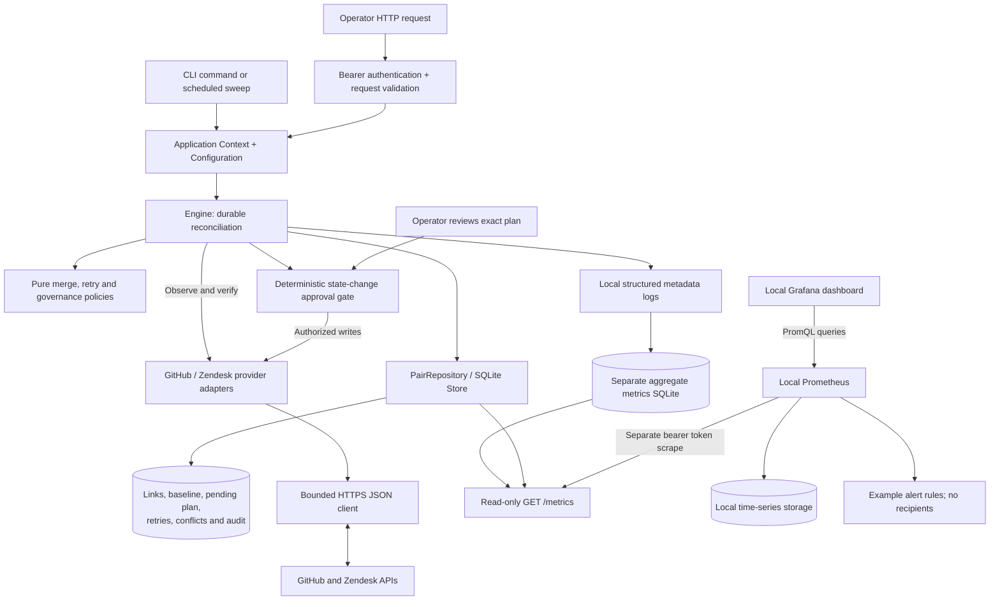

# Support Bridge: design and tradeoffs

## Customer and scope

We target B2B SaaS teams tracking support escalations in Zendesk and engineering work in GitHub. Manual copies of the summary and resolution state can become stale. The customer, workflow and deployment assumptions are recorded centrally in [ASSUMPTIONS.md](ASSUMPTIONS.md); they require validation with the actual customer.

This prototype reconciles **explicitly linked, existing** GitHub issues and Zendesk tickets. It synchronizes the issue title with the ticket subject, and a deliberately small open/closed state. The link is an operator's opt-in decision; the service does not infer which records concern the same customer.

It does not create records, copy comments or attachments, synchronize descriptions, or copy requester details. Ticket subjects can still contain personal or confidential information: the database holds titles and must be treated accordingly.

The benefit is a hypothesis, not a measured outcome: less manual copying and fewer stale escalations. Validate it with a small opt-in pilot before expanding scope.

We use a headless deterministic workflow behind both CLI and HTTP. Our [governance model](GOVERNANCE.md) explains the per-step execution choices, approval boundary and operating responsibilities. **Never rely on AI in compliance:** a model cannot authorize execution or establish policy satisfaction. Accountable policy owners must validate obligations and controls before live use.

## Architecture overview

The application runs on PHP 8.2 or later with PDO SQLite and cURL, without a PHP framework or Composer packages. A bounded CLI sweep and a JSON operator API share the same application composition and reconciliation engine. A process lock for the canonical database path permits one worker; SQLite holds durable reconciliation state and retry timing. The database is bound to its configured repository and Zendesk tenant, preventing old baselines from being retargeted by an environment change.

HTTP calls happen outside SQLite transactions. Local transactions make local state durable; they do not make a transaction spanning GitHub and Zendesk.

The code separates responsibilities where the behavior needs independent verification:

| Files | Responsibility and practical effect |
| --- | --- |
| `src/Domain/MergePolicy.php`, `RetryPolicy.php`, `GovernancePolicy.php` | Decide values, schedules and authorization requirements from explicit inputs. They perform no I/O; time and jitter enter as values, making rule tests deterministic. |
| `src/Engine.php` | Coordinate observations, durable intent, guarded writes, verification and recovery. It does not parse HTTP requests or construct vendor URLs. |
| `src/Contract/PairRepository.php`, `src/Store.php` | Define the durable state/locking boundary and implement it with SQLite. The engine depends on that contract rather than SQLite calls. |
| `src/Provider/Provider.php`, `GitHub.php`, `Zendesk.php`, `Local.php` | Normalize records and apply only supported canonical patches. The local adapter and test doubles exercise the same engine without vendor credentials. |
| `src/HttpClient.php`, `HttpResponse.php` | Bound HTTPS transport, validate hosts and classify sanitized upstream failures. |
| `src/Application/Configuration.php`, `Context.php` | Read deployment settings and assemble storage, providers, engine and telemetry once for both entry points. HTTP callers cannot select a state directory, mode, repository or tenant. |
| `src/Http/Api.php`, `Request.php`, `Response.php`, `src/Exception/*` | Authenticate and validate operator requests, then translate explicit failures to JSON/status codes. Reconciliation is reused rather than reimplemented in controllers. |
| `src/Observability/Prometheus.php` | Persist bounded outcome counters and a duration histogram across CLI processes; render aggregate metrics and local state gauges without record-derived labels. Telemetry failures cannot change business outcomes. |

The result is a small set of boundaries, not a dependency-injection framework or an abstraction for every method. Typed validation, missing-record, state-conflict and worker-busy failures let the API distinguish expected outcomes without interpreting exception-message text.

## Operator API and documentation

The API lists and inspects links, creates explicit links, runs a sweep, selects conflict resolutions, approves exact state-changing plans, retries failed work and exposes local status. Operational `/api` routes require one deployment-configured bearer token, compared with `hash_equals`. The Prometheus text exporter at `GET /metrics` requires a distinct read-only metrics token; it cannot authorize operator actions. Reusing the same configured token for both surfaces is rejected. `/health`, `/docs`, the specification and explicitly allowed static assets are public. JSON operations accept only their exact documented fields with a 16 KiB body limit; error responses include a request ID and sanitized code.

`public/router.php` serves an explicit asset allowlist and delegates API work to `Http\Api`. The OpenAPI contract is `docs/api/openapi.json`. `/docs` uses locally vendored Swagger UI **5.34.0** with submit methods disabled, no remote validator and no query-supplied configuration. It is a read-only reference; clients can still call the real operator API directly. Swagger's bundle includes React, but that is a documentation asset, not a PHP framework. Node/npm are development tools for validating and refreshing the vendored documentation, not requirements for serving it.

The bearer token represents a single operator; there are no individual accounts, roles, token scopes or per-user attribution. The PHP development server binds to localhost in the documented example and provides no TLS termination or rate limiting. A production host must supply those controls before remote exposure. A synchronization request blocks until its bounded sweep completes and uses the same worker lock as the CLI. List responses bound `limit`/`offset`, but currently load all stored pairs before slicing in memory.

## Mapping and merge rules

| Canonical field | GitHub | Zendesk |
| --- | --- | --- |
| `title` | `title` | `subject` |
| `state=open` | `open` | `new`, `open`, `pending`, `hold` |
| `state=closed` | `closed` | `solved`, `closed` |

Writing a state change to Zendesk uses `open` or `solved`. An unchanged canonical open state must not turn a pending or on-hold ticket into open. The integration does not preserve GitHub closure reasons or Zendesk workflow distinctions in its common model. Custom status categories require account-specific validation. Zendesk documents its status model in the [Tickets API](https://developer.zendesk.com/api-reference/ticketing/tickets/tickets/) and [custom status reference](https://developer.zendesk.com/api-reference/ticketing/tickets/custom_ticket_statuses/).

A Zendesk `closed` ticket is terminal. The service can observe it as closed, but blocks edits or reopening that would require changing that ticket. It never creates a follow-up ticket. See [Zendesk's update guidance](https://developer.zendesk.com/documentation/ticketing/managing-tickets/creating-and-updating-tickets/).

For each field, compare both current values with the persisted common baseline:

| Observed values | Decision |
| --- | --- |
| Both equal | Accept convergence; no remote write |
| GitHub alone differs from baseline | Copy that field to Zendesk |
| Zendesk alone differs from baseline | Copy that field to GitHub |
| Both changed to different values | Quarantine the whole pair |

Changes to different fields can merge. Example: an engineer changes the title while an agent solves the ticket; the merged result contains both changes. A conflict in any field suspends the pair, including otherwise mergeable fields. This is conservative and keeps operator review understandable.

On the first observation, equal records establish a baseline. Existing disagreement needs an explicit source decision; timestamps are not used to guess ownership. The operator can resolve a quarantined pair by choosing one whole record as the source. Resolution checks both canonical fields and versions against the stored conflict snapshot. Any observed change, including an unrelated edit that advances the version, refreshes the conflict and requires another review. The same timestamp-granularity limits described below apply to this freshness check.

## Durable work and uncertain outcomes

### Deterministic approval before an effect

`GovernancePolicy` validates the persisted field/capability contract and classifies its original state transitions. Under `escalation-state-v1`, explicit linking authorizes title-only transfer; any outbound open/closed transition holds the entire plan in `awaiting_approval` before any write. This includes reopening and a title change accompanying a state transition. Ineligible immutable destinations fail before an impossible approval is requested. No model decides whether approval is required.

Inspection exposes the policy version, plan hash, approval requirement and approval match without provider reads or a side effect. `approve PAIR HASH REASON` and its HTTP equivalent run under the canonical lock, require the currently inspected hash, re-read both records and reject changed fields or versions. The hash covers the pair/link identities, target, both preimages/versions and policy version. The approval event is persisted before authorization state; an audit failure cannot enable a subsequent effect. Source selection and retry never grant approval.

Execution rechecks the stored plan/approval and remote evidence. Destinations still requiring a write retain their observed versions; an unchanged original source must also retain its reviewed version. Already-achieved targets can be acknowledged without another write, preserving recovery after an unknown outcome. No approval can authorize another plan or policy version. Completed/quarantined work clears current approval while retaining local audit history. Pending reviews are skipped by scheduled sweeps until an operator acts; a stale approval request refreshes a conflict for a new source decision.

The shared operator credential identifies no individual and cannot prove a human or independent approver. This is an explicit attestation, not verified human origin or a compliance decision. Do not give this broad credential to an agent. The [read-only review skill](../skills/support-bridge-escalation-review/SKILL.md) provides instructions; a separately authenticated facade must enforce agent privileges before integration. Customer policy owners still need to approve data boundaries, state prerequisites and this title-only opt-in. AI output cannot satisfy those responsibilities.

An additive, transactional migration adds a nullable `approval` column to existing stores; the `target` / `before` / `versions` shape remains unchanged. Legacy state-changing intents receive the gate. This narrow upgrade is tested; general schema lifecycle, rollback and restored-backup recovery remain unfinished.

### Reconciliation and recovery

Before writing, persist the intended merged values and each destination's observed preimage and version. Patch only fields that need to change. Keep the plan durable until all required effects have been acknowledged and the common baseline can advance.

On recovery, read the destination again and inspect the fields in the pending patch:

- A field already equal to its desired value needs no repeat write.
- A field still equal to its expected preimage remains eligible only if the destination's recorded version is unchanged.
- A field equal to neither indicates an intervening edit and requires conflict handling.

If a destination still needs any write and its version has changed, recovery quarantines the pair even when the canonical values look unchanged. An unrelated edit can therefore require operator attention. This conservative choice detects an observable edit-and-revert instead of overwriting it with a stale intent. If the complete destination already equals the target, recovery can acknowledge it without writing or requiring the original version.

This covers a timeout after a server accepted the write, as well as a crash before local acknowledgement. It also preserves work when one destination succeeds and the other fails. Historical patches are never blindly replayed. Repeated polling after convergence should emit no writes, avoiding a feedback loop.

This is checked, repeatable reconciliation, **not exactly-once delivery**. The adapters use API update timestamps as versions; their granularity and provider semantics limit detection of intervening edits. An unchanged value and timestamp do not prove that no edit happened. No local transaction can remove a remote network uncertainty.

## Remote concurrency and retry policy

Zendesk updates use `safe_update` with `updated_stamp` from the latest read. An update collision causes fresh observation instead of forcing the stale write; Zendesk describes this mechanism in its [ticket update guidance](https://developer.zendesk.com/documentation/ticketing/managing-tickets/creating-and-updating-tickets/).

The [GitHub issue update endpoint](https://docs.github.com/en/rest/issues/issues#update-an-issue) does not document an equivalent version precondition. A fresh read, minimal PATCH and verification narrow the race, but a human can edit the same field between that read and PATCH. The implementation cannot guarantee prevention or detection of every lost update in that window. Conditional GET caching is not proof of conditional PATCH support.

Transient network/server failures and rate limiting schedule persistent exponential backoff with jitter, honoring server retry guidance. After five failed attempts, the pair becomes dead for operator attention. Authentication and validation errors need correction rather than endless retries. Conflicts are separate from transport failures. See the [GitHub integration practices](https://docs.github.com/en/rest/using-the-rest-api/best-practices-for-using-the-rest-api) and [Zendesk rate-limit guidance](https://developer.zendesk.com/documentation/api-basics/best-practices/best-practices-for-avoiding-rate-limiting/).

## Observability boundary

The application stores outcome counters and a classic duration histogram in a separate `metrics.sqlite`, so short-lived CLI processes contribute to the same series. Outcome/status labels are finite; metric names and labels contain no pair IDs, titles, credentials or raw error messages. Snapshot gauges report persisted pair counts, pending plans and the most recent observed convergence. The operator's JSON `/api/metrics` response is distinct from the Prometheus text format at `/metrics`.

Metrics are recorded after the business result is durable and are best effort. A crash between those commits can omit an observation; telemetry is not an exactly-once business ledger. A failed metrics store does not change the business result. An exporter read failure returns HTTP 503 rather than invented zero counters, causing Prometheus's `up` signal to fail. A successful scrape exposes the separate telemetry-storage availability gauge.

The local monitoring stack uses Prometheus **3.13.5 LTS** and Grafana OSS **13.2.4**, installed from checksum-verified official archives. Prometheus reads its separate scrape credential from a private file and pulls aggregate metrics; Grafana queries Prometheus through a provisioned datasource. An eight-panel dashboard shows scrape health, states, backlog, throughput and duration. Four example rules are evaluated locally; there is no Alertmanager, receiver or notification destination. Credentials and runtime data remain outside the repository, all listeners bind to loopback, and no cloud account is required. The monitoring launcher and server configuration are in [monitoring/README.md](../monitoring/README.md); metric semantics are in [OBSERVABILITY.md](OBSERVABILITY.md).

The real local stack was started with isolated synthetic application data and verified through an authenticated scrape, a Prometheus query, Grafana datasource health, dashboard provisioning and loaded rules. This confirms that local path, not production monitoring coverage, notification delivery or customer service objectives. Prometheus itself has no extra authentication in this loopback setup, so other processes on the host can query aggregate data. Remote deployment needs TLS, authentication, access control and supervision.

## Trade-offs

The state-change gate adds explicit review and preserves a deterministic execution path, at the cost of latency and delaying title changes in mixed plans. The title-only opt-in needs customer validation; stricter customers may require review for every write. The binary state contract makes merge rules understandable but loses richer vendor workflow meaning. Whole-pair quarantine protects a coherent decision at the cost of delaying safe fields. Version checks deliberately quarantine some unrelated edits rather than replaying a stale plan. A one-way ownership policy would remove much of this conflict handling if the customer accepts it.

SQLite and one worker keep installation and crash recovery inspectable. They also serialize work and constrain deployment to a single host with local storage. Polling avoids webhook registration and delivery handling, but spends API quota even when nothing changes. The CLI and API share a composition root to avoid divergent behavior; the thin framework-free HTTP layer still leaves authentication operations, deployment hardening and maintenance with this project.

## Known limitations

Structured logs contain event metadata and record identifiers, not titles, credentials or complete API responses. The SQLite file contains title snapshots, so restrict access, define retention and include it in backup/recovery planning. Credentials belong in the execution environment, not source control. Production deployment also needs a secret manager and an explicit credential-rotation procedure.

Offline domain, reconciliation, HTTP adapter, API and observability tests establish selected behavior under controlled inputs and faults. They do not establish live API compatibility, production throughput or customer benefit. Real adapters have not been validated with live credentials. Before a pilot, confirm token permissions, Zendesk required fields/custom statuses, triggers, rate limits and terminal tickets in sandbox accounts. Business rules may transform or reject an otherwise valid update.

REA was actually run on the local Swagger JavaScript artifacts. The vendor bundle exceeded its worker heap, and even the focused initializer result retained explicit semantic unknowns. This was partial static artifact analysis, not a PHP source review, browser-behavior verification or vendor security audit. See [TOOLING-INSTALLATION.md](TOOLING-INSTALLATION.md) for pins and evidence. Agency profiles provide review guidance; their installation alone is not proof of review.

An unchanged eligible pair requires two provider reads; writes and recovery require additional checks. One worker, synchronous HTTP calls and SQLite serialize progress; a slow request or large retry backlog increases freshness lag. The API's blocking sweep, in-memory list pagination and lack of built-in rate limiting also bound its suitability. Multiple hosts must not share this design by assuming a local file lock is a distributed lock. Audit retention, general schema lifecycle/rollback, distributed jobs and production monitoring supervision remain operational work.

Metrics can miss post-commit crashes, and a globally recent convergence timestamp can conceal an individual stalled pair. Histogram quantiles estimate values from buckets and rate queries need enough samples; absent samples are not zero latency. The PHP development server can also delay scrapes while serving a blocking sweep. The local dashboard and example alert thresholds are useful demonstrations, not agreed SLOs or a tested incident-response process.

## Measurement and next improvements

Measure a pilot using:

- Manual copying actions and minutes per escalation, before and after adoption.
- Time from a source edit to observed convergence, reporting median and tail latency.
- Share of linked pairs that are stale, conflicted, dead or awaiting approval; age of unresolved items and approval wait time (not yet measured as a duration by the exporter).
- API calls per useful change, rate-limit responses and recovery success after outages.

Set acceptance targets with the support team; compare similar escalation cohorts and retain the pre-pilot baseline. Do not count an offline test duration as a production benchmark or attribute every change in resolution time to this integration.

The next improvements should follow evidence: live contract tests first; then metrics and recovery tooling; then webhook wake-ups with polling as a repair path. If volume requires parallelism, use durable jobs partitioned by pair, a database with explicit worker coordination and per-provider rate budgets. Stronger remote concurrency guarantees need provider-supported version checks or a different ownership contract, not just more workers.
