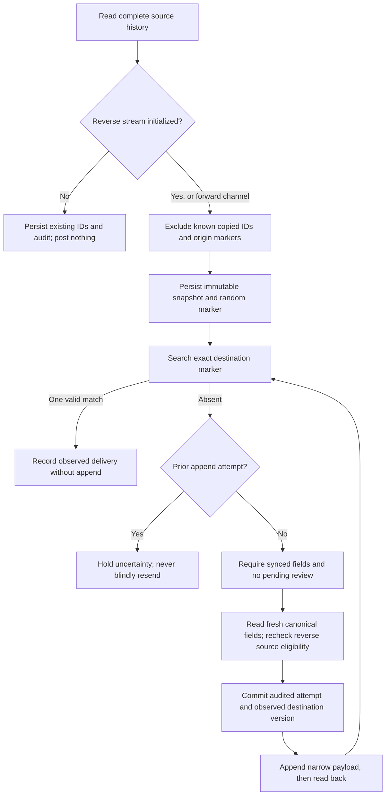

# Engineering conversations across Zendesk and GitHub

The bridge has two separately enabled append channels:

| Source | Destination | Starting behavior |
| --- | --- | --- |
| Original GitHub issue comments | Internal Zendesk notes | Includes existing eligible comments when enabled |
| New internal Zendesk notes | GitHub issue comments | First complete scan records existing IDs without posting history |

Public Zendesk replies, the initial ticket report and copied bridge messages are excluded from the reverse channel. Neither channel synchronizes source edits, deletion, redaction, attachment bytes or issue-description edits. The integration account writes each destination message; source attribution in its body does not impersonate or verify the original author.

The [customer walkthrough](SCENARIO.md#start-in-zendesk) shows the intended question-and-answer flow. Separately enabled channels are part of the explicit deployment/data-sharing decision. A Zendesk internal note can contain private material: copying it to GitHub makes it visible to that repository's audience, which can be public. The bridge does not classify, redact or approve that transfer.

## Expected behavior

1. Start with one explicitly linked ticket/issue pair and verified common fields. Tagged intake can create this mapping.
2. With reverse delivery enabled, allow its first complete scan to finish. Inspect `notes` or `GET /api/note-deliveries`: the pair's stream must have a non-null `initialized_at`.
3. Add a developer question in GitHub. Forward delivery copies it once into Zendesk as an internal note, with source login, timestamp and comment link.
4. Add a **new internal note** in Zendesk answering the question. Reverse delivery copies it once into the linked GitHub issue, with Zendesk user ID, available display name, creation timestamp and ticket URL.
5. Poll again. The copied messages are recognized as bridge outputs and do not travel back again.

Use **Internal note**, not a public customer reply, for the return path. Public replies remain in Zendesk. Names are included when Zendesk supplies them through the ticket-comment response's optional user side-load; otherwise the numeric source user ID remains explicit. No additional user-directory request or OAuth scope is required. Names/logins are attribution, not verified engineering roles or approval authority.

Zendesk text is posted as a literal fenced block so Markdown, mentions and image syntax remain text. The source link is outside that block. Rich formatting can differ; attachment URLs inside the text remain literal and attachment bytes are never downloaded.

## New notes only

The first **successful complete scan per pair** records all existing Zendesk comment IDs, including public comments and the initial report. It creates no delivery rows for them and reports `initialized: 1`. This is the cutover; setting the environment flag alone does not establish it. Notes added before that first scan completes are part of the excluded history.

A failed/incomplete first scan or failed required audit leaves the stream uninitialized. Wait for a successful starting point before adding the first demonstration reply. For a newly linked pair the same rule applies independently.

The starting point persists across worker restarts, disable/re-enable cycles and container recreation. Pausing delivery does not reset it. Notes created after cutover while the worker is paused are eligible when it resumes. A historical public comment later made internal remains excluded because its ID was already observed. Unsupported historical bodies do not need to be copied or reformatted.

There is no backfill or reset endpoint. Do not erase cutover IDs or delivery evidence to replay an old discussion.

## Architecture overview

Both channels use the same `CommentWorkflow`, narrow `CommentSource`/`CommentDestination` ports, deterministic origin check and canonical business lock. `CommentDirection` selects fixed tables, identifiers, marker prefixes and audit event names. Typed commands and provider-free queries are shared by CLI and HTTP.

Forward evidence remains in the existing `comment_deliveries` and `comment_streams` tables with its saved snapshots and markers unchanged. Additive `note_deliveries` and `note_streams` tables hold reverse snapshots, attempted writes, observed GitHub comment IDs and cutover evidence on the same injected SQLite connection. There is no queue, separate read database, new service or traffic generator.

`ZendeskCommentHistory` supplies complete bounded fixed-host listings for both adapters. The reverse source filters public/initial/excluded comments and re-reads a pending source note before its first append. `GitHubIssueComments` supplies bounded listing, unique-marker lookup and a narrow body-only POST; the transport permits only that marked comment path in addition to the existing issue-creation POST.



## Loop and duplicate prevention

Every source ID is unique within its pair and direction. Its first-observed payload and random marker are durable before any append. Further discovery cannot create another delivery for that ID.

Origin checks consult the **opposite channel's ledger** for an observed destination ID or the exact marker at the start of a message. They run before preparing a new delivery. Marker lookup works even when an append succeeded but its acknowledgement was lost. A saved destination ID continues to identify a copy if its marker is later edited away.

We do not filter the integration account: a real person can use that same account to add a legitimate new reply. Unknown reserved bridge headers stop that stream for investigation instead of being relayed. Markers are correlation evidence, not secrets, signatures or permission grants. Manual copying/tampering, removal of local state or inconsistent restoration can defeat origin evidence; no distributed exactly-once guarantee is claimed.

## Governance and recovery

New appends in both directions require a synced pair, a common baseline, no pending plan/conflict/approval and fresh agreement of the supported fields. This prevents ordinary note delivery from changing source versions while a field plan awaits review. A message saying “fixed” or “approved” never authorizes closure, selects a conflict winner or grants approval. **Never rely on AI in compliance.**

Before the first reverse append, the source is fetched again. If it was deleted, made public or changed from the immutable formatted snapshot, it is held rather than publishing the old private text or rewriting that snapshot. A later source edit/redaction after delivery does not retract or edit the copied message. Source metadata becoming unavailable can defer work; fresh checks are sequential observations, not an atomic transaction with either vendor.

A required audit failure stops subsequent effects. After an audited append attempt, timeout, rejection or process failure leads to observation-only recovery. One matching destination marker can acknowledge the result. Absence, ambiguous markers or incomplete history never authorize a second append. A definite preflight rejection can therefore remain uncertain and require investigation.

Zendesk receives only `comment.body`, `public=false`, `safe_update=true` and its observed update stamp. GitHub receives only `body`, after an additional issue-version/lock preflight. GitHub does not offer an atomic equivalent of Zendesk safe update for comment creation; an edit can still race the GET/POST interval. No destination author override, state update or requester field is sent.

An observed public forward-delivery marker creates the existing durable privacy hold, which now stops **both** channels. This cannot undo exposure or continuously recheck previously acknowledged notes. There is no automatic hold reset. Immutable Zendesk tickets block new forward notes; locked/unavailable GitHub discussions can stop reverse delivery. Vendor triggers and notifications require account-specific validation.

## Operate and inspect

Keep the existing `support-bridge-live-demo` project, its state and credentials. Both flags default to zero on a fresh configuration:

```dotenv
BRIDGE_GITHUB_COMMENTS_ENABLED=1
BRIDGE_ZENDESK_NOTES_ENABLED=1
```

Enable only the channels whose source content and destination audience have been reviewed. Retain `live-worker` and the existing credential-renewal profile when selected. Rebuild/recreate API and worker with the same private env file and both Compose files; follow [Docker operation](DOCKER.md). No new volume or service is needed. The worker order is **intake → fields → GitHub comments → Zendesk internal replies**, with a nominal 60-second delay after a complete pass.

Use the full deployment prefix, replacing the private env path:

```bash
docker compose --env-file /absolute/private/live-demo.env -p support-bridge-live-demo -f compose.yaml -f compose.live-demo.yaml run --rm --no-deps cli notes
```

`notes` reads the reverse ledger and initialization state without contacting vendors. `sync-notes` explicitly runs one effectful reverse pass, including first-scan initialization. The forward commands remain `comments` and `sync-comments`. A sweep processes every eligible linked pair, not a caller-selected ticket.

| HTTP operation | Behavior |
| --- | --- |
| `GET /api/comment-deliveries` | Forward snapshots, state and discovery evidence |
| `POST /api/comments/sync` with `{}` | Explicit enabled forward pass |
| `GET /api/note-deliveries` | Reverse snapshots, initialization time, excluded count and discovery evidence |
| `POST /api/notes/sync` with `{}` | Explicit enabled reverse pass |

These use the existing broad operator token. The monitoring token cannot invoke them, and callers cannot supply message text, a public flag, credentials, source URLs, authors or approval. Swagger remains documentation only. Listings expose sensitive stored snapshots; apply storage/access/retention controls. `items` and `streams` are independently paginated with the same limit/offset.

| Delivery state | Meaning |
| --- | --- |
| `pending` | Snapshot saved; no append attempt committed; freshness or field review can still hold it |
| `sending` | Audited attempt committed; a crash can leave the remote result unknown |
| `uncertain` | Observe the marker; no automatic second append |
| `delivered` | One corresponding destination message observed |
| `blocked` | Source eligibility, destination writability or visibility evidence requires investigation |

Forward rows keep `zendesk_comment_id`; reverse rows use `github_comment_id`. Reverse streams expose `initialized_at` and `excluded_count`, never their full stored exclusion list. Per-pass counts describe that command only. `initialized` is the number of reverse streams initialized during the pass; `privacy_hold` is shared.

## Monitoring

[Grafana](http://127.0.0.1:1990/d/supportbridge-overview) shows separate forward and reverse panels. The reverse panel includes **Starting points recorded**. The all-pairs table has twelve visible columns, including independent forward internal-note and reverse GitHub-reply delivered/waiting totals.

Operator attention includes sending/uncertain/blocked work and discovery errors from either direction, plus the shared privacy hold once. Excluded history is not counted as delivered or waiting. Counts are stored observations, not current conversation equality or customer confirmation. Exact reasons require authenticated inspection. Text, names, source comment IDs, markers and review evidence remain excluded from metric labels. Numeric ticket/issue IDs retain their documented monitoring exposure.

## Trade-offs

- Two append channels reduce manual copying of questions and replies, while duplicating sensitive text across systems and requiring explicit destination approval.
- New-only cutover avoids replaying old internal discussions. It needs one successful initialization scan before the first test reply; notes added before that point are excluded.
- Durable source IDs and markers prevent ordinary duplicates and reflection loops without discarding messages by author account. State loss or manual marker tampering remains a limit.
- Immutable snapshots make uncertain outcomes inspectable. Pending source changes can block delivery; later edits/deletion/redaction require separate correction or removal.
- Whole-plan review holds new conversation delivery, preserving review evidence at the cost of latency.
- Complete bounded history reads simplify absence/uniqueness checks but consume requests repeatedly. A reverse append has a fresh source re-read and an extra GitHub preflight.
- Conservative unknown-outcome handling avoids a blind resend but can hold a genuinely rejected append until investigated.

## Known limitations

Histories must complete within five pages of 100 comments per source/destination record. A rotating offset listing is not atomic; provider visibility and pagination can delay observation. A raw GitHub source body is limited to 60,000 UTF-8 bytes and a forward note to 62,000. The complete reverse GitHub payload, including attribution and literal-text fencing, must fit 60,000 bytes. Unsupported/oversized new content fails visibly instead of truncating. Historical excluded bodies are not imported.

Each channel processes at most five recovery and five pending deliveries per pass, with persisted cooldown of at least 60 seconds and longer vendor retry guidance. No delivery-latency, ordering, exactly-once, general restore or notification guarantee is made. There is no automatic uncertain-append reset, backfill, edit/delete/redaction propagation or attachment download.

The source user ID or login is attribution, not verified individual identity. Optional display names can be absent or stale. GitHub visibility, Zendesk roles/triggers, notification behavior, token permissions and real provider failure recovery need separate account validation. Neither these controls nor internal-only Zendesk visibility establishes compliance.

## Verification and AI use

`tests/comments.php` retains forward recovery/authority/privacy checks. `tests/conversations.php` adds new-only cutover, full question-and-answer flow, repeated scans, origin markers and destination IDs, same-account human replies, lost responses/acknowledgements, source changes, hold/approval boundaries, migration preservation, payload bounds, API authority and direction-specific metric checks. Real HTTP fixtures and OpenAPI schemas cover the reverse endpoints and populated ledger. Container checks verify shared wiring without vendor effects.

[REVIEW.md](REVIEW.md) separates executed controlled checks, local rendering and provider observations. AI assisted implementation, failure review and documentation. Deterministic code and explicit operator decisions govern execution; AI output cannot approve a message, state transition, source choice or compliance decision. See [AI use](../README.md#ai-use).
