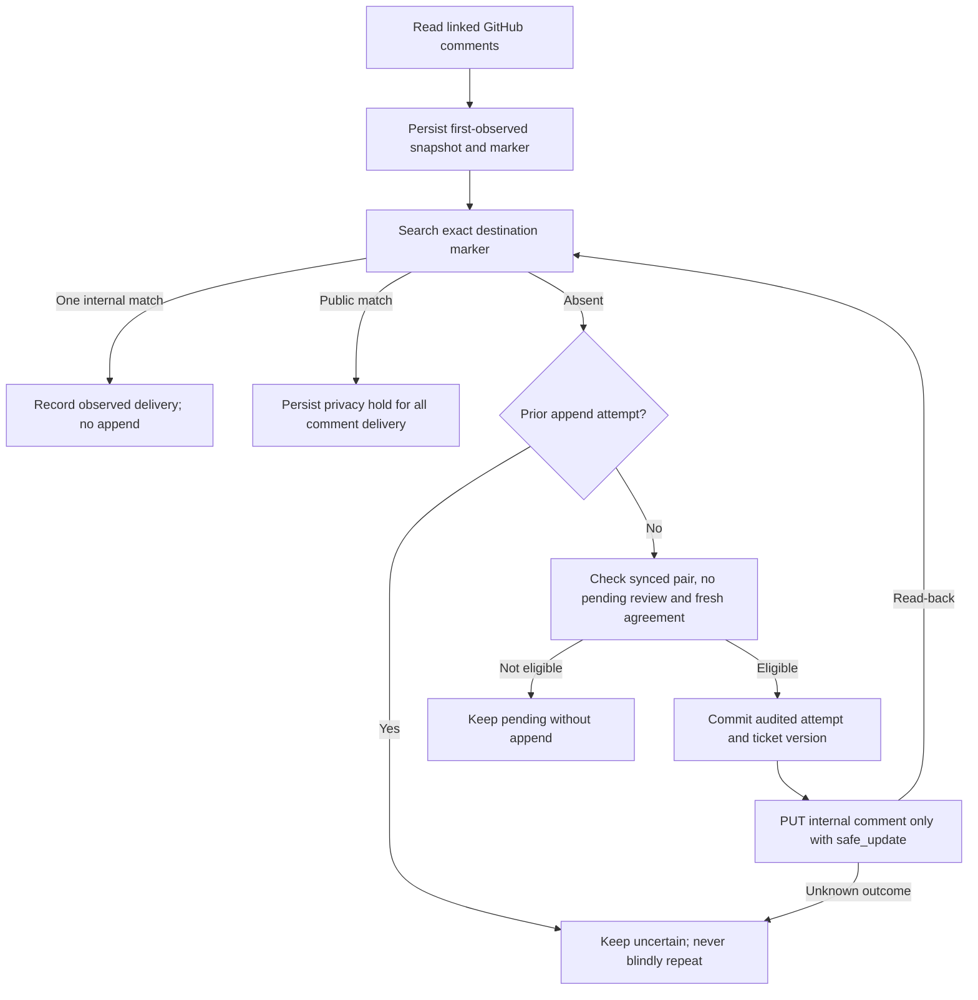

# GitHub comments to Zendesk internal notes

Engineering can leave an issue comment in GitHub and support can read it in the linked Zendesk ticket as an **internal note**. The bridge retains the source text, author login, creation time and a GitHub comment link. It does not summarize or interpret the message. This reduces another copying step in our [primary escalation scenario](SCENARIO.md); customer benefit remains unmeasured.

## Expected behavior

1. Start with an explicitly linked issue/ticket pair, including a mapping created by Zendesk intake.
2. Add an ordinary comment to the GitHub issue. For example: “The fix is ready for verification in the next release.”
3. The configured worker reconciles fields, then runs comment delivery, with a nominal 60-second delay after each full pass. Work duration, vendor visibility, rate limits and the per-pass budget add latency.
4. Once the pair is synced without pending plan, conflict or approval, the bridge appends the source comment to Zendesk with `public: false`. Support sees an internal note attributed to the integration account, with the GitHub author identified in the note text. It does not impersonate that author in Zendesk.
5. The bridge reads back the note and records its Zendesk comment ID only after observing its unique marker on an internal note. Further scans do not append it again.

The channel is **one way**. Zendesk replies and internal notes do not create GitHub comments. GitHub issue descriptions, reactions, review threads and attachment bytes are not mirrored. URLs in the source remain text/links; the service does not fetch their contents. Ordinary user and bot issue comments are included; GitHub login attribution does not establish that the author is an engineer or an authorized business approver.

All existing comments visible within the scan bounds are eligible on first enablement, including comments predating the mapping. Each source ID is copied once per pair. The first observed body is saved immutably; later edits, deletion or redaction in GitHub do not edit, delete or redact the Zendesk note. A comment deleted before discovery can be missed. To send a correction, add a new GitHub comment with a new source ID. Plan data-sharing and retention accordingly.

## Architecture overview

`SyncGitHubComments` is an explicit typed command shared by worker, CLI and HTTP. `CommentFactory` constructs the separate `CommentSource` and `InternalNotes` capabilities only for that command. Ordinary `Provider` field patches remain limited to title/state. `ListCommentDeliveries` reads local state without constructing providers.

`CommentWorkflow` holds the canonical business lock. `CommentRepository` receives the context's existing scoped SQLite connection. Additive `comment_deliveries` and `comment_streams` tables retain immutable note snapshots, source revision, random marker, attempted timestamp, observed destination version/ID, status, schedule and discovery errors. Existing reconciliation plan and approval JSON is unchanged. This durable delivery ledger does not introduce a broker, second business database or asynchronous command bus.



The receiver request contains only `comment.body`, `comment.public=false`, `safe_update=true` and the freshly read `updated_stamp`. It supplies no subject, status, author override or requester field. [Zendesk comments](https://developer.zendesk.com/api-reference/ticketing/tickets/ticket_comments/) use `public=false` for internal notes and are appended through the ticket-update endpoint. Ticket read/write scopes and the existing repository Issues access are reused; no credential expansion is required.

## Governance and recovery

New appends wait while a pair is not synced, has any pending plan/conflict/approval, or fresh canonical fields differ from its stored baseline. Thus notes cannot invalidate review evidence by changing the Zendesk version during a pending plan. Provider version changes associated with source comments can still make existing evidence stale; delivery never refreshes an approval automatically. The next ordinary field sweep resolves or gates that work first. A comment saying “fixed” or “approved” never changes state, authorizes resolution or selects a conflicting source. **Never rely on AI in compliance.** No model participates in delivery, classification, approval or policy checks.

The note snapshot and correlation marker commit before an audited append attempt. An audit failure stops subsequent effects. A timeout, rejected update or process death after that attempt leaves uncertainty. Recovery searches the exact marker in Zendesk and requires one internal match. It never blindly resends an attempted append, even when a later lookup finds nothing or the original response was a safe-update conflict. That conservative choice can leave a genuinely rejected append waiting for operator investigation. Existing markers and attempts must not be cleared to force progress.

The marker is visible in the internal note and is correlation evidence, not an authentication secret. Multiple matches or incomplete history cannot establish a unique delivery. A persisted destination note can be acknowledged during a later pair review because acknowledgement creates no external effect. Local delivery-acknowledgement failure after a successful append is recovered by this same read path.

If a marker is observed on a **public** comment, the ledger records the violation and a durable privacy hold stops all subsequent comment discovery/appends, including after restart. Reconciliation and credential renewal retain their separate rules. `privacy_hold` is visible in inspection/metrics; there is no automatic reset endpoint. Account owners must investigate exposure and vendor rules, then arrange reviewed maintenance before resuming. The hold cannot undo an already public note and does not continuously monitor notes already acknowledged as delivered.

Zendesk's immutable closed tickets become blocked deliveries; no follow-up ticket is created. Solved but writable tickets may receive internal notes. Tenant triggers can reject notes, send notifications or change fields despite the narrow request. Internal-only visibility does not establish regulatory compliance or guarantee that account automation sends no email. Validate actual tenant behavior before real customer use. Canonical state changes are never included in the note request; unexpected later vendor changes are observed by the normal reconciliation gate rather than silently corrected by comment delivery.

## Operate and inspect

Keep the existing `support-bridge-live-demo` project, both Compose files, credentials and eight current volumes. Add this non-secret flag to its private env file:

```dotenv
BRIDGE_GITHUB_COMMENTS_ENABLED=1
```

Retain the already configured `live-worker` and, for managed credentials, `oauth-renewal` profiles. Inspect all linked histories before enabling: initial operation can copy historical comments. Rebuild and recreate API/worker with the same deployment selection; a fresh installation defaults to comments disabled. There is no additional service or background traffic generator. The worker runs **intake → field reconciliation → comment delivery**. Stop the worker to pause scheduled effects; the explicitly enabled authenticated command remains available.

```bash
docker compose --env-file /absolute/private/live-demo.env -p support-bridge-live-demo -f compose.yaml -f compose.live-demo.yaml run --rm --no-deps cli comments
```

`comments` is a read-only first-page query. `sync-comments` explicitly runs one effectful pass when enabled in live mode. Equivalent HTTP operations are `GET /api/comment-deliveries?limit=50&offset=0` and `POST /api/comments/sync` with exactly `{}` under the broad operator token. They accept no caller-supplied text, public flag, identity, provider URL, credentials or approval. Swagger remains documentation only. See [API contracts](API.md).

The listing exposes sensitive note snapshots and markers. `items` and `streams` are independently paged with the same limit/offset; `total` and `stream_total` describe their collection sizes. Streams expose bounded error text, the last scan-attempt timestamp and the next due time. `privacy_hold` describes the subsystem-wide hold. Command counts `discovered`, `delivered`, `waiting` and `unavailable` describe that pass, not the whole queue; `held` indicates the durable hold.

| Delivery state | Meaning |
| --- | --- |
| `pending` | Saved snapshot; no append attempt committed. Pair review, fresh field agreement or preflight may still be needed. |
| `sending` | Audited attempt committed. A crash may leave the remote outcome unknown. |
| `uncertain` | Search before deciding; no second append is automatically authorized. |
| `delivered` | One corresponding internal note was observed. This is not customer confirmation or resolution. |
| `blocked` | An immutable destination or internal-only evidence violation needs investigation. |

[Grafana](http://127.0.0.1:1990/d/supportbridge-overview) adds **GitHub comments to internal notes**, with five fixed-state counts. Operator attention also includes sending/uncertain/blocked deliveries, discovery failures and the privacy hold. The all-pairs table also shows delivered and waiting note counts next to each numeric ticket/issue mapping, automatically including new links. Waiting combines pending, sending, uncertain and blocked; inspect authenticated evidence for the exact state. Numeric vendor IDs label per-pair gauges; comment text, author, internal pair keys and markers remain excluded. See [monitoring data exposure](OBSERVABILITY.md#trade-offs-and-data-exposure). Scrapes read the store and never contact a provider or deliver a note.

## Trade-offs

| Choice | Benefit | Cost |
| --- | --- | --- |
| Internal, one-way copies | Engineering updates reach support without publishing a customer reply | Zendesk staff can see source text; reverse discussion is outside this channel |
| First-observed snapshot and source attribution | Stable delivery evidence and traceable origin | Edits, deletion and redaction do not propagate; duplicated sensitive data needs retention controls |
| Pause notes during field review | Preserves pending state-plan versions and whole-plan review | Engineering comments can wait while another issue is unresolved |
| Marker observation after unknown outcomes | Avoids a blind duplicate after response loss | Definite rejection can remain held too; manual investigation is required |
| Explicit internal-only check and durable hold | Stops further copies after an observed privacy-contract violation | Cannot undo exposure or prove all tenant triggers safe |
| Polling in the existing worker | Reuses scheduling, credentials and canonical lock | Repeated history reads consume requests and increase pass duration |

## Known limitations

Both the [GitHub issue-comment listing](https://docs.github.com/en/rest/issues/comments#list-issue-comments) and Zendesk lookup must complete within five pages of 100 entries per issue/ticket. An incomplete source history prevents preparing that scan; an incomplete destination history prevents establishing absence or unique delivery. Offset paging is not an atomic snapshot. A source comment is limited to 60,000 UTF-8 bytes, and the formatted note to 62,000 bytes. Unsupported records, oversized bodies and the existing bounded HTTP response limit fail visibly rather than truncating or silently dropping content. High-volume histories need a separately designed incremental strategy.

Each pass handles at most five recovery and five pending deliveries. Failed reads persist at least a 60-second delay and honor longer retry guidance. These schedules do not change field retry budgets or approvals. There is no guaranteed delivery latency, distributed exactly-once transaction, automatic uncertain-append reset, general disaster recovery or source-edit/redaction propagation. Losing the database, removing/copying markers, vendor-side mutation and manual duplication can break recovery assumptions.

Notes use the integration's Zendesk identity. The copied GitHub login is source attribution, not verified reviewer identity. Original Markdown/plain-text rendering can differ in Zendesk; attachment content is not downloaded. Comments can contain confidential data, credentials or malicious instructions; this service neither redacts them nor executes their contents. Restrict opted-in records and destination access before production use.

## Verification and AI use

`tests/comments.php` covers delivery, historical import, duplicate scans, source edits/deletion, unknown outcomes, audit failures, stale field guards, pending approval/conflict holds, immutable destinations, privacy holds, cooldown, bounds, payload allowlists, authenticated APIs, provider-free queries and fixed-state metric privacy. Container checks verify shared wiring and provisioned monitoring without vendor effects. Actual account observations and remaining limitations are recorded separately in [REVIEW.md](REVIEW.md).

AI assisted implementation, failure-case review and documentation. Deterministic code, persisted evidence and explicit operator decisions govern execution. AI output cannot authorize a note, state transition, source choice or compliance decision. See the [AI-use disclosure](../README.md#ai-use).
