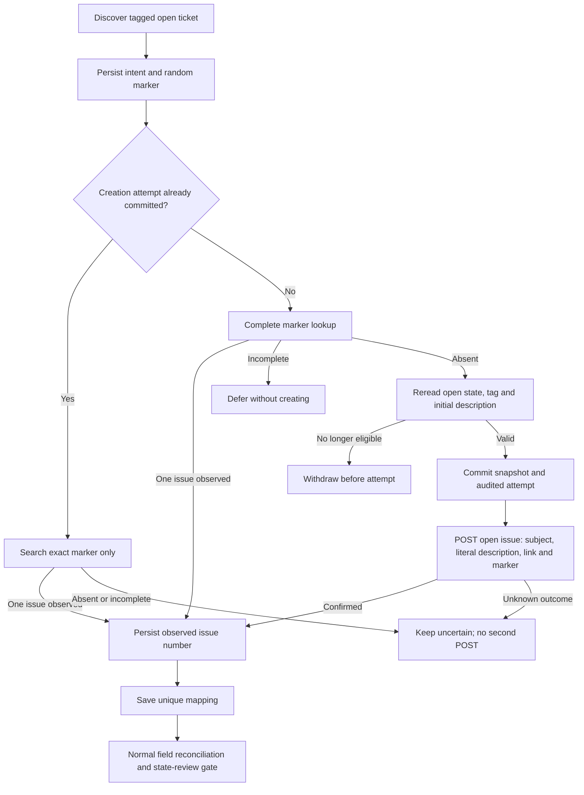

# Zendesk-first engineering intake

Support starts an escalation from one Zendesk ticket. A support person adds `support_bridge_escalate` when engineering is needed. The bridge creates an open GitHub issue and persists the mapping before ordinary reconciliation. No model classifies the ticket, selects a destination or grants approval. Our [primary scenario](SCENARIO.md#start-in-zendesk) gives the screen-by-screen demonstration.

## Customer context and value

We assume a B2B support team handles customer conversations in Zendesk and engineering work in one configured GitHub repository. Most support questions do not need engineering. Explicit tagging records that routing decision and avoids copying the subject, creating an issue and entering two IDs manually. Reduced copying and fewer lost escalations are expected benefits; customer adoption and time savings remain unmeasured.

## Enable operation

Use the existing `support-bridge-live-demo` project, both Compose files and its private deployment env file. Preserve its state, credential and monitoring volumes. First inspect existing pairs and all tickets carrying the intended tag: enabling intake authorizes creation for every eligible, unlinked matching ticket, not only the currently displayed ticket.

Add these non-secret settings to the private file:

```dotenv
COMPOSE_PROFILES=oauth-renewal,live-worker
BRIDGE_ZENDESK_INTAKE_ENABLED=1
BRIDGE_ZENDESK_ESCALATION_TAG=support_bridge_escalate
BRIDGE_LIVE_SWEEP_INTERVAL=60
```

Keep `oauth-renewal` for managed credentials; otherwise select only the profiles actually configured. GitHub requires repository Issues read/write and Zendesk needs ticket read/write access. Credentials remain outside source. This feature does not renew GitHub credentials or change their expiry.

```bash
docker compose --env-file /absolute/private/live-demo.env -p support-bridge-live-demo -f compose.yaml -f compose.live-demo.yaml up --build -d --wait
docker compose --env-file /absolute/private/live-demo.env -p support-bridge-live-demo -f compose.yaml -f compose.live-demo.yaml ps
docker compose --env-file /absolute/private/live-demo.env -p support-bridge-live-demo -f compose.yaml -f compose.live-demo.yaml logs --tail=20 worker
```

There is one worker service, running intake before reconciliation. It waits 60 seconds after finishing a pass, rather than guaranteeing a pass starts every 60 seconds. No additional polling daemon or traffic generator is required. Queries, Swagger, bootstrap, credential renewal and metric scrapes never run intake. Stop `worker` to pause scheduled effects without stopping monitoring; the enabled authenticated intake command remains available to an operator.

The live worker can process every eligible existing pair. Conflicts, retry budgets and state approval waits remain effective. Do not start it merely to bypass a review checkpoint. Native local-provider mode does not support vendor intake.

## Initial description and issue body

The initial description is Zendesk's ticket `description` field: the first comment, rather than the latest reply or complete conversation. See the [Tickets API](https://developer.zendesk.com/api-reference/ticketing/tickets/tickets/). Discovery keeps metadata only. Before the first creation attempt, a fresh ticket read validates the full initial description and saves it in `snapshot.initial_description` alongside the observed fields/version before the audited POST. Missing/null text is unknown and prevents creation; an actual empty string gets an explicit empty-description message.

`EngineeringIssueBody` is the shared formatter for creation and reviewed maintenance. It emits **Zendesk ticket N** as an explicit Markdown link to the Zendesk agent URL, avoiding a bare `#N` that GitHub would interpret as a repository reference. The description is copied verbatim inside a dynamically sized text fence, so embedded Markdown, mentions and reference numbers remain literal. Source instructions are data and are never executed or used for approval. This preserves text while sacrificing original rich-text rendering. Attachment URLs remain text; their contents are not fetched.

Initial description text is limited to 30,000 UTF-8 bytes, with no NUL bytes or silent truncation. The formatter keeps the resulting body below 62,000 bytes, including a fence longer than embedded fence runs. This bound also covers pathological fence input and is separate from the 500-byte title rule. The first comment can be internal: the escalation tag opts this initial content into the repository transfer and does not establish redaction, permitted disclosure or compliance.

This is a creation-time copy. Later source edits/redaction, replies and internal notes do not rewrite GitHub issue bodies; linked older issues are not automatically backfilled. Unattempted prepared work reads the source again before creation. Existing attempted/uncertain/linked snapshots keep their exact historical shape and marker; recovery never creates another issue to add missing text. `initial_description` is optional in read contracts for legacy and discovery-only snapshots. A separately authorized existing-issue repair must preserve custom body edits, mapping, recovery marker and pending work, use an audited body-only update, and verify the result.

## Architecture overview

`IntakeEscalations` is a typed application command shared by CLI, API and worker. `IntakeFactory` constructs vendor capabilities only for that command. `ListEscalations` is a provider-free query. `TicketSource` isolates Zendesk discovery/fresh reads; `EngineeringIssues` isolates exact-marker lookup and creation. The ordinary reconciliation `Provider` interface still exposes fetch/patch, not creation.

`EscalationWorkflow` uses the existing canonical business lock and `EscalationRepository` uses the context's existing SQLite connection. An additive `escalations` table retains the ticket ID, generated pair name, random marker, source fields/version, observed issue number, attempted timestamp, schedule and error. Existing pair plans and approval JSON are unchanged. Audit transitions commit with their corresponding ledger update; an audit failure prevents subsequent effects. These mutable local events are not an external audit service.



### Eligibility and data transfer

- Discovery lists a page of accessible non-archived tickets using the ticket-scoped endpoint, newest IDs first, and filters the configured exact tag and open state locally. Untagged subjects are not validated or retained. The vendor response can include unrelated ticket content in memory; the ledger retains only eligible snapshots. Fresh reads require canonical open (`new`, `open`, `pending` or `hold`) and the same tag before the first create request.
- Removing the tag or solving the ticket before creation withdraws the prepared intent. Retagging an unattempted withdrawn intent can prepare it again. After creation, removing the tag does not unlink, delete or stop reconciliation of the mapped pair.
- The created issue is open by default. Its title is the subject; its body contains an explicit Zendesk ticket link, the initial description as literal text and the existing random recovery marker. Subsequent Zendesk replies/internal notes, attachment bytes, requester identity and other metadata are not copied. Subjects, initial descriptions and tenant-bearing links can be sensitive, especially in a public repository. The operating owner must approve that destination.
- A pair is named `zendesk-<ticket number>`. Existing manual mappings take precedence; matching titles never infer a link. Uniqueness rejects multiple mappings for the same remote ID. Manual `link` remains available for verified legacy records and recovery.
- Creation opt-in permits that open issue and subsequent title synchronization. It never authorizes a closing/reopening write or resolves a conflict. Concurrent ticket changes between fresh read and POST can still produce an initially differing pair; reconciliation applies its normal baseline/conflict rules.

### Recovery and failure states

| Intake state | Meaning and next action |
| --- | --- |
| `prepared` | Intent is durable; no create attempt committed. Lookup and fresh eligibility checks may be retried. |
| `creating` | Audited attempt committed before POST. A crash can leave it here whether or not GitHub accepted creation. Recovery reads first. |
| `uncertain` | Creation is unconfirmed. Search the persisted marker; never automatically send a second POST. |
| `linked` | GitHub ID observed and mapping stored. This says nothing about customer resolution or current convergence. |
| `blocked` | Pair name, issue or ticket mapping conflicts with existing local state. Inspect both mappings before recovery. |
| `withdrawn` | Eligibility disappeared before creation; no POST was sent. |

The marker is persisted before any create request. It is visible in the GitHub issue body and is correlation evidence, not a secret or an authorization token. Recovery lists repository issues in every state and matches the exact marker in the body; it does not use eventually indexed GitHub search. Duplicate matches and malformed/incomplete listings stop preflight. A confirmed issue number is saved before linking, so a crash or link-audit failure can resume without creating another issue. If the mapping committed but ledger finalization failed, the next pass observes the mapping and completes it.

Unknown outcome includes a timeout or a rejected create request whose response cannot confirm a created issue. Even when later lookup finds nothing, the bridge preserves uncertainty rather than assuming no issue exists. Inspect the repository and current ledger. If an issue can be verified independently, an operator may explicitly link those existing IDs with the normal `link` command; a later pass can acknowledge that mapping. If the saved issue ID disagrees with the mapping, it remains blocked. Do not delete the attempt, marker or ledger row to force a resend. There is no automatic reset or retry-create endpoint for uncertainty.

Vendor failures persist an intake-wide cooldown of at least 60 seconds, honoring longer `Retry-After` values. This limits repeated discovery/preflight calls without modifying reconciliation retry budgets or approvals. Uncertain-marker absence is revisited on its own due time. Discovery failure may delay recovery too; the flow is conservative and serial.

## Inspect without changing records

```bash
docker compose --env-file /absolute/private/live-demo.env -p support-bridge-live-demo -f compose.yaml -f compose.live-demo.yaml run --rm --no-deps cli escalations
docker compose --env-file /absolute/private/live-demo.env -p support-bridge-live-demo -f compose.yaml -f compose.live-demo.yaml run --rm --no-deps cli inspect zendesk-TICKET_NUMBER
```

The authenticated API offers `GET /api/escalations?limit=50&offset=0` and pair inspection. The listing contains sensitive snapshots and markers. CLI `escalations` returns the first 50 ledger rows; the API provides further pages. A deliberately authorized `intake` CLI command or `POST /api/intake` with `{}` runs one effectful pass. Its summary is per-pass, with `discovered`, `linked`, `waiting`, `skipped`, `truncated` and `deferred`; it is not the total queue. See [API contracts](API.md).

[Grafana](http://127.0.0.1:1990/d/supportbridge-overview?refresh=5s) shows fixed-state intake totals and every stored mapping in **All linked ticket and issue pairs**. A newly linked ticket appears automatically by numeric Zendesk/GitHub ID after the next scrape/refresh. Prepared or uncertain intents without a mapping appear only in intake totals. Numeric IDs are monitoring data; internal pair keys, titles and markers stay excluded. See [metric trade-offs](OBSERVABILITY.md#trade-offs-and-data-exposure). **Operator attention** includes creating/uncertain/blocked intake records as well as pair approval/conflict/dead work; one escalation can contribute to both. A transient creating intent can appear while an issue is being created. Monitoring never supplies approval.

## Trade-offs

| Decision | Benefit | Cost |
| --- | --- | --- |
| Explicit support tag | Clear deterministic engineering opt-in; avoids routing every ticket | Anyone allowed to add that tag can initiate creation; no independent per-person authorization |
| Polling in the existing worker | Reuses lock, credentials and operating service | Vendor visibility, work duration and page rotation add delay; no webhook delivery |
| Initial problem text plus source link | Engineering can read the original report without opening another system | Duplicates potentially sensitive text; later conversation and corrections still need the source |
| Durable nonce and held uncertainty | Avoids a blind duplicate after a lost response | Genuine failures before issue creation can remain held for an operator |
| Additive SQLite ledger | Crash evidence shares existing single-host persistence | No cross-provider transaction, distributed exactly-once delivery or tested disaster recovery |
| Fixed-state aggregate metrics | New tickets are observable without leaking IDs/titles | Individual new records need authenticated inspection rather than a named dashboard row |

## Known limitations

Zendesk discovery requests one 50-ticket page per pass, newest IDs first, rotates through at most 20 pages, and reports `truncated` when more results remain at our 1,000-ticket cap. The [ticket-list API](https://developer.zendesk.com/api-reference/ticketing/tickets/tickets/#list-tickets) uses existing ticket read access; search returned 403 with the selected ticket-scoped credential in a live preflight, so we do not broaden scopes for discovery. Archived and agent-inaccessible tickets are excluded by the vendor. Offset pagination is not a consistent snapshot; new/removed results can move between pages. Tagged tickets outside the latest 1,000 accessible non-archived tickets may never be discovered. A larger deployment needs incremental/cursor discovery or a separately designed webhook path. The 1,000-ticket bound is our operating limit, not the listing endpoint's overall capacity.

Each pass handles up to five recovery and five prepared intents; discovery, lookup and fresh reads also consume API requests. Recovery scans at most five 100-entry pages from [GitHub repository issues](https://docs.github.com/en/rest/issues/issues), including pull requests in that listing's page budget. More than 500 entries makes absence unprovable within the bound and blocks new creation. Listings can change while paging; vendor consistency is not an exactly-once guarantee. Uncertain/blocked records are retained without an age limit or automatic deletion.

The durable evidence must survive. Database loss, inconsistent restoration, manual duplicates, marker removal or copying a marker to another issue can prevent safe recovery. The local lock prevents competing local workers, not vendor-side changes or other applications. There is no automatic ticket-to-many-issues mapping, automatic deletion, classification, priority/assignee routing, Zendesk-to-GitHub comment synchronization, requester redaction, per-ticket vendor credential or per-user approval identity.

Tenant-required fields and notification triggers still need account-specific validation. Automated issue creation can notify repository subscribers. Use authorized fictional records for demonstrations. Controlled tests are not production capacity, customer-policy validation or a compliance decision.

## Verification and AI use

`tests/intake.php` exercises tagged creation, duplicate scans, withdrawal, durable unknown outcomes, restart/link-audit recovery, canonical locking, mapping collisions, cooldown, bounds, malformed responses, HTTP capabilities, provider-free queries and the unchanged state approval gate. The loopback server checks the published HTTP contract; disposable container checks validate wiring without vendor access. Dated actual results belong in [REVIEW.md](REVIEW.md), separately from selected live observations.

AI assisted implementation, adversarial-case review and documentation as disclosed in the [README](../README.md#ai-use). Execution uses fixed PHP decisions. **Never rely on AI in compliance:** no model may decide policy satisfaction, authorize creation or a state write, choose a conflicting source or supply operator approval. Passing tests does not establish those organizational controls.
