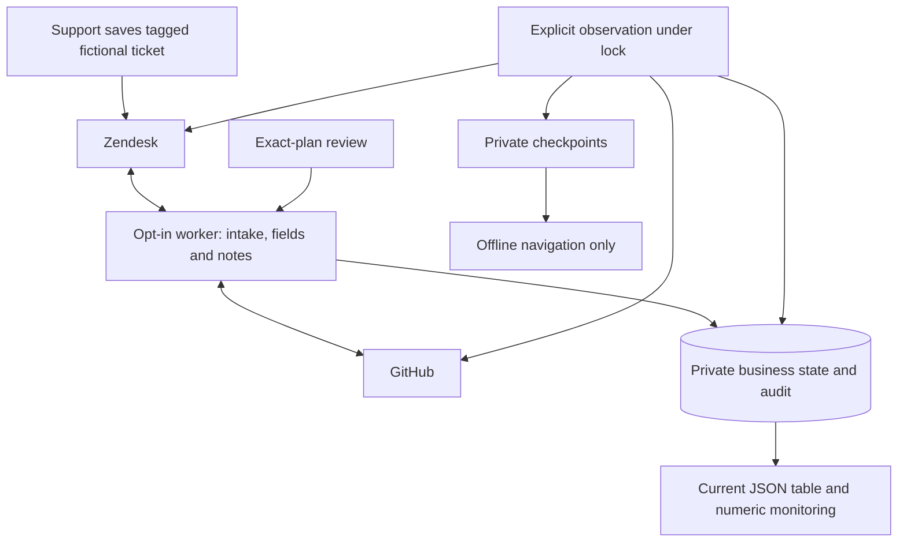

# Guided live demonstration and recorded replay

We demonstrate an escalation by changing owned synthetic records in GitHub and Zendesk, running the ordinary reconciliation workflow, and capturing what both providers and the bridge actually report. The [CSV-export case](SCENARIO.md) remains the primary customer narrative. This guide supplies the deployment and evidence procedure; it does not declare that the full live sequence has been completed.

## Customer context and value

Our assumed customer operates a B2B reporting service. Support tracks a failed large CSV export in Zendesk, while engineering tracks its investigation in GitHub. The teams need a shared summary and resolution state without repeatedly copying updates. We expect fewer stale escalations and less copying; a customer pilot must measure that value.

The original three prepared cases provide a bounded narrative set. New tagged-ticket escalations use the same workflow and appear automatically in the all-pairs dashboard; this is not an allowlist:

| Case | Prepared GitHub source | Purpose |
| --- | --- | --- |
| Large CSV export | [Issue 19](https://github.com/AlbertFlorescu/support-bridge/issues/19) | Primary summary, resolution and reopening case |
| Duplicate webhook delivery | [Issue 20](https://github.com/AlbertFlorescu/support-bridge/issues/20) | A second independent escalation |
| Expired SSO session | [Issue 21](https://github.com/AlbertFlorescu/support-bridge/issues/21) | Competing summary edits and explicit source selection |

We created and read back three matching fictional Zendesk tickets, established all three baselines, and exercised both title directions and an explicitly approved mixed title/state plan for the CSV-export pair. The [verification record](REVIEW.md#live-demonstration-verification-2026-10-28) states that bounded evidence. Actual ticket IDs, mappings, checkpoints and media remain private. Reopening, conflict resolution and injected reliability cases in the broader walkthrough are separate demonstrations; account-specific validation, customer benefit and production readiness remain open questions.

## Explicit assumptions and authority

- We have permission to create and edit the chosen fictional records in both accounts. We check account rules and notification behavior before creating them; an internal note alone does not disable every tenant trigger.
- A setup actor creates or edits source records using the relevant vendor credential. It receives no bridge operator credential or approval capability. These source actions occur outside the bridge's outbound approval gate.
- An operator verifies each existing issue/ticket mapping before linking it. Similar titles do not establish identity. The reconciliation provider interface has no remote-create operation.
- Title/subject and binary resolution state synchronize both ways. Explicitly enabled [GitHub comment delivery](COMMENTS.md) appends internal Zendesk notes once per source comment. Intake copies the initial Zendesk description once into a newly created issue. Later Zendesk conversation/description edits, tags and setup markers are not mirrored into GitHub. Historical issue comments are eligible when enabling; inspect source content first.
- The live project has its own state, credentials and monitoring history. We preserve both local projects and never import their numeric IDs or baselines into live state.
- Every outbound state-changing plan waits for explicit exact-plan approval. Conflicting sources require an explicit decision over fresh evidence. We do not use scripted synthetic approval in live mode.

The Zendesk ticket scopes cover tickets the client-associated account can access; they are not limited to these three IDs. A fine-grained GitHub token limits repository write authority, but the shared bridge operator credential still provides broad application authority. Neither credential proves individual human review or separation of duties. [Governance](GOVERNANCE.md) records these limits and policy ownership.

## Architecture overview



The live overlay uses the same engine, typed application commands/queries, persistence and governance policy as local execution. Its guarded `live-init` role requires both live mode and explicit demo enablement. It initializes bound schemas and separate bootstrap credentials without constructing providers, fetching records, creating fixtures, linking pairs or reconciling them.

Checkpoint capture is an explicit observation operation, not a local query handler. It acquires the canonical application lock, reads local inspection, then fetches the two provider records sequentially. It does not synchronize, approve, select a source or advance the baseline. Remote users can still edit between those reads; the snapshot is not atomic across vendors. Optional Prometheus queries happen separately and are best effort.

## Select the isolated live project

This is our one normal operating deployment: the existing `support-bridge-live-demo` project, retaining its linked cases, account, credentials and volumes. Use Docker Engine with Linux containers and Compose 2.24.4 or later. Keep the private env file, explicit project name and both Compose files with every live command. The [connection reference](DOCKER.md#choose-a-stack-and-its-ports) gives the canonical ports. The former local and traffic projects remain stopped with their volumes parked; their state is never imported or merged into this project.

| Service | Live default host address | Inside its network |
| --- | --- | --- |
| API and Swagger | [127.0.0.1:1988/docs](http://127.0.0.1:1988/docs) | `api:8080` |
| Prometheus | [127.0.0.1:1989](http://127.0.0.1:1989/) | `prometheus:9090` |
| Grafana overview | [127.0.0.1:1990](http://127.0.0.1:1990/d/supportbridge-overview) | `grafana:3000` |

Create a private deployment env file outside source. It contains account identities, not credential values. For example, after replacing every placeholder:

```dotenv
BRIDGE_GITHUB_REPOSITORY=owner/demo-escalations
BRIDGE_ZENDESK_SUBDOMAIN=demo-sandbox
BRIDGE_ZENDESK_AUTH=oauth
BRIDGE_LIVE_HTTP_PORT=1988
BRIDGE_LIVE_PROMETHEUS_PORT=1989
BRIDGE_LIVE_GRAFANA_PORT=1990
```

The live project stores its two vendor access tokens in a separate named `vendor-secret` Docker volume. Only API, explicit CLI and the opt-in worker mount that volume read-only at `/run/secrets/vendor`; their file settings point to `github-token` and `zendesk-token` inside it. Initialization, Prometheus, Grafana and smoke verification receive no vendor credential volume. The confidential client identifier/secret are imported only into `issuer-secret` for the isolated renewer. Application readers receive access credentials, never issuer configuration; monitoring receives neither.

Issue and [import the access tokens](#import-access-tokens-into-the-live-project) before starting the three persistent services and one-shot initializer. Review the account identities and selected Compose project first:

```bash
docker compose --env-file /absolute/private/live-demo.env -p support-bridge-live-demo -f compose.yaml -f compose.live-demo.yaml up --build -d --wait
docker compose --env-file /absolute/private/live-demo.env -p support-bridge-live-demo -f compose.yaml -f compose.live-demo.yaml ps
docker compose --env-file /absolute/private/live-demo.env -p support-bridge-live-demo -f compose.yaml -f compose.live-demo.yaml run --rm --no-deps cli status
```

The background worker is disabled on a fresh configuration until the `live-worker` profile is selected. For the Zendesk-first flow, enable it together with intake as described in [intake operation](INTAKE.md). Stop it only when deliberate manual checkpoints require pausing effects. No traffic generator is present. Enabling the profile starts intake and reconciliation immediately; it is not a read-only action. `BRIDGE_LIVE_SWEEP_INTERVAL` controls its delay, defaulting to 60 seconds. Do not enable it to bypass a review wait.

Keep the private env file at the canonical 1988/1989/1990 host ports. Shell values for `BRIDGE_LIVE_HTTP_PORT`, `BRIDGE_LIVE_PROMETHEUS_PORT` and `BRIDGE_LIVE_GRAFANA_PORT` can override it, so confirm actual bindings. Loopback bindings and internal service ports remain unchanged. Port consolidation and recreation authorize no new source edits, synchronization or approvals. Ordinary stop/down retains this project's volumes; never remove parked or live volumes as routine cleanup.

## Automatic Zendesk token renewal

For the existing live deployment, [enable the isolated renewal service](OAUTH.md#enable-renewal-for-the-existing-live-deployment) by adding `oauth-renewal` to the private profile list while retaining any already enabled `live-worker` profile. Do not replace the existing list or enable a fresh worker implicitly. The same two Compose files and project identity apply. The `oauth-credentials` importer writes only the new issuer volume; `zendesk-token-renewer` alone reads that client configuration and publishes the managed access-token bundle. API, CLI and worker read the current bundle before each Zendesk request without receiving the client secret.

Renewal uses ticket-only scopes and fixed HTTPS issuance. It does not run synchronization, edit vendor records, approve a plan or reset business retry budgets. Its Docker health requires recent loop progress and a usable token. Host downtime, client revocation or vendor failures can still interrupt access. The [renewal guide](OAUTH.md) documents initialization, mode selection, recovery, verification and the shared vendor-volume limitation.

## Credentials and manual OAuth issuance

Use a short-lived fine-grained GitHub token restricted to the chosen repository with Issues read/write and the required Metadata read permission. Keep it in `github-token`, outside source and command output. The selected repository may contain private titles; do not substitute an unrestricted account token merely to simplify setup.

For Zendesk, create a confidential client through **Admin Center → Apps and integrations → APIs → OAuth clients**, restrict its allowed scopes to `tickets:read` and `tickets:write`, and privately retain its identifier and one-time secret. The name `Support Bridge Demo` and identifier `support-bridge-demo` describe this integration. Follow the [client registration guide](https://support.zendesk.com/hc/en-us/articles/4408845965210-Using-OAuth-authentication-with-your-application); secret creation and account permission changes require the account owner's authorization.

The following helper is for explicit manual/native compatibility mode. Managed deployments use [automatic renewal](OAUTH.md) instead of repeating these steps. Run the repository's development helper with PHP and cURL on a POSIX filesystem. Its ordinary client files must be private, normally mode `0600`, and its existing output directory mode `0700`. Windows ACLs are not a substitute for those checked POSIX mode bits; use a private Linux/WSL directory for issuance when needed.

```bash
php tools/oauth/issue-zendesk-token.php \
  --subdomain=demo-sandbox \
  --client-id-file=/absolute/private/issuer/zendesk-client-id \
  --client-secret-file=/absolute/private/issuer/zendesk-client-secret \
  --output=/absolute/private/issuer/zendesk-token
```

The helper requests exactly `tickets:read tickets:write` for **14,400 seconds**, verifies the returned scope and a lifetime no longer than requested, and atomically writes a `0600` access-token file. It prints status, scope and expiry only. It does not create the client, start services, synchronize records or change file ownership. It uses verified HTTPS, fixed tenant hosts, bounded transport and no redirects.

Zendesk's [client-credentials grant](https://developer.zendesk.com/api-reference/ticketing/oauth/grant_type_tokens/#client-credentials-grant-type) associates the token with the client account and returns no refresh token. The manual helper does not schedule renewal; the optional isolated credential service repeats this same grant before managed access expires. The client secret remains useful for issuance until revoked; access-token expiry is a different control.

Keep issuance inputs under the issuing operator's ownership. The import command below creates the deployed copies under UID10001. It preserves private host files and avoids a dependency on Docker being able to bind-mount their host filesystem.

### Import access tokens into the live project

The explicit `credentials` service belongs to the `tools` profile and is started only when named. It runs as UID10001 with networking disabled, a read-only root filesystem and dropped capabilities. Its only persistent mount is the live project's `vendor-secret` volume, writable at `/var/lib/support-bridge` for import. It cannot read the business, operator, scrape or Grafana volumes.

Build its runtime image, then send a small JSON object through standard input. The only accepted keys are `github-token` and `zendesk-token`. Read each value from its private host file; keep credential values out of command arguments, env files, shell tracing and terminal output. This PowerShell example uses placeholder paths that must be replaced:

```powershell
docker compose --env-file C:\private\live-demo.env -p support-bridge-live-demo -f compose.yaml -f compose.live-demo.yaml build credentials

$credentialInput = @{
    'github-token' = [IO.File]::ReadAllText('C:\private\github-token').Trim()
    'zendesk-token' = [IO.File]::ReadAllText('C:\private\zendesk-token').Trim()
}
$credentialInput | ConvertTo-Json -Compress |
    docker compose --env-file C:\private\live-demo.env -p support-bridge-live-demo -f compose.yaml -f compose.live-demo.yaml run --rm --no-deps -T credentials
$credentialInput = $null
```

The importer requires live mode and explicit demo enablement. It validates the complete bounded input and both destination file types before replacing either credential. Values must be nonempty, at most 4,096 bytes and contain no whitespace or control characters. Its directory is mode `0700` and ordinary token files mode `0400`, owned by the importing application UID. It rejects symbolic links and non-file destinations, preserves unchanged token bytes, and writes changed files with a private temporary file, flush, filesystem sync and atomic rename. It prints only a fixed success or failure result. It does not construct providers, open business state, fetch records, link pairs, reconcile or approve work.

The two manual file replacements are individually atomic; rotating both credentials is not one transaction. If import fails, complete a successful import before recreating readers. This importer does not configure the confidential client or replace the managed OAuth bundle; use `oauth-credentials` and the renewer for that mode. The volume contains plaintext credentials protected by local permissions and its reader set; it is not encrypted Docker Secrets storage or a secret manager. Preserve it with the other live-project volumes during ordinary stop/down operations.

### Rotate an expiring access token

This procedure applies to manually supplied token files. Managed Zendesk renewal publishes a new bundle automatically and its per-request readers need no restart. For manual mode, reissue the Zendesk access token before its expiry, then repeat the import with the current private GitHub and Zendesk access-token files. In manual mode the OAuth client identifier and secret stay on the issuing host; managed mode keeps them in the isolated issuer volume. After a successful import, **recreate the API and any credential-reading worker/CLI containers** because their processes loaded the previous files into their environment at startup. For the default live topology:

```bash
docker compose --env-file /absolute/private/live-demo.env -p support-bridge-live-demo -f compose.yaml -f compose.live-demo.yaml up -d --no-deps --force-recreate api
```

New `run --rm` CLI containers load the current volume files. If the worker was deliberately enabled, recreate it with the same profile and deployment configuration too. An expired or revoked token can leave work requiring intervention; inspect its current evidence and correct the credentials before an explicit retry. Retry does not grant approval or resolve a conflict.

The live overlay defaults to `BRIDGE_ZENDESK_AUTH=oauth`, with no email required. Native live deployment must select OAuth explicitly; the provider factory retains `api-token` as its compatibility default when that setting is absent. Legacy API-token mode requires `BRIDGE_ZENDESK_EMAIL` and is usable only where the vendor account still permits it. The `zendesk-token` file always holds the chosen access credential, never the client secret. The helper is development tooling and is absent from the runtime image.

## Run the customer checkpoints

For new escalations, use [Start in Zendesk](SCENARIO.md#start-in-zendesk): create the fictional ticket, add `support_bridge_escalate`, and let the explicitly configured worker create and link the issue. [Intake setup](INTAKE.md) describes enablement and failure recovery. The following paired-source setup is retained only for existing fixtures, migration and controlled recovery; it is not required on the normal new-ticket path.


Create each fictional source record separately, read it back, and record the actual IDs. Use identical supported canonical fields initially when the intention is to establish a common baseline. Retain stable setup markers so a repeated setup can find existing demo records instead of creating duplicates. Tenant-required fields and notification triggers need account-specific checks.

Review the chosen mapping, then link only existing records. Replace these example IDs with the verified values:

```bash
docker compose --env-file /absolute/private/live-demo.env -p support-bridge-live-demo -f compose.yaml -f compose.live-demo.yaml run --rm --no-deps cli link csv-export 123 456
docker compose --env-file /absolute/private/live-demo.env -p support-bridge-live-demo -f compose.yaml -f compose.live-demo.yaml run --rm --no-deps cli inspect csv-export
```

Linking makes no live provider request, but opts that mapping into subsequent title-only synchronization. `sync` processes every eligible linked pair in the selected live project, not just the displayed pair. Inspect all existing work before running it.

Follow [the eight customer checkpoints](SCENARIO.md#eight-checkpoints), capturing before and after each deliberate action:

1. Establish the baseline from equal source fields with an explicit sweep.
2. Change one owned source title, sweep, and read both vendors back to verify the actual transfer.
3. Prepare a source state transition and inspect the resulting whole-plan approval wait. A source edit already performed in a vendor is outside the outbound bridge gate.
4. Stop for an operator to review the exact durable plan and supply its hash and rationale. A later sweep still checks freshness before writing.
5. Demonstrate reopening through the same gate if it is permitted for the chosen records.
6. Use the local reliability demo for injected lost-response faults. The live adapter has no demonstration-only fault endpoint; do not claim an injected vendor outage merely from a local test.
7. Create competing owned source titles, capture the actual conflict, and stop for a fresh operator source decision. Source selection queues a plan and cannot approve a state transition.
8. Capture a later converged no-op sweep; no-op observations increase reconciliation totals without proving another useful update.

Use `sync` only with authorization for the selected live records. An approval wait exits `2`; retry work exits `3`. Do not change saved plans, approval records, retry times or baselines to force progress. A changed account rule, unexpected record or failed credential is evidence to inspect, not a reason to fabricate a successful checkpoint.

## Capture and render actual observations

Create a private `evidence/` directory in this project's application volume. This explicit filesystem operation creates no link, approval or reconciliation work. It also avoids host bind requirements on Docker Desktop installations where the source checkout or host credential directory cannot be mounted:

```bash
docker compose --env-file /absolute/private/live-demo.env -p support-bridge-live-demo -f compose.yaml -f compose.live-demo.yaml run --rm --no-deps \
  --entrypoint php cli -r 'umask(0077); $path="/var/lib/support-bridge/evidence"; if (is_link($path) || (!is_dir($path) && !mkdir($path,0700)) || !chmod($path,0700)) { exit(1); }'
```

Capture runs in a fresh CLI container with the live project's existing state and read-only vendor credential mount:

```bash
docker compose --env-file /absolute/private/live-demo.env -p support-bridge-live-demo -f compose.yaml -f compose.live-demo.yaml run --rm --no-deps \
  --entrypoint php cli \
  /app/bin/capture-demo.php csv-export \
  --output=/var/lib/support-bridge/evidence/evidence.json --run=csv-export-live \
  --label='Baseline observed' --operation='Read the linked records after the baseline sweep' \
  --prometheus-query-url=http://prometheus:9090 \
  --prometheus-url=http://127.0.0.1:1989 --grafana-url=http://127.0.0.1:1990
```

Repeat capture with a label and operation that describe what actually happened. Labels are limited to **200 UTF-8 bytes**, operations to **500**. One archive accepts at most **100 checkpoints** and **2 MiB**. Its run ID, mode, repository and Zendesk subdomain must remain the same; it rejects appending to an older archive without tenant binding. Choose a new output/run for a different deployment rather than modifying recorded identity.

The archive contains provider titles, versions, baseline, pending target/preimages, current governance state and a bounded allowlist of recent operational events. It excludes credentials and free-form approval rationale. Filtered nonempty errors retain a visible `details_omitted` indicator. Event order preserves insertion order within the same timestamp second. A checkpoint's label and operation are descriptive text supplied by the operator, not execution evidence by themselves.

Optional telemetry contains only aggregate scrape health, pair-state counts, pending-plan count and reconciliation totals. If a query fails, capture omits telemetry rather than inventing zeros. Scraped aggregates can lag the inspected pair's state and include other pairs. Provider reads, local inspection and Prometheus samples are not one cross-system transaction. Browser monitoring origins must use loopback; `prometheus` is accepted only as the internal query transport host.

Export the archive from the running API container into an existing private host directory. `compose cp` reads the existing volume; it does not invoke synchronization or expose the archive through HTTP:

```bash
docker compose --env-file /absolute/private/live-demo.env -p support-bridge-live-demo -f compose.yaml -f compose.live-demo.yaml \
  cp api:/var/lib/support-bridge/evidence/evidence.json /absolute/private/evidence/evidence.json
```

Use paths understood by the Docker CLI's host. A Windows Docker CLI expects a Windows output path even when launched from WSL. Protect the host output directory before exporting, and retain the captured JSON only for the agreed demonstration period. Files in the application volume remain sensitive artifacts separate from the business SQLite files; they are not complete business backups.

If the host copy operation rejects a private path or reparse point, stream only the archive through the existing API container and write its captured stdout privately. For example, in PowerShell with the selected deployment arguments and private paths already set:

```powershell
$captured = docker compose --env-file $deployment -p support-bridge-live-demo -f compose.yaml -f compose.live-demo.yaml exec -T api php -r 'readfile("/var/lib/support-bridge/evidence/evidence.json");'
if ($LASTEXITCODE -ne 0) { throw 'Evidence export failed.' }
[IO.File]::WriteAllText($output, ($captured -join "`n"), [Text.UTF8Encoding]::new($false))
```

This does not fetch providers or execute the workflow. Keep the output out of terminal transcripts and public build artifacts. The source archive and exported copy still need the same privacy controls.

Render the exported archive on a development host with Node, outside the runtime container:

```bash
node tools/demo-viewer/render.cjs \
  --input /absolute/private/evidence/evidence.json \
  --output /absolute/private/evidence/replay.html
```

The [viewer contract](../tools/demo-viewer/README.md) describes the allowlisted input and presentation controls. **Next, Previous and Play only select recorded checkpoints.** They make no provider requests, execute no workflow and supply no approval. The HTML is self-contained and disables network requests and form submission through its content security policy. Monitoring links open current dashboards independently of the recorded checkpoint.

The renderer omits `run.zendesk_subdomain` from HTML metadata, but optional Zendesk record links still reveal their tenant and IDs. Titles and operational snapshots can also be sensitive. Keep JSON, HTML, screenshots and video in private artifact storage; review the retained content before sharing. A video of playback is a recording of captured observations, not a live execution. These files are mutable presentation artifacts, not a tamper-evident audit, compliance decision or complete business backup.

## Monitoring and verification

The current all-pairs table uses `/monitoring/pairs` directly through Grafana’s pinned backend datasource; it shows stored verified subjects and clickable source IDs. Prometheus supplies numeric totals/history for the other panels. A new link needs only the next table refresh; metric panels may wait for a scrape. [Observability](OBSERVABILITY.md) owns the exact contract.

Open the live project's [Grafana login on port 1990](http://127.0.0.1:1990/login), using the live project's persisted account. Only a fresh database starts with `admin` and its generated password. The [Grafana sign-in guide](DOCKER.md#sign-in-to-grafana) includes the explicit live bootstrap command and account-rotation limits. Keep `127.0.0.1` consistent. Compose assigns a project-specific login cookie name; applying that setting requires Grafana recreation and one fresh sign-in while preserving its accounts and data. For older deployments still sharing a cookie name across ports, diagnose in an independent browser session.

Read [Grafana's panel meanings](SCENARIO.md#reading-the-dashboard-during-the-case) together with the actual provider records and authenticated inspection. A healthy scrape means the exporter is reachable. Operator attention counts current conflicts, dead work and approval waits; throughput includes no-op polls. The all-pairs table includes every saved mapping, its last verified subject, clickable Zendesk/GitHub source numbers and delivered/waiting internal-note counts automatically. It uses protected read-only JSON context through the pinned Infinity backend, with no new vendor requests or titles in Prometheus labels. A pending edit may differ from the displayed verified subject. Only numeric vendor IDs label per-pair gauges; internal pair keys, titles, hashes and rationales remain excluded. IDs are retained in monitoring data, with seven series per link; see [exposure and scaling trade-offs](OBSERVABILITY.md#trade-offs-and-data-exposure).

After at least one explicit link exists, the live project's smoke check can validate API authentication, inspection, scrapes and Grafana provisioning without provider access or business writes:

```bash
docker compose --env-file /absolute/private/live-demo.env -p support-bridge-live-demo -f compose.yaml -f compose.live-demo.yaml --profile test run --rm --no-deps smoke
```

Smoke assumes Grafana's `admin` bootstrap account and generated password. It does not validate an account that was renamed or rotated. Verify the actual browser login for the intended project without resetting its database. The [container verification and disposable lifecycle checks](DOCKER.md#verification) remain required for container changes; they use isolated local state, not these vendor records.

Offline OAuth, live-bootstrap and replay checks test our own contracts. Source creation, authenticated reads, actual writes, convergence, vendor triggers and customer outcomes are separate evidence categories. Keep executed test counts and hosted CI results in [REVIEW.md](REVIEW.md), and account-specific run evidence outside source.

On a shell with Docker, `sh docker/check-live-demo.sh` exercises the actual credential importer, live initializer and fresh CLI readers in a uniquely named disposable project. It uses fake access tokens, disables outbound access for the test network, keeps the importer networkless, verifies read-only private credential mounts and rotation, and never creates links or runs synchronization. Cleanup removes only that check's own containers and volumes; it does not validate vendor accounts.

## Trade-offs

- One live deployment keeps the three linked cases and monitoring together. Retaining its state separately from disposable test fixtures prevents accidental imports, while private credentials still need an explicit lifecycle.
- Tagged intake removes manual issue creation and linking from new escalations. The existing worker polls before reconciliation, adding search-index and scheduling delay; manual sweeps remain available for deliberately controlled checkpoints. Both paths preserve the same review and retry gates.
- Ticket-only OAuth scopes reduce resource access but still grant broader ticket capabilities than this bridge uses. We have no per-pair vendor credential or per-user operator role.
- A private credential volume avoids host bind-mount and host UID compatibility requirements, while adding deployed copies that need explicit import, retention and rotation. The importer has write access to that volume; workflow services receive read-only access.
- Short access-token expiry limits lifetime. The isolated optional renewer removes routine manual replacement at the cost of an issuer-only client volume, another service and vendor connectivity. Manual/native token mode still requires explicit reissuance and reader recreation.
- Captured replay preserves explanations and exact observed stages without repeatedly changing vendor records. It can become stale and cannot replace fresh evidence for a later approval.

## Known limitations

Automatic credential renewal requires its enabled profile and a running Docker host; it cannot repair revoked client access, vendor outages or exhausted business retry budgets. It does not renew GitHub credentials. The renewer shares the vendor volume and can read the GitHub token there, although it never uses it.

Sequential provider reads, finite version timestamp precision and GitHub's preflight/PATCH gap remain. The local lock cannot prevent vendor-side edits or make two providers atomic. Tenant triggers, required fields, notifications and state semantics need actual account validation. Ticket source setup is distinct from bridge intake. Tagged GitHub creation has its own durable-marker recovery, and uncertain absence never authorizes a second POST; it is not a vendor exactly-once guarantee. See [intake limits](INTAKE.md#known-limitations).

Bootstrap, mounts and loopback ports do not supply production ingress, encryption, a secret manager, independent approval or operational ownership. Evidence archives are bounded, mutable and contain only selected recent events. They are not a retention service or a restored-business-state format. A complete live run, customer acceptance and production capacity require their own evidence.

## AI use

AI may help us develop, review and explain this demonstration, as disclosed in the [README](../README.md#ai-use). No model runs in the synchronization or replay paths. **Never rely on AI in compliance:** it cannot establish policy satisfaction, choose a conflicting source, authorize a write or supply operator approval. Source setup authorization, workflow approval and evidence interpretation remain distinct decisions.
