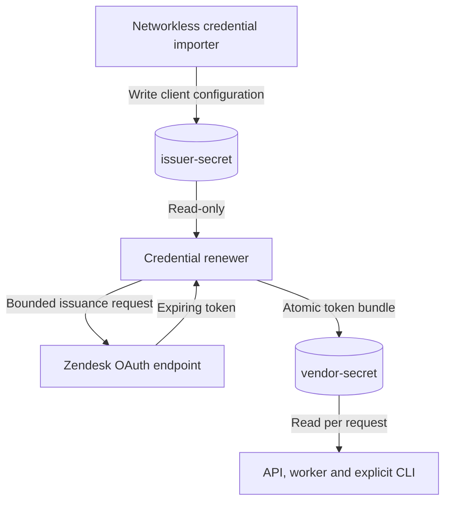

# Zendesk credential renewal

Our optional `zendesk-token-renewer` service keeps Zendesk access available without manual access-token replacement. It requests a new token through the confidential-client credentials flow before the current token expires. It has no ticket workflow, business database or operator credential.

We request **14,400 seconds** with exactly `tickets:read tickets:write`. Four hours is our configured lifetime, not a claim that Zendesk requires that lifetime. The credential remains expiring; renewal removes the repeated operator step. It does not grant approval, resolve conflicts or run synchronization.

## Architecture overview

The live deployment uses the same two Compose files and project identity. The `oauth-renewal` profile adds one credential service to the API, Prometheus and Grafana services. Its only network operation is a bounded HTTPS request to the configured tenant's `/oauth/tokens` endpoint. It does not create or edit GitHub issues or Zendesk tickets. Credential renewal does not enable `live-worker`. Zendesk-first operation selects that effectful profile separately, alongside intake configuration; see [intake operation](INTAKE.md).

| Component | Credential access | Responsibility |
| --- | --- | --- |
| `oauth-credentials` | Writes only `issuer-secret`; no network | Import the configured tenant, client identifier and client secret through bounded JSON stdin |
| `zendesk-token-renewer` | Reads `issuer-secret`; writes `vendor-secret` | Issue, validate and atomically publish a managed Zendesk token |
| API, explicit CLI and optional worker | Read-only `vendor-secret`; no issuer volume | Read the current managed bearer token before each Zendesk GET or PUT |
| Prometheus, Grafana, initializer and smoke | No issuer volume or vendor volume | Keep their existing monitoring, bootstrap and verification roles |



The client configuration is an ordinary private file at `/run/secrets/oauth/client.json`, mounted read-only in the renewer. The networkless importer writes it as UID10001 into a private directory. Client values are not embedded in source, images, command arguments, the private env file or logs.

The renewer publishes `/var/lib/support-bridge/zendesk-oauth.json` in the existing `vendor-secret` volume. Readers see that same file at `/run/secrets/vendor/zendesk-oauth.json`. One atomic file contains the access token, tenant/client binding, scope and issuance/expiry/renewal times; readers cannot combine a new token with old expiry metadata. The directory is `0700` and files are `0400`. Publication uses the same `.import.lock` as the access-token importer. This deployment lock is separate from the business worker lock.

The shared `vendor-secret` volume also contains the GitHub token. The renewer therefore has filesystem access to that token even though its implementation never uses or replaces it. These mounts are not a per-file sandbox. Separating those access-token volumes would narrow that boundary further. The operating managed-renewal deployment retains eight named volumes, including `issuer-secret`. Enabling this profile preserves the other existing volume identities.

## Enable renewal for the existing live deployment

Keep the current `support-bridge-live-demo` identity, existing records and private deployment file. Initial repository/tenant setup and access-token import remain in [the live guide](LIVE_DEMO.md). Do not import old local fixture state or replace baselines when enabling renewal.

Add these settings to the private deployment env file:

```dotenv
# Retain live-worker when it is already enabled for the selected deployment.
COMPOSE_PROFILES=oauth-renewal,live-worker
BRIDGE_ZENDESK_AUTH=oauth
BRIDGE_ZENDESK_TOKEN_FILE=
BRIDGE_ZENDESK_OAUTH_BUNDLE_FILE=/run/secrets/vendor/zendesk-oauth.json
```

The profile example retains an already enabled worker; on a fresh setup use only `oauth-renewal` until workflow effects are explicitly authorized. Do not drop other enabled profiles when editing this setting.

The empty `BRIDGE_ZENDESK_TOKEN_FILE` value is intentional: managed OAuth must not compete with a startup-loaded access token. Also leave `BRIDGE_ZENDESK_TOKEN` unset. Configure one managed bundle or one manual token source, never both. These paths select protected files; no credential value belongs in this env file.

Import the existing confidential client's identifier and secret privately. Replace the example paths and tenant label with the deployment's verified inputs:

```powershell
docker compose --env-file C:\private\live-demo.env `
    -p support-bridge-live-demo -f compose.yaml -f compose.live-demo.yaml `
    build oauth-credentials
if ($LASTEXITCODE -ne 0) { throw 'OAuth importer build failed.' }

$issuerInput = @{
    subdomain = 'demo-sandbox'
    client_id = [IO.File]::ReadAllText('C:\private\zendesk-client-id').Trim()
    client_secret = [IO.File]::ReadAllText('C:\private\zendesk-client-secret').Trim()
}
$issuerInput | ConvertTo-Json -Compress |
    docker compose --env-file C:\private\live-demo.env `
        -p support-bridge-live-demo -f compose.yaml -f compose.live-demo.yaml `
        run --rm --no-deps -T oauth-credentials
if ($LASTEXITCODE -ne 0) { throw 'OAuth client import failed.' }
$issuerInput = $null
```

The importer accepts exactly `subdomain`, `client_id` and `client_secret`. It has no business state, operator token, vendor access-token mount or network. The client must permit only the ticket scopes the issuer requests. Creating or changing a vendor client still requires the account owner's authorization.

Build and start the selected deployment:

```bash
docker compose --env-file /absolute/private/live-demo.env -p support-bridge-live-demo -f compose.yaml -f compose.live-demo.yaml up --build -d --wait
docker compose --env-file /absolute/private/live-demo.env -p support-bridge-live-demo -f compose.yaml -f compose.live-demo.yaml ps
```

Enabling the managed source requires recreating existing credential readers once so they receive the changed configuration. Normal `up` applies that change while retaining volumes. Subsequent token renewals need no API or worker restart: the provider reads the bundle for each request. Fresh `run --rm` CLI commands use the same managed source automatically through the private env file.

## Renewal and failure behavior

The renewer issues a token when its bundle is missing, expired or due. It renews five minutes before a four-hour token expires; a shorter accepted lifetime uses a margin of ten percent, capped at five minutes. The issuer validates the exact returned scopes, bearer format, configured tenant and allowed lifetime. Expiry is measured from request start, so a slow response does not extend the recorded lifetime.

If issuance fails, the previous valid bundle remains intact and the service retries with bounded delays. It does not print returned bodies, credentials or raw exceptions. Health requires a usable token and recent loop progress; process existence alone is insufficient. Inspect the service through Docker `ps` and its sanitized logs. Never print the bundle file to diagnose it: it contains the access token.

Provider-free API queries, `/health`, `/metrics` and `/monitoring/pairs` do not issue tokens or contact either vendor. Provider requests read managed credentials; they do not renew them. A known expired credential fails before transport. A failed PUT is not replayed inline with a different token: the normal durable recovery policy still decides later effects.

Renewal cannot repair a revoked client secret, changed account permissions or an extended vendor outage. It does not reset business attempts, retry schedules, approvals, conflicts or durable plans. If existing work exhausted its retry budget during a credential outage, inspect that work after access is restored and use the ordinary authorized recovery command.

When Docker or the host is stopped, no renewal runs. Startup checks the stored expiry and requests a new token when needed. This is not a continuously available credential service across host downtime. Check the actual service health before a presentation; an old case status or a green exporter does not establish current vendor access.

## Change the confidential client identity

The managed bundle is bound to its tenant and client identifier. Replacing the secret for the same client identifier does not change that identity. Selecting a different client identifier deliberately fails the existing bundle's binding check; waiting for expiry, restarting or running ordinary retries cannot migrate it. The renewer must not silently discard a token because its configured identity changed.

For an authorized migration within the same configured tenant:

1. Stop only `zendesk-token-renewer` using the existing private env/project/Compose prefix. Keep the API, monitoring, live state and unrelated credentials in place. Avoid provider-reading or effectful workflow commands during the credential transition; local inspection remains available.
2. Import the new tenant/client configuration through the networkless `oauth-credentials` service described above. Confirm it belongs to the existing deployment's tenant; this procedure does not migrate business state to another account.
3. Use an explicitly reviewed one-shot issuer helper with the same restricted mounts to retire **only** `/var/lib/support-bridge/zendesk-oauth.json` and its matching `/var/lib/support-bridge/zendesk-oauth-heartbeat.json`. Acquire the deployment `.import.lock`, validate ordinary single-link files and verify the heartbeat belongs to that bundle before retiring them. This is a narrow credential-file operation, not a general cleanup or an automatic retry step. Preserve the lock file, `github-token`, `zendesk-token`, issuer configuration and every application or monitoring volume. No recursive deletion, glob or volume removal belongs in this operation.
4. Start only `zendesk-token-renewer` again. Its absent managed bundle now permits fresh issuance for the explicitly configured client. Verify a newly issued, correctly bound credential and healthy loop before an authorized read of an existing vendor record. The API's per-request reader can consume the new bundle without a restart when its configuration path is unchanged.

This operation changes credential identity only. Existing baselines, durable plans, approvals, conflicts and retry budgets remain unchanged, and subsequent workflow effects still require the normal review/freshness gates. A new client identifier or fresh credential cannot authorize a saved state change.

## Manual compatibility mode

The [manual helper and access-token importer](LIVE_DEMO.md#credentials-and-manual-oauth-issuance) remain available for explicit manual/native operation. To select that mode, disable the `oauth-renewal` profile, unset `BRIDGE_ZENDESK_OAUTH_BUNDLE_FILE`, and configure the existing token value or file. Recreate readers when changing between modes. Do not rely on a cached manual token as a silent fallback when managed renewal fails.

GitHub authentication is separate. This service neither renews the GitHub token nor changes its expiration or permissions. Rotating GitHub's startup-loaded credential still requires its documented import and reader recreation.

## Trade-offs

- A separate issuer process keeps the client secret out of application and monitoring containers, at the cost of one service and one protected volume.
- A single atomic bundle keeps token and expiry evidence together. Readers must validate that file before each Zendesk request.
- Short-lived credentials limit access-token lifetime while renewal depends on the confidential client, network and local supervision.
- Reusing the existing vendor volume avoids migrating live credentials, while giving the renewer filesystem access to the unrelated GitHub token.

## Known limitations and verification

The protected files are plaintext and Docker administrators can read them. This is not an encrypted secret manager. No per-pair vendor credential, verified human reviewer or additional notification destination is introduced. The all-pairs dashboard shows last verified workflow evidence; it does not report token health or vendor freshness.

`tests/oauth-renewal.php` covers issuer and renewal behavior with controlled transport/time; `tests/zendesk-token-rotation.php` checks per-request credential use and failure boundaries. The disposable `docker/check-oauth-renewal.sh` checks Compose isolation and rotation without live vendor requests. Its test-only `docker/compose.oauth-check.yaml` overlay pins the empty manual token source because Windows/WSL forwarding can drop blank environment variables. The check retains fake credentials and an internal network with no vendor egress; that extra overlay is not part of the normal two-file deployment. Keep actual execution results in [REVIEW.md](REVIEW.md), separately from authenticated vendor reads and customer validation.

## AI use

AI can assist development and explanation as disclosed in the [README](../README.md#ai-use). Renewal follows PHP validation, clocks, file locks and fixed credential scopes. No model decides when a policy is satisfied, selects a conflicting source or grants approval. **Never rely on AI in compliance.**
