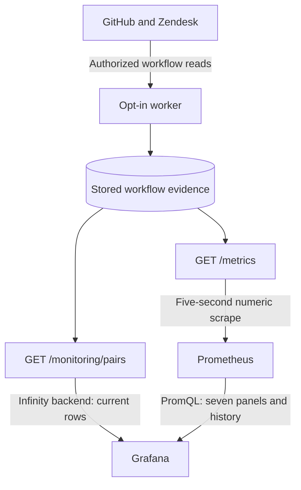

# Linked-pair observability

One Prometheus and one Grafana display every stored GitHub/Zendesk link in `support-bridge-live-demo`. New mappings appear automatically; no alias allowlist or dashboard edit is required. Monitoring reads actual stored workflow evidence. There is no traffic generator or native monitoring alternative.

| Service | Address |
| --- | --- |
| Grafana | [127.0.0.1:1990](http://127.0.0.1:1990/d/supportbridge-overview?refresh=5s) |
| Prometheus | [127.0.0.1:1989](http://127.0.0.1:1989/) |
| API and Swagger | [127.0.0.1:1988/docs](http://127.0.0.1:1988/docs) |

Use the full project/env-file prefix in [Docker operation](DOCKER.md). Grafana uses its persisted account; bootstrap files can be stale after rotation. [Sign-in guidance](DOCKER.md#sign-in-to-grafana) separates authentication from service health. Prometheus has no additional login on its loopback listener, so other local processes can read its numeric identifiers and history.

## Data paths and timing



The table has its own protected API query; it does not read Prometheus. The other seven panels use the provisioned **Support Bridge Prometheus** datasource. For example, `support_bridge_linked_pairs` supplies the total count, while range queries over `support_bridge_linked_pair_status` supply the timeline. Grafana renders numbers and maps workflow codes to labels/colors; Prometheus collects and retains their samples.

Grafana can display API data without Prometheus. This deployment retains both because current record context and historical numeric monitoring answer different questions. Its Compose health dependencies start both data sources; no separate Prometheus-free operating profile is implemented.

| Clock | What changes |
| --- | --- |
| Worker pass, then nominal 60-second delay | Discovers eligible source edits, creates links, reconciles fields and delivers separately enabled GitHub comments and new Zendesk internal notes |
| Current table refresh, every five seconds | Reads a new local JSON snapshot, including subjects and URLs |
| Prometheus scrape, every five seconds | Records numeric local evidence |
| Grafana Prometheus refresh, every five seconds | Queries the available samples for counts/history |

These are independent observations. A new saved link can appear in the table before its next metric sample. Provider visibility, work duration, cooldown, review and retry add latency before monitoring has any new evidence.

## Read the dashboard

| Panel | Meaning |
| --- | --- |
| Metrics connection | Prometheus can scrape the bridge. It does not check vendor credentials or current vendor state. |
| GitHub comments to internal notes | Five fixed delivery-state totals from the local ledger. Delivered means an internal note was observed. |
| New Zendesk internal notes to GitHub | Five reverse delivery-state totals and the number of recorded starting points. A starting point is initialization, not a delivered reply. |
| Zendesk engineering intake | Counts of prepared, creating, uncertain, linked, blocked and withdrawn intents. Linked means mapped, not resolved. |
| Actual linked pairs | Count of every stored mapping, including manually linked and automatically created pairs. An empty store reports a genuine zero. |
| Operator attention | Pair approval/conflict/dead work, intake concerns and both conversation delivery/discovery channels and their shared privacy hold. It is a diagnostic sum; concerns can overlap. |
| All linked ticket and issue pairs | One row per mapping, identified by Zendesk ticket and GitHub issue number. Includes the last verified ticket subject, clickable source numbers, workflow state, last verified resolution, pending plan, failed attempts, internal notes delivered/waiting, GitHub replies delivered/waiting and last verified convergence. |
| Observed linked-pair workflow history | Scrape-sampled status for each numeric mapping. It can miss transitions between samples and is not an audit trail. |

To find a new escalation, wait for the enabled worker to create and save its link, then find its two numbers in **All linked ticket and issue pairs**. An untagged or still-unlinked ticket has no pair row. A prepared/uncertain intake can appear in intake totals before a mapping exists. The table covers the complete local link set rather than the first page of `/api/pairs`. **Ticket subject** is the last verified common baseline title, displayed as plain text. It can lag a newer Zendesk subject while the worker or review is pending; we never substitute an unapproved target. No baseline shows **No verified subject**. Click either record number to open the fixed HTTPS destination in a new tab using your own vendor login. Local-provider fixtures have null source URLs because they are not vendor records. The table always shows current stored context regardless of the dashboard time range; subject history is not reconstructed. Narrow windows and longer link sets require horizontal or vertical table scrolling; collapse the Grafana menu to leave more room for all twelve columns.

Monitoring cannot discover an unsaved GitHub comment or initiate a vendor read. After a layout update, reload the page once; later mappings appear on the normal table refresh without a new allowlist or dashboard edit.

**Synced** describes the bridge's last stored observation, not continuous vendor freshness. **Last verified resolution** comes from the common baseline, never an unapproved target. **Resolved** means canonical closed; it proves neither customer confirmation nor Zendesk's immutable closed status. A pending plan is unfinished work, not approval. Zero convergence time displays **Never verified**. Unknown stored states remain explicit. A failed scrape reports failure instead of inventing success or zero rows.

**Internal notes delivered** counts durable deliveries with an observed internal Zendesk note. **Internal notes waiting** sums pending, sending, uncertain and blocked deliveries for that pair; consult authenticated evidence to distinguish these states. The count does not continuously recheck note visibility, count arbitrary Zendesk replies or establish a customer response. A new source comment appears only after the worker observes it; field review can hold delivery. **GitHub replies delivered** counts observed destination comments from new Zendesk internal notes after initialization; **GitHub replies waiting** uses the same four unfinished states from its separate ledger. Public replies, initial descriptions, excluded history and recognized bridge copies contribute no new reverse delivery. Counters do not count every discussion entry or establish continuous source visibility.

## Complete linked-pair projection

`GetMonitoringSnapshot` reads business aggregates and the complete link/note projection in one read-only SQLite transaction on the injected business connection. `LinkedPairProjection` validates shared numeric evidence and one-to-one identity. `LinkedPairMetrics` renders only numeric gauges. `GetLinkedPairTable` dispatches the table use case and `LinkedPairTable` presents verified subjects and fixed source URLs; both reads remain free of provider access, reconciliation, approvals or business writes. Aggregate diagnostic counters in `metrics.sqlite` are a separate observation, not a transaction with the business store.

`support_bridge_linked_pairs` is a label-free count. The following nine gauges each have one series per stored mapping:

| Gauge, prefixed `support_bridge_linked_pair_` | Meaning |
| --- | --- |
| `status` | Stored workflow code; labels `github_issue` and `zendesk_ticket` identify the mapping. |
| `resolution` | Last verified baseline: 0 unverified, 1 open, 2 canonical closed. |
| `pending_plan` | 1 when a durable field plan exists, otherwise 0. |
| `attempts` | Persisted failed field-reconciliation attempts. |
| `last_success_timestamp_seconds` | Last observed field convergence as Unix seconds; 0 means never verified. |
| `notes_delivered` | Observed internal-note deliveries for the linked issue. |
| `notes_waiting` | Pending, sending, uncertain or blocked GitHub-to-Zendesk deliveries. |
| `notes_to_github_delivered` | Observed GitHub comments copied from eligible new Zendesk internal notes. |
| `notes_to_github_waiting` | Pending, sending, uncertain or blocked Zendesk-to-GitHub deliveries. |

The eight gauges after `status` use only `github_issue`; the one-to-one mapping keeps their numeric series associated with the same source. The current JSON table requires no frontend join across Prometheus samples. IDs stay strings in Grafana. Only positive numeric vendor identifiers of at most 16 digits are accepted. Duplicate or invalid IDs, invalid numbers or corrupt baseline evidence fail the scrape. Internal pair keys, titles, descriptions, comment text/authors/URLs, errors, markers, credentials, plan hashes and approval rationales never become labels.

| Status code | Display |
| ---: | --- |
| 1 | Ready for sweep |
| 2 | Synced |
| 3 | Awaiting approval |
| 4 | Conflict |
| 5 | Retry scheduled |
| 6 | Needs intervention |
| 7 | Unknown stored state |

Absent mappings have no row or per-pair series. There is no fabricated missing-case row. Resolution and pending-plan fields describe different facts: a held state change can coexist with the previously verified open baseline. The table converts Unix seconds to integer milliseconds for Grafana date display and rejects overflow. It does not change stored timestamps or numeric metric units.

## Trade-offs and data exposure

We assume a low-volume, single-team pilot with one configured GitHub repository and Zendesk tenant. Numeric IDs are operational data now retained by Prometheus and readable by Grafana viewers and local Prometheus callers. Before broader deployment, review monitoring access, retention and data-sharing permissions. Loopback binding is not authorization between users/processes on the host.

Complete per-pair visibility costs **nine series per link plus one count series**, in addition to the existing aggregates. The complete SQL read and Grafana table response also grow with the link set; historical mappings retain series until normal retention expires. Numeric history/aggregate panels retain the native Prometheus datasource. The current table uses the pinned Infinity backend plugin (4.1.5) to query `/monitoring/pairs` on the bridge API, without another service or database. This adds a plugin dependency and authenticated read path, while keeping subjects and source URLs out of metric labels and Prometheus history. Capacity, latency and safe record limits are unmeasured. A larger deployment needs a measured budget and likely an authenticated paginated record view rather than continuing to grow identifier labels. See [Prometheus cardinality guidance](https://prometheus.io/docs/practices/instrumentation/#do-not-overuse-labels).

The former `support_bridge_demo_case_*` families are retired. Existing Prometheus data remains in its volume and ages out under normal retention; no history is rewritten or backfilled. The current JSON table reads only stored mappings, and the new timeline begins when the new identifier series are first scraped. A mapping absent from the next JSON snapshot disappears from the current table; corresponding metric series disappear after Prometheus staleness processing while earlier observations can remain in history. No unlink command is introduced.

## Retained diagnostic metrics

| Metric | Meaning |
| --- | --- |
| `support_bridge_pairs{status}` | Stored pair counts by workflow state. |
| `support_bridge_pending_plans` | Durable plans awaiting convergence. |
| `support_bridge_last_success_timestamp_seconds` | Most recent convergence across all pairs; can hide an older stalled pair. |
| `support_bridge_reconciliations_total{outcome}` | Observed reconciliations, including no-op polls; not customer edits or remote writes. |
| `support_bridge_reconciliation_duration_seconds` | Classic duration histogram in seconds. |
| `support_bridge_telemetry_storage_available` | This successful scrape read valid durable metric storage. |

Counters and histograms persist in separate `metrics.sqlite`. Their update is atomic there, but not with a business commit; a crash can omit an observation. They are operational diagnostics, not exactly-once audit, billing or compliance evidence. Existing missing/corrupt metric rows fail visibly. The cumulative `+Inf` histogram bucket equals its count. Per-pair gauges need no metric-schema migration.

```promql
support_bridge_linked_pairs
support_bridge_linked_pair_status
support_bridge_linked_pair_notes_delivered
support_bridge_linked_pair_pending_plan
sum by (outcome) (rate(support_bridge_reconciliations_total[5m]))
```

Rates need observations; missing data is not zero latency. A storage failure returns sanitized HTTP 503 and Prometheus reports `up=0`. It does not substitute zero success counts.

## Intake and comment evidence

`support_bridge_intake_records{status="prepared|creating|uncertain|linked|blocked|withdrawn"}` provides six fixed-state totals. `creating` records the pre-POST durable attempt, `uncertain` holds an unconfirmed result, `blocked` needs investigation and `withdrawn` means pre-creation eligibility was removed. A linked intent does not prove field convergence. See [intake recovery](INTAKE.md).

`support_bridge_comment_deliveries{status="pending|sending|uncertain|delivered|blocked"}` provides five fixed-state totals. `support_bridge_comment_stream_errors` counts discovery failures; `support_bridge_comment_privacy_hold` reports a durable subsystem hold after public-note evidence. These aggregates contain no per-record labels. The per-pair delivered/waiting gauges above summarize the same ledger. Empty ledgers export genuine zeros; incomplete or unknown ledger state fails visibly. Inspect [comment recovery](COMMENTS.md) and authenticated evidence before acting. No scrape discovers or appends a note.

The reverse ledger exports `support_bridge_note_deliveries{status="pending|sending|uncertain|delivered|blocked"}`, `support_bridge_note_stream_errors` and `support_bridge_note_streams_initialized`. Initialization counts pairs with a persisted new-only starting point; it does not count skipped historical notes as deliveries. Both channels contribute waiting/discovery concerns to operator attention; the shared privacy hold is counted once. Missing channel inputs remain unknown. `GitHub replies delivered/waiting` in the current table summarizes only the reverse ledger, independently of the existing internal-note counts. First-scan exclusion and loop handling are described in [conversation delivery](COMMENTS.md).

## Alerts, access and renewal

Three local rules cover unavailable scraping, operator attention and pending durable plans. The dashboard and attention rule aggregate every component to the same label set; combining unlabelled totals with raw job/instance-labelled gauges would otherwise yield no result. A complete zero is displayed as No stored concerns, while missing inputs remain unknown rather than being replaced with zero. Quiet time is normal; no elapsed-convergence alert, Alertmanager or recipient is configured. Thresholds are examples, not agreed objectives.

Prometheus and Grafana share a dedicated read-only monitoring token distinct from the broad operator token. It permits `/metrics` and `/monitoring/pairs`, including every linked baseline subject and source URL in the latter. It cannot call `/api` operations; the operator token cannot substitute for it. Grafana mounts `metrics-secret` read-only, loads it at startup into secure datasource provisioning and sends it only through its backend to the allowed host `http://api:8080`. It is not embedded in the dashboard, browser request or image. Grafana administrators and Docker administrators remain trusted; datasource viewers can query all permitted table context without per-pair authorization. Token rotation requires Grafana recreation. Grafana, Prometheus and smoke receive no vendor credentials. Listeners bind to loopback, with no remote write, Pushgateway or telemetry agent. Never rely on AI in compliance: neither a model nor a panel supplies approval, chooses a conflict source or establishes policy satisfaction.

The optional [credential renewer](OAUTH.md) reports usable-token/loop health separately in Docker. It never refreshes case evidence and receives no metric credentials. Exporter health does not establish vendor authentication.

## Verification and recorded evidence

`sh docker/check-alerts.sh` runs six in-memory promtool cases against the built rules: genuine zero, pending approval, privacy hold, missing metrics, uncertain reverse delivery and missing reverse inputs. The standard stack smoke also compares the dashboard query with stored concern counts, so both its zero case and the lifecycle pending-approval case must produce a numeric result.

`tests/observability.php` checks durable telemetry, failures, empty/new/unknown links, per-pair note totals, identifier/privacy validation and 105 mappings beyond the API's first page. API/wire checks verify protected scrapes without business mutation or provider construction. [Container verification](DOCKER.md#verification) checks real scrapes, rules, datasource queries and eight-panel provisioning using isolated fixtures.

For an actual deployment, compare the complete authenticated link set with the label-free count and all nine metric families, then verify every pair appears in the **rendered** Grafana table with its correct partner and note totals. Raw datasource frames do not prove frontend rendering or link correctness. Check twelve visible columns, exact baseline subjects and HTTPS record destinations, with URL helper columns hidden from the table. The record response contains subjects; error responses must remain sanitized and correlated. Use a fresh isolated headless browser without attaching to the user's session. Use current credentials; never reset accounts or volumes to satisfy bootstrap smoke. Record executed results in [REVIEW.md](REVIEW.md), separately from customer or production validation.

Private [checkpoint capture and replay](LIVE_DEMO.md#capture-and-render-actual-observations) retain their four aggregate observations only. Playback navigates recorded evidence; it does not feed metrics, reconcile, approve or edit vendor records. Missing observations remain absent.
