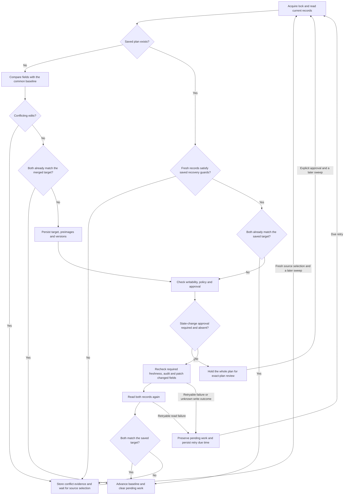

# Primary scenario: a CSV-export escalation

Our main scenario follows one customer escalation from its first shared summary through a verified fix, reopening, an uncertain write and a conflicting update. It explains the business decisions and the evidence we retain at each boundary.

The scenario uses our actual PHP application, API, persistence and monitoring with fictional records. A [bounded live run](REVIEW.md#live-demonstration-verification-2026-10-28) verified both title directions, an explicitly approved mixed title/state update and a no-op sweep. The broader reopening, conflict and uncertain-write narrative remains separate from that execution and from customer validation. [LIVE_DEMO.md](LIVE_DEMO.md) describes the isolated live project and recorded replay.

## Customer context and expected value

We assume a B2B reporting service whose customer cannot export CSV reports above 100,000 rows. Support manages the customer conversation in Zendesk. Engineering investigates the defect in GitHub. An escalation owner coordinates the decision to close or reopen the issue.

The teams need consistent summaries and resolution updates without repeatedly copying them. We expect fewer stale escalations and less copying; we have not measured those benefits with a customer. A pilot should compare copying effort, convergence lag and unresolved work before and after opt-in.

These people are roles in the story, not identities authenticated by the application. Our shared operator credential provides broad authority. The recorded principal is `shared-operator`; it does not prove who acted, whether the caller was human or whether another person reviewed the decision.

The [assumptions register](ASSUMPTIONS.md) records our customer, field, deployment and failure assumptions. [Governance](GOVERNANCE.md) defines policy ownership and the controls needed before real records are opted in.

## Starting records and field contract

Our local sample uses this explicit mapping:

| Record | Identifier | Initial summary | Canonical state |
| --- | --- | --- | --- |
| GitHub issue | `101` | CSV export fails for large reports | `open` |
| Zendesk ticket | `501` | CSV export fails for large reports | `open` |
| Support Bridge pair | `escalation-1` | Links the existing issue and ticket | Initially eligible for reconciliation |

An initialized deployment may already contain this link and its baseline. We inspect it rather than creating a duplicate or resetting its history. The identifiers in this scenario refer to synthetic local records, not actual customer records or issue URLs.

Only two canonical fields cross the integration boundary:

| Canonical field | GitHub | Zendesk |
| --- | --- | --- |
| `title` | Issue title | Ticket subject |
| `state=open` | Open | New, open, pending or hold |
| `state=closed` | Closed | Solved or closed |

An outbound closed transition writes Zendesk **solved**, not irreversibly closed. A title-only Zendesk patch omits status and preserves distinctions such as pending or hold. A truly closed Zendesk ticket is immutable; a required patch stops visibly rather than creating a follow-up ticket.

Comments, descriptions, attachments, requester details, assignees and automatic remote record creation are outside scope. Titles can still contain confidential information. Titles must be nonempty and at most 500 UTF-8 bytes. Link opt-in does not perform redaction or establish data-sharing permission.

## Architecture overview

CLI and HTTP adapters dispatch the same typed commands and queries. Reconciliation and review commands use the engine; other focused handlers own linking, initialization and locked local-provider edits. Query handlers inspect local state without constructing providers or reconciling records. This synchronous CQRS boundary uses one business database, with no queue, event sourcing or separate read database.

The application context composes constructor dependencies and injects a scoped SQLite connection into the repository. Persistence helpers own schema upgrades, transactions and the canonical file lock. There is no process-global database Singleton. Business state and aggregate telemetry use separate SQLite databases inside the application's data directory; metrics cannot decide business correctness.




The diagram shows ordinary merge and uncertain-outcome recovery separately. Recovery retains the saved target rather than recomputing it from a newer baseline. Permanent failures or exhausted attempts become `dead`, as described at checkpoint 6.

One canonical lock coordinates sweeps, approval, source selection, retry and synthetic source edits on a single host. It does not prevent people editing vendor records, and it is not a distributed lock. Provider versions and fresh reads remain necessary. The [architecture guide](ARCHITECTURE.md) explains these responsibilities in detail.

## Eight checkpoints

### 1. Establish the last common agreement

An operator explicitly links the existing issue and ticket. We do not infer a relationship from similar titles or create either vendor record. Linking itself makes no live provider request.

The next sweep reads both records. Equal canonical fields establish the common baseline:

```text
title: CSV export fails for large reports
state: open
```

The baseline means these are the values last observed in both systems. It is not a permanently authoritative copy. It lets us distinguish an ordinary one-sided edit from competing edits later.

If the first observations disagree, we have no trusted common baseline. The pair becomes a conflict and requires a fresh source decision; no side silently wins. For our already initialized sample, the first checkpoint is to verify its mapping and baseline without changing them.

### 2. Support improves the problem description

After speaking with the customer, support changes the Zendesk subject to:

```text
CSV export fails above 100k rows
```

GitHub retains the original title, and both records remain open. Relative to the baseline, only Zendesk changed its summary. The merge target takes that new summary and the unchanged open state.

Before an effect, the engine persists the target, both observed preimages and both versions. Title-only transfer uses the explicit link's opt-in. It patches only GitHub's title, then reads both records again. The baseline advances only after observed equality.

Evidence at this checkpoint is the minimal title patch, matching records, an updated baseline and no pending plan. Support entered the improved description once, and engineering received it. We do not overwrite unrelated vendor fields to make the records look identical.

### 3. Independent changes produce a merged plan

Engineering ships a fix and changes the GitHub title to `CSV export fix verified above 100k rows`. Independently, support receives customer confirmation and marks Zendesk solved.

| Field | Previous baseline | GitHub observation | Zendesk observation | Intended common result |
| --- | --- | --- | --- | --- |
| Summary | CSV export fails above 100k rows | CSV export fix verified above 100k rows | Previous summary | Engineering's new summary |
| Canonical state | `open` | `open` | `closed` | `closed` |

These edits affect different fields, so they merge without discarding either change. Achieving the result requires closing GitHub and updating Zendesk's subject.

Because the plan includes an outbound state change, **the entire plan** enters `awaiting_approval`. We hold the accompanying subject patch as well as GitHub closure. The baseline stays at the previous agreed result, and the durable plan retains the evidence behind the proposed result.

Support has already changed Zendesk outside Support Bridge. The gate does not undo that action or prevent it from happening. It controls only our outbound patches. At this checkpoint, Zendesk can already be solved while GitHub remains open and the new engineering title has not reached Zendesk.

### 4. Review the exact plan

Inspection exposes the pair and linked IDs, pending target, both preimages and versions, policy version, plan hash and recent events. The operator reviews the whole intended transfer, including whether the fix was verified and whether closing the escalation is appropriate.

Approval supplies the current hash and a rationale. The SHA-256 hash binds the pair identity, both linked IDs, target, preimages, versions and `escalation-state-v1`. It is a binding to specific evidence, not a signature establishing human identity or the truth of the rationale.

The approval command fetches both provider records again. Changed fields or versions invalidate the decision and refresh conflict evidence. A required approval audit event precedes authorization persistence; an audit failure cannot authorize subsequent effects.

An accepted approval records the attestation and returns the pair to `new`. It does **not** patch a vendor. The next eligible sweep performs the execution checks. Retry and source selection cannot substitute for this approval, and an approval for another plan or policy version cannot carry over.

### 5. Apply the approved result and verify convergence

The next sweep acquires the application lock, reads the records and rechecks recovery safety, policy, approval and the required source-version evidence. A plan that became stale after approval stops for review.

The engine patches only changed fields, currently GitHub first and Zendesk second. It records `write_started` before a patch and `write_returned` after a returned response. A required audit failure stops subsequent effects.

There is no cross-vendor transaction. One patch can succeed while the other fails. Persisting intent before either effect makes that partial result inspectable and recoverable.

Returned HTTP responses are not the final proof of completion. The engine reads both records again. Only matching the full canonical target advances the baseline, clears the pending plan and approval, and marks the pair `synced`. Audit events remain, but the business store does not automatically archive complete historical plan snapshots after convergence. Explicit private checkpoints can retain selected snapshots; they are a separate presentation archive.

At this checkpoint, both records have the verified-fix summary and closed canonical state. This pair no longer contributes to operator attention or pending-plan gauges after the next successful scrape. Aggregate totals can remain nonzero while other pairs still require work.

### 6. Reopen after an uncertain write

The customer tests a larger report and still encounters the failure. Engineering reopens GitHub. Reopening Zendesk is another outbound state change and needs a new exact-plan approval; the earlier closure approval cannot authorize it.

After approval, the failure scenario deliberately loses the Zendesk response after its local synthetic provider commits the reopen:

```text
The destination applies the change.
Its response is lost before acknowledgement.
Support Bridge retains an uncertain outcome.
```

The pair enters `retry`, preserving its pending target and old baseline. A persisted due time controls the next attempt. We can restart the worker to demonstrate that recovery does not depend on memory in the original process.

Recovery reads before writing:

| Fresh observation | Action |
| --- | --- |
| Both records already equal the full target | Acknowledge convergence without resending a patch |
| A destination still needs a patch and retains the required version | Continue through the current execution checks |
| Required evidence changed | Quarantine for review instead of blindly replaying |

Acknowledging an already-achieved target needs no new effect. Any remaining write still needs the applicable authorization. An edit-and-revert with a changed destination version can therefore stop recovery even when its field values look familiar.

Retryable failures use persisted backoff, bounded jitter and vendor retry guidance. A worker executes due work at or after its due time, not at a guaranteed instant. Permanent failures or the fifth failed attempt become `dead`. Explicit retry can reset the failed-attempt budget, but cannot approve work or resolve a conflict.

### 7. Resolve an actual disagreement

While both records are open, engineering changes its title to `Export fix ready for customer verification`. Support independently changes Zendesk to `Customer still blocked on large CSV exports`.

Both summaries differ from the common baseline and from each other. The pair becomes `conflict`, suspending every outbound patch for that pair. We store both observed records, versions and conflicting fields. We do not select the latest timestamp or assume engineering is globally authoritative.

For this narrative, the escalation owner discusses the case with both teams and decides Zendesk contains the agreed wording. The operator explicitly selects `zendesk`. That decision belongs to the operator; it is not an AI recommendation.

Source selection re-fetches both records and checks the stored conflict evidence. A concurrent edit rejects the old decision and refreshes the conflict. A valid selection chooses the **whole observed source record**, records a new durable plan and returns the pair to `new`; it does not immediately patch a destination.

In this example, both states are open, so the resulting title-only plan can use the link's opt-in on the next sweep. If the selected record implies an outbound state change, the normal whole-plan approval gate still applies.

### 8. Poll again without effects

Once both records match the agreed result, another sweep sends zero patches for this pair. It stays `synced`, and no pending plan remains. Local-provider write counters cover all records; their totals remain unchanged only when no other pair needs a patch in the sweep. Per-pair write audit events distinguish this case from other work.

The sweep can still emit a successful reconciliation observation. We count attempts to check or align records, including successful no-op polls. A high reconciliation counter therefore does not establish a high volume of customer changes, useful updates or vendor writes.

## Reading the dashboard during the case

Grafana focuses on three configured cases: CSV export (`csv-export`), Webhook delivery (`webhook-retry`) and SSO sign-in (`sso-conflict`). These are explicitly linked real-provider records; the case labels do not imply that a retry or conflict currently exists. Titles, vendor IDs, plan hashes and rationales stay out of metric labels.

| Panel | Interpretation and limit |
| --- | --- |
| Scrape health | Prometheus can retrieve the local exporter; this does not prove vendor health or fresh provider reads. |
| Linked cases | Number of the three configured mappings actually present, rather than an assumed total of three. |
| Operator attention | Stored approval waits, conflicts and dead work among the cases; a decision still requires inspection. |
| Case details | Stored workflow status, last verified baseline resolution, pending plan, attempts and last success for each fixed case. |
| Case status history | Status sampled at scrape times, not a complete event history or an atomic cross-vendor snapshot. |

A missing link displays Not linked; an unrecognized state displays Unknown. An absent baseline is Unverified. Neither absence nor uncertainty is successful synchronization. A baseline marked Closed records the last verified agreement, not the present state of either vendor. A pending plan can coexist with an older verified baseline, and conflict evidence need not include an executable plan.

The normal worker is disabled. Vendor edits become visible to the business state only through deliberate provider-reading operations; a successful five-second scrape does not refresh them. Grafana refreshes independently and may miss intermediate status transitions. Aggregate counters and latency histograms remain in Prometheus for diagnosis, outside the five-panel case view. Metrics are best effort and cannot replace current inspection, audit or approval. See [observability semantics](OBSERVABILITY.md) and [the panel guide](../monitoring/README.md#five-dashboard-panels).

## Guided case

Our operating deployment is the existing `support-bridge-live-demo` project: one API, one Prometheus and one Grafana. We inspect current state and advance through deliberate authorized operations, with the worker disabled. Reading a dashboard, recreating containers or changing a port grants no source-edit, synchronization or approval authority.

A manual sweep processes every eligible linked pair. Inspect the complete link set before advancing it. Preserve baselines, durable plans, retry schedules and approval evidence. Unexpected starting evidence requires inspection and an adapted sequence; never rewrite it to make the narrative progress.

At each checkpoint, compare both provider records, the baseline, pending decision and audit evidence with monitoring observations. The [live guide](LIVE_DEMO.md) supplies the full private-env/project/Compose command prefix; [Docker operation](DOCKER.md#operate-the-workflow), the [README](../README.md#review-a-state-change) and [API guide](API.md) provide command examples. This scenario explains the decisions rather than authorizing their execution.

| Surface | Host address |
| --- | --- |
| API and Swagger | [127.0.0.1:8080/docs](http://127.0.0.1:8080/docs) |
| Prometheus | [127.0.0.1:9090](http://127.0.0.1:9090/) |
| Grafana | [127.0.0.1:3000](http://127.0.0.1:3000/d/supportbridge-overview) |

Keep URLs, credentials and retained volumes bound to `support-bridge-live-demo`; the [connection guide](DOCKER.md#choose-a-stack-and-its-ports) covers actual bindings and the persisted Grafana account. Internal addresses remain `api:8080`, `prometheus:9090` and `grafana:3000`. Swagger is reference documentation with submission disabled. Local provider fixtures and the reliability demo test failure paths without adding generated traffic or another operating dashboard; their state is never imported into the live project.

## Guided live records and replay

The [live demonstration guide](LIVE_DEMO.md) uses separately created, owned fictional source records, explicit mappings and manual sweeps in `support-bridge-live-demo`. Its initializer supplies no fixture or mapping, and its worker is disabled by default. Source setup actors may create or edit the authorized vendor records but receive no bridge operator credential or approval capability. A source-side close already performed in Zendesk is outside the bridge's outbound state-change gate.

At a deliberate checkpoint, `bin/capture-demo.php` reads local inspection under the canonical lock and fetches both provider records sequentially. It records actual titles, states, versions, baseline, durable plan and selected audit details. Provider edits remain possible between reads, so the evidence is not a cross-vendor atomic snapshot. Optional aggregate Prometheus samples are separate observations, omitted on failure.

The offline viewer presents the captured stages side by side. **Next and Play navigate recorded data only:** they cannot synchronize, choose a source or approve work. Optional record links identify the observed records, while monitoring links show the current deployment independently of the replay timestamp. Captures and video must identify local versus live provenance and remain private when they retain titles, tenant links or operational evidence. A later approval still requires the current durable plan and fresh provider evidence.

## Evidence and execution status

The source implements the merge, approval, recovery and conflict rules described above. Our executable [reliability demo](../src/Simulation/ReliabilityDemo.php) covers the same progression with synthetic providers, including restart recovery, but selects GitHub as the final conflict source. It is not a recording of this narrative's exact Zendesk-selection sequence or a manual container walkthrough.

The [live source cases](LIVE_DEMO.md#customer-context-and-value) include three fictional records created and freshly read back in each system. All three established matching baselines. The CSV-export case then verified both title directions, a whole-plan approval wait, explicit exact-plan approval, the resulting destination update and a repeated sweep without another write attempt. Eleven private checkpoints retain those observations. The [dated verification record](REVIEW.md#live-demonstration-verification-2026-10-28) distinguishes these executed stages from the remaining narrative and customer acceptance.

REA inspected the selected shipped Swagger bootstrap, whose bytes matched the served artifact. Its JavaScript graph remained partial, and the literal route trace was unresolved. It did not trace the PHP engine or establish vendor behavior. [Development-tool evidence](TOOLING-INSTALLATION.md) records the analysis identity, scope and limits; [verification evidence](REVIEW.md) separates executed checks from outstanding validation.

## Trade-offs

| Decision | Benefit | Cost |
| --- | --- | --- |
| Two-way baseline merge | Preserves independent edits without a global winning system | Ambiguity suspends the pair and needs an operator |
| Whole-plan state approval | Reviews consequential transfers as one coherent plan | Delays accompanying title changes |
| Durable intent and read-before-retry | Recovers partial and uncertain outcomes | Additional reads and conservative version conflicts |
| Minimal patches | Preserves fields outside our contract | Does not eliminate every concurrent-write race |
| Synchronous CQRS and scoped dependencies | Shared use cases with explicit ownership | More classes and wiring; one serial business store remains |
| Local providers and manual checkpoints | Repeatable failure cases with visible decisions | Does not reproduce actual vendor latency, permissions or triggers |
| Isolated live records and recorded replay | Explains actual observations without repeatedly changing sources | Additional credentials and private artifacts; captures can become stale |

## Known limitations and policy ownership

GitHub has a preflight-read-to-patch race, and provider timestamps have finite precision. Neither SQLite nor the file lock makes two vendors atomic. Selected fictional records exercised live account access and ordinary updates; custom Zendesk statuses, other permission/required-field combinations and broader trigger behavior remain unvalidated.

The shared credential cannot establish verified human identity or separation of duties. Approval has no expiry, revocation or rejection workflow. Audit events are mutable, retention is unbounded, completed full plans are not automatically archived, and restoration has not been rehearsed. Optional checkpoint captures preserve selected observed review stages rather than a complete audit archive. Single-host SQLite and the PHP development server do not establish production capacity or availability.

**Never rely on AI in compliance.** Accountable policy owners must determine permitted transfers, review requirements and whether our controls satisfy their obligations. A rationale, hash, alert, passing test or model explanation cannot establish those facts. Code enforces the declared workflow; it does not verify that every prerequisite for customer closure has been fulfilled.

## AI use

AI assisted scenario drafting and review, as described in our [development disclosure](../README.md#ai-use). We checked the narrative against implementation and bounded local evidence. No model runs in the reconciliation workflow, selects a conflict source, authorizes effects or supplies an operator attestation. Advisory explanations must remain separate from the credentials and commands that execute the workflow.
