# C4 architecture and state

This optional visual reference describes our implemented single-host design. [Architecture](../ARCHITECTURE.md) owns the design explanation; [operations](../OPERATIONS.md) owns procedures. These views add no runtime service or dependency.

We use the [C4 model's four zoom levels](https://c4model.com/diagrams), with its [notation-independent conventions](https://c4model.com/diagrams/notation). State machines are a separate behavioral supplement. A C4 container means an application or data store, not necessarily a Docker container; our SQLite stores are files, not database servers.

## Read the views

| Question | View |
| --- | --- |
| Who interacts with the product? | [L1: system context](#l1-system-context) |
| Which applications communicate? | [L2: workflow](#l2-workflow-containers) and [monitoring/credentials](#l2-monitoring-and-credential-containers) |
| How is the PHP worker divided? | [L3: worker components](#l3-worker-components) |
| How is reconciliation implemented? | [L4: selected classes](#l4-reconciliation-code) |
| Where is durable state kept? | [Storage ownership](#storage-ownership) |
| Which transitions actually exist? | [Pair](#pair-states), [intake](#intake-states), [conversation](#conversation-states) and [independent gates](#independent-gates-and-observations) |

Open an image directly to zoom or export its SVG. Each image has a title/key; editable Mermaid sources sit in [source](source/01-context.mmd). Internal C4 components are PHP responsibilities, not additional services. Functional roles in the context view do not establish distinct authenticated people.

## L1: system context

[Editable source](source/01-context.mmd). Support explicitly tags a Zendesk report. The bridge creates its engineering issue and retains the exact mapping. Neither source dialogue nor a dashboard supplies approval.

## L2: workflow containers

[Editable source](source/02-containers-workflow.mmd). The API, worker and CLI reuse the same handlers and one business store. Queries remain provider-free. Only selected commands can contact vendors; browser source choice and approval re-read evidence and queue their separate decisions without a vendor write.

## L2: monitoring and credential containers

[Editable source](source/03-containers-operations.mmd). This is a second view of the same system, expanding monitoring and credential boundaries. Grafana's current table uses protected JSON; Prometheus provides numeric history. Monitoring receives no operator or vendor credential. The separate browser adapter verifies an enabled Grafana session and invokes the existing source-choice or approval command.

Only the renewer reads issuer configuration. Its shared vendor volume also exposes the unused GitHub token; the design does not enforce isolation between files in that volume. Bootstrap and importers are one-off lifecycle operations, not extra always-running services.

For the selected Compose deployment, all host bindings are loopback: API/review **1988 → 8080**, Prometheus **1989 → 9090**, Grafana **1990 → 3000**. The worker and renewer expose no host port. This is one host/project, without replication or failover.

## L3: worker components

[Editable source](source/04-components-worker.mmd). Scope: the scheduled worker container. API and CLI composition reuse these workflows, but their HTTP/query/session adapters are outside this view. The enabled worker runs intake, fields, GitHub comments, then new Zendesk internal notes.

[Context](../../src/Application/Context.php) composes a scoped connection and typed handlers. [Engine](../../src/Engine.php), [EscalationWorkflow](../../src/Intake/EscalationWorkflow.php) and [CommentWorkflow](../../src/Comments/CommentWorkflow.php) retain distinct recovery contracts. Telemetry is best effort; required audit failure prevents subsequent effects.

## L4: reconciliation code

[Editable source](source/05-code-reconciliation.mmd). Scope: the reconciliation component, with injected collaborators shown for context. This is a selected class view, not a complete class catalogue or generated call graph.

Engine owns its [merge](../../src/Domain/MergePolicy.php), [governance](../../src/Domain/GovernancePolicy.php) and [retry](../../src/Domain/RetryPolicy.php) policies. [PairRepository](../../src/Contract/PairRepository.php) and two [Provider](../../src/Provider/Provider.php) instances are injected; [Store](../../src/Store.php) implements persistence outside the reconciliation component. No process-global connection Singleton is used.

## Storage ownership

The eight persistent Compose volumes are retained through recreation. Data stores shown separately in C4 can share a physical volume.

| Volume | State and owner |
| --- | --- |
| `app-data` | API/worker/CLI share `live.sqlite` and its canonical `live.sqlite.lock`. The volume also holds separate `metrics.sqlite` and worker liveness heartbeat. |
| `operator-secret` | Broad operator bearer; initialized once and read by authorized application adapters. It is not a verified human identity. |
| `metrics-secret` | Monitoring-read bearer; API verifies it, Prometheus/Grafana consume it. It cannot run business commands. |
| `grafana-secret` | Bootstrap password and signing secret; Grafana reads them. Persisted account state may differ after rotation. |
| `grafana-data` | Grafana accounts, sessions and retained settings. Rebuilding does not reset the account. |
| `prometheus-data` | Numeric time-series history; default seven-day retention. It is not business audit or approval evidence. |
| `vendor-secret` | Networkless importer writes startup vendor credentials; renewer publishes the managed Zendesk bundle/heartbeat under a separate credential lock. API/worker/CLI read credentials. |
| `issuer-secret` | Networkless OAuth importer writes client configuration; only the isolated renewer reads it. |

Inside `live.sqlite`, the [schema](../../src/Infrastructure/Persistence/SchemaMigrator.php) separates these records:

| Tables | Durable evidence |
| --- | --- |
| `pairs` | Numeric identities; verified baseline; exact target/preimages/versions; approval/conflict; status, attempts, retry time and last success. |
| `events` | Required audit events, including plan decisions, rationale and attempts. These are mutable records, not tamper-evident audit. |
| `settings` | Bound provider identity, intake pagination/cooldown and shared conversation privacy hold. |
| `escalations` | Initial creation snapshot, marker, attempted time, observed issue ID and intake state. |
| `comment_deliveries` / `note_deliveries` | Independent immutable source snapshots, markers, attempts, destination versions/IDs and delivery states. |
| `comment_streams` / `note_streams` | Discovery timestamps, cooldown/error; reverse initialization time and excluded historical IDs. |

`metrics.sqlite` holds diagnostic schema/values independently of required business audit. Browser form proofs are expiring signed values, not another persisted approval/session database. Private captures and offline replays remain outside source and do not execute workflows.

## Pair states

[Editable source](source/06-state-reconciliation.mmd) · [Transition implementation](../../src/Engine.php).

`new`, `synced` and due `retry` work are sweep-eligible. `conflict`, `dead` and `awaiting_approval` wait for the appropriate explicit command. Source changes detected during approval/source choice refresh conflict evidence. A stale form or wrong hash can be rejected without changing business state; a source edit alone does not release a held pair.

A successful approval queues `new` without writing a vendor. A later pass checks the complete plan and reviewed evidence. Only verified agreement advances the baseline and clears plan/approval. Infrastructure/audit failures can abort a pass while leaving the last committed state; they do not invent a seventh failure status.

Native GitHub Open/Closed map to canonical open/closed. Zendesk New/Open/Pending/Hold map to open; Solved/Closed map to closed. Subject-only patches preserve native status; outbound state writes use Open/Solved. Immutable Closed tickets cannot be reopened.

## Intake states

[Editable source](source/07-state-intake.mmd) · [Status enum](../../src/Intake/IntakeStatus.php) · [Workflow](../../src/Intake/EscalationWorkflow.php).

No automatic `uncertain → creating` edge exists. Even a missing marker after an attempted POST does not authorize another create. A `withdrawn` unattempted intent can be prepared again after renewed eligibility. A blocked link only recovers automatically when a matching existing mapping is observed.

## Conversation states

[Editable source](source/08-state-conversations.mmd) · [Status enum](../../src/Comments/DeliveryStatus.php) · [Workflow](../../src/Comments/CommentWorkflow.php).

The same five states apply separately to both directions. `sending` can survive process death because its attempt was saved first. An attempted append is recovered by unique read-back, never blind repetition. Confirming an already existing copy is different from issuing a new append.

## Independent gates and observations

These coexist with ledger states; treating them as one combined “ticket status” would hide important boundaries.

| State or gate | Meaning |
| --- | --- |
| Channel disabled/enabled | Separate configuration opt-ins. Pausing retains all ledgers and the reverse starting point. |
| Reverse `initialized_at` absent/present | First complete scan persists historical IDs and posts nothing. Subsequent eligible original internal notes may be discovered; no automatic reset/backfill exists. |
| Privacy hold clear/set | Shared durable `comments_privacy_hold` stops both directions after unsafe public-copy evidence. There is no automatic clear or retraction. |
| Approval absent/present | Exact pair/plan/policy attestation, not a pair status. `requires_approval`/`approved` are derived governance results. Source choice and retry never supply approval. |
| Browser review | A currently allowed Grafana session and valid ten-minute session/action/pair/hash form proof are required. Conflict choices additionally bind the selected side and complete saved snapshot; state approval remains separate. Expired or cross-origin forms confer no authority; form expiry does not expire recorded approval. |
| Discovery/cooldown | Page, scan time, `next_run` and error evidence schedule work independently of row status. |
| OAuth `current` / `renewed` / `renewal_failed` | Renewal tick/heartbeat observations, not business states. Readers require a valid, tenant-bound, unexpired bundle; the renewer additionally checks client binding. Renewal failure never fabricates a replacement. Health also requires a matching recent heartbeat. |
| No baseline / no success timestamp | No verified subject/resolution, or Never verified. Dashboard Unknown/Not observed is presentation/absence, not a new database status. |
| Sweep outcomes | `skipped`, `waiting`, `deferred` and unavailable counts describe a pass; they are not extra ledger states. |

[Governance](../GOVERNANCE.md) owns authority and identity limits. **Never rely on AI in compliance:** no diagram, source message, model, monitoring result or playback grants approval. These views document implementation; they do not prove current health, customer acceptance or production readiness.

## Maintain and render

Edit the corresponding `source/*.mmd` file, regenerate its SVG and inspect it. Mermaid CLI 11.12.0, Mermaid 11.17.2 and Linux Chromium were used (ELK layout for the denser container/component and intake views); it is an authoring tool outside the runtime image. From the repository root in Ubuntu WSL:

~~~bash
for diagram in docs/c4/source/*.mmd; do
  mmdc -i "$diagram" -o "docs/c4/images/$(basename "$diagram" .mmd).svg" -b white -w 1800
done
node --test tools/docs/check.test.cjs
node tools/docs/check.cjs
~~~

Select a Linux Chromium executable/local Puppeteer configuration if the renderer requires it. Keep machine-specific paths and options outside source. The Markdown check validates links/fences, not Mermaid syntax or image freshness; render and visually inspect changed diagrams separately. Recheck enums, workflow transitions, schema and Compose mounts when behavior changes. Never edit persisted plans or vendor records to match a diagram.
